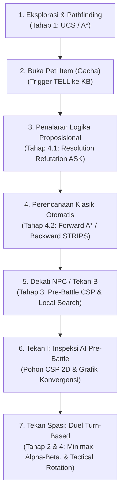

# Bakekok - Dokumentasi Sistem Game AI Terpadu (Tahap 1, 2, 3, & 4)

> **Tugas Besar Mata Kuliah Kecerdasan Buatan**  
> Program Studi Ilmu Komputer — Universitas Pendidikan Indonesia  
> **Kelompok 7**

---

## 1. Identitas Anggota Kelompok 7
1. **Muhammad Hanif Muyassar**
2. **Moch Fadillah Pratama**
3. **Muhammad Zidan Mirza Fedrieka**

---

## 2. Panduan Menjalankan Game

### 1. Prasyarat Sistem
* **Python**: Versi `3.10` atau lebih baru (direkomendasikan `3.11` / `3.12` / `3.14`).
* **Sistem Operasi**: Windows, macOS, atau Linux.

### 2. Instalasi Dependensi
Buka terminal/PowerShell pada folder proyek `Game-AI`, lalu jalankan:

```bash
pip install -r requirements.txt
```
*(Dependensi utama adalah `pygame-ce >= 2.5.0`)*

### 3. Menjalankan Permainan
```bash
python main.py
```

---

## 3. Skenario Panduan Fitur AI 

Game ini memadukan materi perkuliahan Kecerdasan Buatan dari Tahap 1 hingga Tahap 4 ke dalam satu ekosistem *gameplay* yang utuh dan interaktif:



### Langkah 1: Eksplorasi Peta & Pathfinding (Materi Tahap 1)
* Gerakkan karakter utama (**Bolu**) menggunakan tombol **`W, A, S, D`** atau **Tombol Panah**.
* Tekan tombol **`[Spasi]`** untuk memanggil NPC patroli melacak Bolu.
* Tekan tombol **`[Ctrl]`** untuk menampilkan **Debug Overlay Pathfinding**:
  * Menampilkan visualisasi petak yang dievaluasi (*closed set* warna kuning), jalur terpendek (*path* warna biru), metrik waktu eksekusi (ms), serta perbandingan algoritma **Uniform Cost Search (UCS)** vs **A\*** dengan berbagai heuristik (*Manhattan*, *Euclidean*, *Chebyshev*).
  * Mengimplementasikan bobot medan riil (*Weighted Terrain Cost*): langkah di jalan tanah/jembatan berbiaya $c = 1.0$, sedangkan medan rumput berbiaya $c = 2.0$.

### Langkah 2: Interaksi Item & Mini-Game Gacha (Trigger Logika)
* Dekati salah satu peti harta karun di peta (berjarak $\le 1$ langkah ubin), lalu tekan **`[E]`**.
* Akan muncul roda *roulette* gacha item yang memberikan buff serangan (**ATK**), pertahanan (**DEF**), atau ramuan (**Potion**) kepada Bolu.
* **Koneksi Tahap 4**: Membuka peti harta karun secara otomatis memicu persepsi dunia baru (`TELL`) ke dalam *Knowledge Base* (KB) logika proposisional (`ChestOpened_X` dan `HasLootedItem_Player`).

### Langkah 3: Penalaran Logika Proposisional & Basis Pengetahuan KB (Materi Tahap 4.1)
* Tekan tombol **`[K]`** saat berada di peta untuk membuka **Overlay Penalaran Logika Proposisional** (atau buka **Pohon Resolusi Refutasi Fullscreen** via tombol `[T]`).
* Sistem menjalankan penalaran deduktif formal:
  1. **Knowledge Base (KB)** memuat 12 aturan klausul CNF yang memodelkan sensor peti, komunikasi antar-agen, dan penugasan peran NPC.
  2. Begitu peti dibuka, agen mengeksekusi inferensi resolusi refutasi ($KB \cup \{\neg \alpha\} \vdash \square$) untuk membuktikan secara matematis bahwa ancaman terjadi.
  3. Hasil pembuktian menetapkan **Kuro** sebagai pemburu (*Chaser*) dan **Shiro & Oyen** sebagai penjaga ketat perimeter (*Guardians*).

### Langkah 4: Perencanaan Klasik Otomatis PDDL / STRIPS (Materi Tahap 4.2)
* Tekan tombol **`[P]`** di peta untuk membuka **Overlay Automated Planning** (atau buka **PDDL Action Graph Modal** via tombol `[T]`).
* Sistem mengompilasi tujuan strategis pulau (`IslandSecure`, `PerimeterLocked`, `InCombat`) menjadi urutan aksi terstruktur:
  1. **Forward State-Space Search (Progression Planning)**: Menggunakan algoritma **A\*** terpandu heuristik $h_{\text{add}}$ / $h_{\text{max}}$.
  2. **Backward Relevant-States Search (Regression Planning)**: Perencanaan mundur berorientasi tujuan (*Goal-Directed Regression*).
  3. NPC mengeksekusi rencana secara fisik di dunia: Kuro bergerak memotong jalan (*choke point*) jembatan, sementara Shiro mengamankan perimeter peti yang tersisa.

### Langkah 5: Masuk ke Fase Pre-Battle (Materi Tahap 3)
* Tabrak / dekati NPC musuh atau tekan tombol **`[B]`** dari mana saja untuk langsung memicu fase **Pre-Battle**.
* Di fase ini, sistem AI di balik layar secara otomatis menjalankan:
  1. **CSP Solver (Backtracking + MRV + LCV + AC-3)** untuk memastikan komposisi tim musuh mematuhi 8 batasan legalitas (C1 - C8).
  2. **Local Search Optimizer** untuk menyesuaikan tingkat kesulitan skuad musuh agar seimbang dengan status Bolu (Dynamic Difficulty Adjustment).
* Ganti algoritma optimasi secara instan dengan menekan tombol angka **`[1]` s/d `[5]`**:
  * `[1]`: *Hill Climbing (Steepest-Ascent)*
  * `[2]`: *Hill Climbing with Sideways Move* (mengatasi Plateau)
  * `[3]`: *Random Restart Hill Climbing* (mengatasi Local Maximum)
  * `[4]`: *Simulated Annealing* (probabilitas langkah downhill $\exp(\Delta / T)$)
  * `[5]`: *Genetic Algorithm* (crossover skuad & mutasi)
* Tekan **`[R]`** untuk me-*reroll* skuad dengan seed acak baru.

### Langkah 6: Buka Inspeksi Visualizer AI Pre-Battle (Pohon CSP & Grafik)
* Pada layar Pre-Battle, klik tombol **`[INSPEKSI AI]`** atau tekan tombol **`[I]`**.
* Jendela visualizer interaktif akan terbuka dengan dua tab utama:
  * **Tab 1: Pohon CSP & Pruning**:
    * Menampilkan pohon pencarian Backtracking CSP secara 2D.
    * Gunakan tombol kontrol bawah (**Play, Step Next, Step Back, Reset, Speed**) atau geser *scrubber slider* untuk menganalisis pembentukan skuad langkah demi langkah.
    * Klik simpul mana saja pada pohon untuk melihat detail di kolom samping kanan: **Alasan anakan dipilih (MRV & LCV)** dan **Alasan anakan lain dipangkas (Forward Checking)**.
    * Klik tombol **`[?] Aturan C1-C8`** untuk melihat modal ringkasan seluruh aturan konsistensi.
  * **Tab 2: Optimasi Local Search**:
    * Menampilkan grafik konvergensi 2D hubungan antara iterasi vs Difficulty / Fitness.
    * Panel kanan menampilkan evaluasi detail setiap transisi langkah (*Move*, *Sideways*, *Restart*, *Cooling*, dll).

### Langkah 7: Masuk ke Arena Duel Tag-Team (Materi Tahap 2 & Tahap 4)
* Tekan **`[Spasi]`** atau **`[Enter]`** untuk masuk ke arena pertarungan turn-based.
* Pilih aksi bertarung Anda melalui kontrol diamond hub yang ergonomis:
  * `[1 / W]`: Serangan biasa (*Attack*).
  * `[2 / A]`: Serangan kuat (*Heavy Attack*).
  * `[3 / D]`: Bertahan dengan perisai (*Defend*, reduksi damage 65%).
  * `[4 / S]`: Minum ramuan (*Potion*).
* Giliran musuh dikendalikan oleh **Adversarial Search (Minimax / Alpha-Beta Pruning / Expectimax)**.
* **Fitur Taktis Tahap 4 (Battle Automated Planning)**:
  * Banner taktis dinamis memantau kondisi frontline musuh. Jika darah sekarat, automated planner mengeksekusi rotasi taktis (`SwapRetreat`, `CastDefend`, `HealTeammate`) secara cerdas.
* Tekan tombol **`[T]`** saat duel untuk membuka **Pohon Keputusan Minimax & Alpha-Beta**, memperlihatkan cabang evaluasi utilitas dan pemangkasan cabang.
* Tombol **`[ESC] Keluar`** (di pojok kiri atas arena): Keluar dari duel secara damai kembali ke eksplorasi peta, mereset status pengejaran NPC dan memulihkan visualisasi pathfinding ubin kuning & biru.
* **Harta Rampasan Duel (*Spoils of War*)**: Mengalahkan skuad musuh memberikan rampasan bertema hangat (Gold, EXP, Drop Item) yang langsung terintegrasi dan tampil pada panel tab inventaris Bolu.

---

## 4. Ringkasan Kontrol Permainan (Keybindings Cheat-Sheet)

| Mode Permainan | Tombol Keyboard | Aksi / Fungsi |
|:---|:---|:---|
| **Eksplorasi (Peta)** | `W, A, S, D` / `Panah` | Menggerakkan Player (Bolu) pada grid ubin |
| | `E` | Membuka peti harta karun terdekat (Gacha Item & Trigger TELL KB) |
| | `Spasi` | Memanggil NPC Oyen melacak Bolu via pathfinding |
| | `Ctrl` | Membuka/menutup Debug Overlay Pathfinding (Materi 01) |
| | `K` | Membuka In-Game Overlay Logika Proposisional & KB (Materi 07) |
| | `P` | Membuka In-Game Overlay Classical Automated Planning (Materi 08) |
| | `B` | Masuk ke fase Pre-Battle (Materi 03) |
| | `Esc` | Keluar dari aplikasi |
| **Fase Pre-Battle** | `1, 2, 3, 4, 5` | Mengganti algoritma Local Search |
| | `R` | Re-roll / optimasi ulang skuad musuh |
| | `I` / Klik Tombol | **Membuka Inspeksi Visualizer AI Pre-Battle** |
| | `Spasi` / `Enter` | Memulai duel turn-based |
| | `Tab` / `Esc` | Kembali ke mode eksplorasi peta |
| **Visualizer Pre-Battle** | Klik Tab Atas | Beralih antara **Tab 1 (CSP Tree)** & **Tab 2 (Local Search)** |
| | Klik `[?] Aturan C1-C8` | Menampilkan popup dialog ringkasan 8 aturan konsistensi |
| | Drag Mouse / Tombol Zoom | Menggeser (*pan*) dan memperbesar/memperkecil kanvas pohon |
| | Play / Step / Scrubber | Mengendalikan simulasi langkah algoritma |
| | Scroll Mouse di Panel | Menggulir teks penjelasan teori & analisis simpul |
| | `X` / `Esc` | Menutup jendela visualizer |
| **Arena Pertarungan** | `1` / `W` | Serangan Biasa (*Attack*) |
| | `2` / `A` | Serangan Kuat (*Heavy Attack*) |
| | `3` / `D` | Bertahan (*Defend*) |
| | `4` / `S` | Menggunakan Potion |
| | `T` | **Membuka Fullscreen Universal Decision Tree Modal AI** |
| | `R` | Reset duel dari awal |
| | Klik `[ESC] Keluar` / `Esc` | Keluar dari duel secara damai & pulihkan status damai dunia |
| | `Tab` | Menyerah dan kembali ke peta |

---

## 5. Arsitektur Sistem & Struktur Direktori

Kode program dibangun secara modular menggunakan Python 3.10+ berbasis pustaka `pygame-ce` dengan pemisahan tanggung jawab yang ketat:

```
Game-AI/
├── main.py                          # Entry point utama aplikasi
├── requirements.txt                 # Dependensi pustaka (pygame-ce)
├── README.md                        # Dokumentasi teknis & panduan permainan
├── laporan_tahap4_materi7_8.md      # Laporan akademis komprehensif Materi 07 & 08
├── assets/                          # Spritesheet karakter, potret NPC, dan atlas ubin
├── data/
│   └── map_tubes.json               # Peta ubin 2D, koordinat, layer medan, dan collision
├── game/
│   ├── app.py                       # Loop utama, event handler, kamera, state machine
│   ├── core/
│   │   ├── config.py                # Konstanta global, palet warna antislop, domain stat, budget CSP
│   │   ├── events.py                # Event dispatcher & sinyal komunikasi antar-modul
│   │   ├── animation.py             # Sistem interpolasi animasi sprite
│   │   └── audio.py                 # Manajemen audio dan sound effects
│   ├── world/
│   │   ├── mapdata.py               # Parser ubin peta, terrain cost (jalan tanah vs rumput)
│   │   ├── player.py                # Karakter pemain (Bolu), inventaris item, status HP/potion
│   │   └── npc.py                   # Karakter NPC di peta (Oyen, Kuro, Shiro), waypoint patroli
│   ├── ai/
│   │   ├── search.py                # Modul Tahap 1: UCS, A*, heuristik (Manhattan, Euclidean, Chebyshev)
│   │   ├── battle_ai.py             # Modul Tahap 2: Minimax, Alpha-Beta Pruning, Expectimax
│   │   ├── difficulty.py            # Rumus evaluasi tingkat kesulitan dan fungsi fitness DDA
│   │   ├── npc_config_csp.py        # Modul Tahap 3.2: CSP Solver, Backtracking, MRV, LCV, AC-3, C1-C8
│   │   └── npc_config_optimizer.py  # Modul Tahap 3.1: Local Search Engine (5 algoritma optimasi)
│   ├── logic/
│   │   ├── kb_rules.py              # Modul Tahap 4.1: Basis Pengetahuan (KB), 12 Klausul CNF, TELL
│   │   ├── inference_engine.py      # Modul Tahap 4.1: Mesin Resolusi Refutasi (KB ∪ {¬α} ⊢ □)
│   │   └── inter_npc_manager.py     # Modul Tahap 4.1: Manajer koordinasi inter-agen NPC
│   ├── planning/
│   │   ├── pddl_types.py            # Modul Tahap 4.2: Tipe data formal PDDL (Action, Predicate, State)
│   │   ├── domain_world_patrol.py   # Modul Tahap 4.2: Domain PDDL Patroli Dunia & Pertahanan Peti
│   │   ├── domain_battle_tactics.py # Modul Tahap 4.2: Domain PDDL Taktik Rotasi & Pemulihan Skuad
│   │   ├── planner_engine.py        # Modul Tahap 4.2: Forward A* (h_add/h_max) & Backward STRIPS
│   │   └── task_executor.py         # Modul Tahap 4.2: Eksekutor jembatan rencana ke aksi game
│   ├── battle/
│   │   ├── battle_system.py         # Logika duel turn-based, giliran, kalkulasi damage, logging
│   │   ├── battle_background.py     # Render latar belakang dinamis arena pertarungan
│   │   ├── battle_vfx.py            # Efek visual animasi prosedural (pedang berayun, perisai, shake)
│   │   └── npc_squad.py             # Model skuad musuh (frontline aktif, bench, rotasi tag-team)
│   └── ui/
│       ├── components.py            # Komponen UI dasar (Button, Card, Modal, Panel)
│       ├── nav_rail.py              # Navigasi panel dock sisi kiri
│       ├── overlay.py               # In-game HUD & Debug Overlay Pathfinding / Battle
│       ├── pre_battle_visualizer.py # Visualizer Akademis Pre-Battle (Pohon CSP & Grafik)
│       ├── logic_overlay.py         # Panel HUD in-game penalaran logika proposisional
│       ├── planning_overlay.py      # Panel HUD in-game perencanaan otomatis PDDL
│       ├── graph_modal.py           # Modal visualisasi graf/pohon untuk Logika & Planning
│       ├── tree_overlay.py          # Visualizer Decision Tree Minimax/Alpha-Beta Battle
│       ├── inspector_dock.py        # Dock panel inspektur komprehensif
│       └── tabs/                    # Implementasi tab inspeksi (Search, Minimax, CSP, Logic, Planning)
└── scratch/
    ├── test_logic_resolution.py     # Unit test & visualizer inferensi Resolusi Refutasi (Materi 07)
    ├── test_automated_planning.py   # Unit test Forward A* vs Backward Regression STRIPS (Materi 08)
    ├── test_tahap4_integration.py   # Test integrasi end-to-end Modul 07 & 08
    ├── test_battle_exit_and_chase.py# Test tombol keluar battle & reset status damai
    ├── test_spoils_and_companion_inventory.py # Test sinkronisasi hasil rampasan battle ke inventaris
    ├── benchmark_csp_mrv_lcv.py     # Skrip benchmark komparatif CSP (30 run dengan & tanpa MRV/LCV)
    ├── run_tahap3_experiments.py    # Skrip benchmark otomatis CSP Solver & 5 Algoritma Local Search
    ├── run_experiments.py           # Skrip benchmark otomatis Minimax, Alpha-Beta, & Expectimax
    └── test_app_integration.py      # Headless end-to-end integration test game loop
```

---

## 6. Landasan Teori & Pemetaan Materi Kuliah

Sistem AI di dalam game ini mengimplementasikan 6 pilar materi perkuliahan secara terintegrasi:

### 1. Tahap 1: Informed Search & Navigasi Grid (Materi 01)
* **Uniform Cost Search (UCS)**: Menemukan jalur terpendek berdasarkan akumulasi biaya riil $g(n)$ dengan $h(n) = 0$.
* **A\* Search**: Mengarahkan pencarian menggunakan fungsi evaluasi:
  $$f(n) = g(n) + h(n)$$
* **Fungsi Heuristik Terverifikasi**:
  * *Manhattan Distance* (Grid 4-connected, terbukti *admissible* & *consistent*):
    $$h(n) = |x_n - x_{\text{goal}}| + |y_n - y_{\text{goal}}|$$
  * *Euclidean Distance* (Garis lurus, *admissible*):
    $$h(n) = \sqrt{(x_n - x_{\text{goal}})^2 + (y_n - y_{\text{goal}})^2}$$
  * *Chebyshev Distance*:
    $$h(n) = \max(|x_n - x_{\text{goal}}|, |y_n - y_{\text{goal}}|)$$
* **Weighted Terrain Cost**: Langkah di jalan tanah/jembatan memiliki biaya $c = 1.0$, sedangkan medan berumput berbiaya $c = 2.0$.

### 2. Tahap 2: Adversarial Search Turn-Based Battle (Materi 04)
* **Minimax**: Mengevaluasi seluruh kemungkinan langkah pemain dan musuh untuk memaksimalkan utilitas giliran dalam permainan *zero-sum*.
* **Alpha-Beta Pruning**: Memangkas cabang-cabang pohon permainan yang terbukti tidak akan dipilih oleh pemain rasional, menurunkan kompleksitas dari $O(b^d)$ menjadi mendekati $O(b^{d/2})$.
* **Expectimax**: Memodelkan ketidakpastian aksi jika pemain dianggap tidak selalu bermain optimal (*bounded rationality*).
* **Tag-Team Battle**: Jika frontline NPC tumbang, sistem mengaktifkan anggota berikutnya dari *bench*, menjaga kesinambungan duel.

### 3. Tahap 3.1: Local Search (Materi 05)
Local search mencari konfigurasi akhir optimal di mana lintasan (*path*) tidak penting dengan konsumsi memori konstan $O(1)$.
* **Fungsi Objektif (Fitness Function)**:
  $$\text{Fitness}(s) = -|\text{Difficulty}(s) - \text{TargetDifficulty}|$$
* **5 Algoritma yang Disediakan**:
  1. **Hill Climbing (Steepest-Ascent)**: Memilih tetangga dengan kenaikan fitness terbesar.
  2. **Hill Climbing with Sideways Move**: Mengizinkan transisi antar-tetangga bernilai sama hingga 15 langkah untuk melintasi area datar (*plateau* & *shoulder*).
  3. **Random Restart Hill Climbing**: Menjalankan ulang pendakian bukit dari *seed* awal legal CSP yang berbeda untuk meloloskan diri dari *local optimum*.
  4. **Simulated Annealing (SA)**: Mengadopsi prinsip termodinamika metalurgi; gerakan yang memperburuk fitness tetap dapat diterima dengan probabilitas Boltzmann:
     $$P(\text{accept}) = \exp\left(\frac{\Delta E}{T}\right), \quad T_{k+1} = T_k \times \alpha$$
  5. **Genetic Algorithm (GA)**: Mengoperasikan populasi konfigurasi skuad melalui seleksi turnamen, rekombinasi (*crossover*), dan mutasi acak.

### 4. Tahap 3.2: Constraint Satisfaction Problem (CSP) (Materi 06)
CSP merumuskan pembentukan skuad sebagai masalah kepatuhan batasan formal:
* **Himpunan Variabel ($X$)**: $6 \times N$ atribut untuk $N$ anggota skuad ($N \in \{1, 2, 3\}$): `char_type`, `hp`, `potions`, `atk_bonus`, `def_bonus`, `eval_profile`.
* **Himpunan Domain Diskret ($D$)**:
  * `char_type` $\in$ `{"warrior", "ranger", "mage", "assassin"}`
  * `hp` $\in$ `{60, 70, 80, 90, 100, 110, 120}`
  * `potions` $\in$ `{0, 1, 2, 3}`
  * `atk_bonus` $\in$ `{0, 5, 10, 15}`
  * `def_bonus` $\in$ `{0, 2, 4, 6}`
  * `eval_profile` $\in$ `{"BALANCED", "AGGRESSIVE", "DEFENSIVE"}`
* **8 Batasan Konsistensi (C1 - C8)**:
  * **C1 (Budget HP)**: Total HP seluruh anggota skuad $\le 250$.
  * **C2 (Budget Potion)**: Total Potion seluruh anggota skuad $\le 5$.
  * **C3 (Syarat Tank)**: Jika `char_type = "tank"`, maka $HP \ge 90$.
  * **C4 (Syarat Ranger)**: Jika `char_type = "ranger"`, maka $ATK \ge 5$.
  * **C5 (Keunikan Role)**: Tidak boleh ada role kembar jika jumlah anggota skuad $\ge 2$.
  * **C6 (Mage Glass Cannon)**: Jika `char_type = "mage"`, maka $HP \le 90$ dan profil AI $\in$ `{"BALANCED", "AGGRESSIVE"}`.
  * **C7 (Tank Sinergi)**: Jika `char_type = "tank"`, maka profil AI $\in$ `{"BALANCED", "DEFENSIVE"}`.
  * **C8 (Assassin Burst & Budget ATK)**: Total akumulasi $ATK \le 25$; jika `char_type = "assassin"`, maka $ATK \ge 10$, $HP \le 90$, dan profil AI $\in$ `{"BALANCED", "AGGRESSIVE"}`.
* **Mekanisme Penyelesaian**:
  * **AC-3 Filtering**: Menyaring domain *unary* sebelum pencarian dimulai.
  * **MRV (Minimum Remaining Values)**: Memilih variabel paling kritis (*fail-first*) yang memiliki sisa domain tersedikit.
  * **LCV (Least Constraining Value)**: Memprioritaskan nilai yang paling ramah dan tidak mematikan domain variabel lain (*succeed-first*).
  * **Forward Checking**: Langsung memangkas cabang simpul jika terdeteksi melanggar batasan konsistensi.

### 5. Tahap 4.1: Logika Proposisional & Resolution Refutation (Materi 07)
Materi 07 mengimplementasikan penalaran berbasis pengetahuan (*Knowledge-Based Agents*) menggunakan representasi deklaratif logika proposisional dan algoritma deduksi formal:
* **Knowledge Base (KB)**: Menyimpan fakta dunia dan aturan dalam bentuk **Conjunctive Normal Form (CNF)**:
  $$KB = \bigwedge_{i} C_i, \quad C_i = \bigvee_j l_{ij}$$
* **12 Aturan Domain Terstandarisasi (R1 - R5)**:
  1. `R1A-R1D (Deteksi Peti)`: $\text{ChestOpened}_X \implies \text{Alert}_Y \equiv (\text{Alert}_Y \lor \neg \text{ChestOpened}_X)$
  2. `R2A-R2B (Penugasan Pemburu)`: $(\text{Alert}_Y \land \text{HasLootedItem}_\text{Player}) \implies \text{AssignChaser}_Y \equiv (\neg \text{Alert}_Y \lor \text{AssignChaser}_Y \lor \neg \text{HasLootedItem}_\text{Player})$
  3. `R3A-R3B (Protokol Alarm)`: $\text{AssignChaser}_Y \implies \text{BroadcastAlarm}_Z \equiv (\neg \text{AssignChaser}_Y \lor \text{BroadcastAlarm}_Z)$
  4. `R4A-R4B (Kunci Perimeter)`: $(\text{BroadcastAlarm}_Z \land \text{Unopened}_W) \implies \text{AssignTightGuard}_Z$
  5. `R5A-R5B (Cadangan Sektor Oyen)`: $(\text{BroadcastAlarm} \land \text{Unopened}_C) \implies \text{AssignTightGuard}_\text{Oyen}$
* **Algoritma Pembuktian Kontradiksi (Resolution Refutation)**:
  Untuk membuktikan apakah query $\alpha$ merupakan konsekuensi logis dari basis pengetahuan ($KB \models \alpha$), kita menyangkal query ($\neg \alpha$) lalu menyatukannya dengan $KB$. Aturan resolusi diterapkan secara sistematis pada pasangan klausul yang memiliki literal komplementer ($P$ dan $\neg P$):
  $$\frac{l_1 \lor \dots \lor l_i \lor \dots \lor l_k, \quad m_1 \lor \dots \lor \neg l_i \lor \dots \lor m_n}{(l_1 \lor \dots \lor l_{i-1} \lor l_{i+1} \lor \dots \lor l_k \lor m_1 \lor \dots \lor m_{j-1} \lor m_{j+1} \lor \dots \lor m_n)}$$
  Jika proses resolusi menghasilkan **klausa kosong ($\square$ / empty clause)**, maka terbukti terjadi kontradiksi ($KB \land \neg \alpha \equiv \text{False}$), yang berarti $KB \models \alpha$ **terbukti bernilai benar (True)**.

### 6. Tahap 4.2: Classical Automated Planning PDDL / STRIPS (Materi 08)
Materi 08 mengimplementasikan perencanaan otomatis klasik (*Automated Planning*) berbasis bahasa formal STRIPS / PDDL:
* **Struktur Formal Operator Aksi STRIPS**:
  Setiap aksi $a$ didefinisikan sebagai tripel $a = \langle \text{Precond}(a), \text{Add}(a), \text{Del}(a) \rangle$.
  Transisi state deterministic dievaluasi secara simbolik:
  $$\text{Result}(s, a) = (s \setminus \text{Del}(a)) \cup \text{Add}(a)$$
* **Dua Domain Masalah**:
  1. **Domain Patroli Dunia & Pertahanan Peti (`domain_world_patrol.py`)**:
     * *Aksi*: `MoveToChokePoint`, `InterceptPlayer`, `MoveToSector`, `ReinforceGuard`.
     * *Tujuan*: Mengamankan perimeter pulau dan mencegat pemain di titik genting jembatan.
  2. **Domain Taktik Rotasi & Pemulihan Battle (`domain_battle_tactics.py`)**:
     * *Aksi*: `SwapRetreat`, `CastDefend`, `HealTeammate`.
     * *Tujuan*: Merotasi frontline yang sekarat ke bangku cadangan (*bench*), mengaktifkan perisai tank, dan menyembuhkan rekan tim.
* **Dua Mesin Algoritma Perencanaan**:
  1. **Forward State-Space Search (Progression Planning)**:
     * Menjelajahi ruang state dari $s_0$ menuju $g$ menggunakan algoritma pencarian **A\*** terpandu.
     * Heuristik terapan: **Relaxed Graph Heuristic** ($h_{\text{add}}$ dan $h_{\text{max}}$) yang menghapus efek penghapusan (*delete lists*) untuk menjamin estimasi jarak *admissible*.
  2. **Backward Relevant-States Search (Regression Planning)**:
     * Melakukan regresi mundur dari goal $g$ menuju initial state $s_0$.
     * Menghitung *predecessor state* $g'$ untuk aksi $a$ yang relevan dan konsisten:
       $$g' = (g \setminus \text{Add}(a)) \cup \text{Precond}(a)$$
     * Mengeliminasi eksplorasi cabang yang tidak relevan secara langsung dengan tujuan akhir (*goal-directed*).
* **Validasi Transisi State Maju (*Forward State Transition Validation*)**:
  Seluruh rencana yang dihasilkan oleh Backward Regression selalu divalidasi ulang dengan mengeksekusinya secara maju dari $s_0$ ke $g$ untuk memastikan kepatuhan 100% bebas dari konflik interferensi (*delete-list clobbering*).

---

## 7. Hasil Eksperimen & Analisis Benchmark

Seluruh eksperimen dapat direproduksi secara instan dan mandiri menggunakan skrip di folder `scratch/`.

### 1. Kinerja CSP Solver (`scratch/run_tahap3_experiments.py`)

| Metrik Evaluasi CSP | Hasil Pengukuran | Keterangan |
|:---|:---:|:---|
| **Waktu AC-3 Preprocessing** | **0.005 ms** | Pemangkasan apriori berlangsung sub-milidetik |
| **Waktu Solve 2 Anggota NPC** | **0.175 ms** | Backtracking + MRV + LCV |
| **Waktu Solve 3 Anggota NPC** | **0.299 ms** | Menemukan solusi lengkap instan |
| **Tingkat Kepatuhan Aturan C1 - C8** | **100% (0 Pelanggaran)** | Seluruh solusi terbukti konsisten |
| **Komposisi Default 3 NPC** | Warrior + Ranger + Mage | Komposisi kelas sinergis dan seimbang |

### 2. Perbandingan 5 Algoritma Local Search (Target Difficulty = 0.55)

| Algoritma Local Search | Waktu Eksekusi (ms) | Rata-rata Iterasi | Nilai Fitness | Difficulty Dicapai | Kepatuhan Legalitas CSP |
|:---|:---:|:---:|:---:|:---:|:---:|
| **Hill Climbing (HC)** | 3.93 ms | 5.0 | -0.0028 | 0.5528 | **100% Valid** |
| **HC with Sideways Move** | **2.84 ms** | 5.0 | -0.0028 | 0.5528 | **100% Valid** |
| **Random Restart HC** | 11.98 ms | 5.6 | **-0.0016** | **0.5516** | **100% Valid** |
| **Simulated Annealing (SA)** | 29.97 ms | 136.0 | -0.0072 | 0.5572 | **100% Valid** |
| **Genetic Algorithm (GA)** | 65.30 ms | 30.0 gen | -0.0025 | 0.5480 | **100% Valid** |

> **Temuan Kunci:**
> * **HC with Sideways Move** adalah algoritma tercepat (**2.84 ms**), sangat ideal untuk transisi *gameplay* waktu nyata tanpa jeda.
> * **Random Restart HC** menghasilkan solusi paling presisi mendekati target ($0.5516$, deviasi hanya $0.0016$).
> * Integrasi CSP sebagai validator menghasilkan tingkat kepatuhan **100% legal** pada seluruh algoritma.

### 3. Adaptabilitas Dinamis Skuad terhadap Kondisi Pemain (DDA)

Sistem secara otomatis menyesuaikan *target difficulty* berdasarkan inventaris item, status HP pemain, dan buff gacha peti harta karun:

| Skenario Pengujian | Kondisi Pemain (Bolu) | Target Difficulty | Difficulty Tercapai | Deviasi | Komposisi Skuad Musuh yang Dihasilkan |
|:---|:---|:---:|:---:|:---:|:---|
| **Skenario A (Standar)** | HP 100, Potion 2, ATK +0, DEF +0 | 0.5500 | 0.5472 | 0.0028 | Assassin (BAL) + Ranger (BAL) + Mage (BAL) |
| **Skenario B (Terluka)** | HP 35, Potion 0, ATK +0, DEF +0 | 0.4000 | 0.3972 | 0.0028 | Warrior (BAL) + Ranger (BAL) + Mage (BAL) |
| **Skenario C (Buff Peti)**| HP 100, Potion 4, ATK +6, DEF +4 | 0.6500 | 0.6500 | **0.0000** | Ranger (BAL) + Mage (AGG) + Assassin (BAL) |

### 4. Kinerja Inferensi Logika Proposisional & Resolusi Refutasi (Tahap 4.1)

Pengujian deduktif menggunakan skrip `scratch/test_logic_resolution.py` pada 12 aturan klausul CNF:

| Skenario Pengujian Logika | Query yang Dibuktikan ($\alpha$) | Waktu Inferensi | Langkah Resolusi | Hasil Pembuktian ($KB \models \alpha$) |
|:---|:---|:---:|:---:|:---:|
| **Kondisi Awal (Damai)** | `AssignChaser_Kuro` | 0.03 ms | 3 langkah | **False** (Tidak ada kontradiksi) |
| **Peti A Dibuka (Bolu Curi Item)** | `AssignChaser_Kuro` | **0.05 ms** | **10 langkah** | **True** (Muncul klausa kosong $\square$) |
| **Penyebaran Alarm Sinyal** | `AssignTightGuard_Shiro` | **0.04 ms** | **7 langkah** | **True** (Klausa kosong $\square$) |
| **Penjagaan Cadangan Oyen** | `AssignTightGuard_Oyen` | **0.04 ms** | **7 langkah** | **True** (Klausa kosong $\square$) |

> **Analisis Langkah Resolusi Peti A:**
> Pada langkah ke-10, resolusi antara klausul unit $(\neg \text{ChestOpened}_A)$ dan fakta $(\text{ChestOpened}_A)$ menghasilkan resolvent kosong `[]`. Hal ini membuktikan secara matematis tanpa keraguan bahwa hipotesis negasi salah, sehingga penugasan Kuro mengejar pemain adalah mutlak valid.

### 5. Kinerja Automated Planning PDDL / STRIPS (Tahap 4.2)

Perbandingan performa komputasi antara **Forward Progression (A\*)** dan **Backward Regression (STRIPS)** menggunakan skrip `scratch/test_automated_planning.py`:

| Domain Masalah | Algoritma Perencana | Waktu (ms) | Simpul Dievaluasi | Panjang Rencana | Validasi Eksekusi Maju |
|:---|:---|:---:|:---:|:---:|:---:|
| **Domain 1: Patroli & Pertahanan Pulau** | **Forward A\* ($h_{\text{add}}$)** | **0.03 ms** | **5 node** | 4 aksi | **100% Valid** |
| | **Backward Regression** | 0.04 ms | 9 node | 4 aksi | **100% Valid** |
| **Domain 2: Taktik Rotasi Battle** | **Forward A\* ($h_{\text{add}}$)** | **0.01 ms** | **4 node** | 3 aksi | **100% Valid** |
| | **Backward Regression** | 0.03 ms | 8 node | 3 aksi | **100% Valid** |

> **Rencana Aksi yang Dihasilkan:**
> * **Domain 1**: $\text{MoveToChokePoint}(\text{Kuro}, \text{Tebing}, \text{Jembatan}) \to \text{InterceptPlayer}(\text{Kuro}, \text{Bolu}, \text{Jembatan}) \to \text{MoveToSector}(\text{Shiro}, \text{Dermaga}, \text{Peti}_B) \to \text{ReinforceGuard}(\text{Shiro}, \text{Peti}_B)$.
> * **Domain 2**: $\text{SwapRetreat}(\text{Oyen}, \text{Kage}) \to \text{CastDefend}(\text{Kage}) \to \text{HealTeammate}(\text{Shiro}, \text{Oyen})$.

---

## 8. Skrip Pengujian Otomatis & Benchmark

Anda dapat menjalankan seluruh pengujian mandiri tanpa membuka jendela grafis game:

1. **Uji Integrasi Penuh Tahap 4 (Logika Proposisional + Automated Planning)**:
   ```bash
   python scratch/test_tahap4_integration.py
   ```
2. **Uji Deduksi Logika & Resolusi Refutasi (Materi 07)**:
   ```bash
   python scratch/test_logic_resolution.py
   ```
3. **Uji Perencanaan Klasik PDDL STRIPS Forward & Backward (Materi 08)**:
   ```bash
   python scratch/test_automated_planning.py
   ```
4. **Uji Tombol Keluar Battle, Reset Chasing, & Pemulihan Ubin Pathfinding**:
   ```bash
   python scratch/test_battle_exit_and_chase.py
   ```
5. **Uji Sinkronisasi Harta Rampasan Perang (*Spoils of War*) ke Inventaris**:
   ```bash
   python scratch/test_spoils_and_companion_inventory.py
   ```
6. **Benchmark Lengkap Tahap 3 (CSP Solver + 5 Local Search + DDA)**:
   ```bash
   python scratch/run_tahap3_experiments.py
   ```
7. **Benchmark Komparasi Heuristik CSP (30 Run dengan & tanpa MRV/LCV)**:
   ```bash
   python scratch/benchmark_csp_mrv_lcv.py
   ```
8. **Benchmark AI Battle Tahap 2 (Minimax vs Alpha-Beta vs Expectimax)**:
   ```bash
   python scratch/run_experiments.py
   ```
9. **Pengujian Integrasi End-to-End Game Loop (Headless)**:
   ```bash
   python scratch/test_app_integration.py
   ```
10. **Unit Test Aturan CSP & Validator**:
    ```bash
    python scratch/test_csp.py
    ```
11. **Unit Test Local Search Optimizer**:
    ```bash
    python scratch/test_optimizer.py
    ```

---
