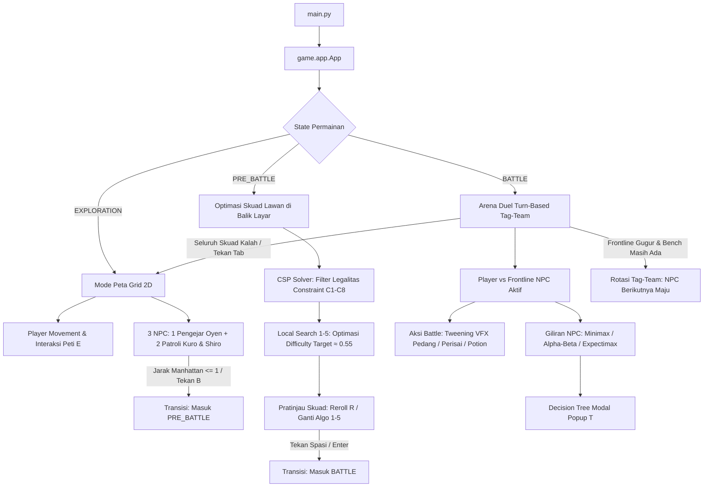

# Bakekok - Dokumentasi Teknis & Game AI Tahap 2

Proyek Tugas Besar Mata Kuliah Kecerdasan Buatan — Kelompok 7  
Program Studi Ilmu Komputer, Universitas Pendidikan Indonesia.

---

## 1. Identitas Proyek & Anggota Kelompok

- **Nama Game**: Bakekok
- **Mata Kuliah**: Kecerdasan Buatan
- **Kelompok**: 7 (Tubes AI)
- **Anggota Kelompok**:
  1. **Muhammad Hanif Muyassar**
  2. **Moch Fadillah Pratama**
  3. **Muhammad Zidan Mirza Fedrieka**

---

## 2. Arsitektur Sistem & Struktur Kode

Sistem dikembangkan menggunakan Python 3.10+ berbasis kerangka `pygame-ce` dengan arsitektur modular yang memisahkan komponen *rendering*, *game loop*, *pathfinding engine*, *adversarial battle engine*, dan *interactive debug overlay*.

```
Game-AI/
├── main.py                     # Titik masuk utama aplikasi (Entry Point)
├── requirements.txt            # Daftar dependensi pustaka (pygame-ce)
├── assets/                     # Spritesheet, potret kelas NPC, dan aset grafis item/ubin
├── data/
│   └── map_tubes.json          # Metadata grid peta, layer ubin, atlas tile, dan rintangan
├── game/
│   ├── __init__.py             # Inisialisasi package game
│   ├── app.py                  # Main loop, penanganan event, kamera, state manager (Exploration/Pre-Battle/Battle)
│   ├── battle_ai.py            # Engine AI duel: BattleState, TreeNode, Minimax, Alpha-Beta, Expectimax
│   ├── battle_system.py        # Manajer duel turn-based, rotasi Tag-Team, kalkulasi stat buff, logging aksi
│   ├── battle_vfx.py           # Engine visual efek prosedural (tweening pedang, denyut perisai, menuang ramuan, hit shake)
│   ├── config.py               # Konstanta visual, palet warna, ukuran window, batas nilai, dan budget CSP
│   ├── difficulty.py           # Fungsi evaluasi tingkat kesulitan (Difficulty Breakdown & Fitness Evaluator)
│   ├── events.py               # Event dispatcher untuk komunikasi antar-komponen (GameManager)
│   ├── mapdata.py              # Parser map_tubes.json, surface builder, koordinat grid, dan step cost
│   ├── npc.py                  # Entitas NPC: pergerakan halus, waypoint patroli, palette swap tint_color
│   ├── npc_config_csp.py       # CSP Solver: Backtracking, MRV, LCV, AC-3 Unary Pruning, Validator Constraint C1-C8
│   ├── npc_config_optimizer.py # Local Search Engine: 5 Algoritma optimasi difficulty dan penyeimbang squad adaptif
│   ├── npc_squad.py            # Entitas tim petarung NPC: NPCMember, NPCSquad, manajemen frontline & rotasi bench
│   ├── overlay.py              # Debug overlay panel kiri ber-grid (clipping mask anti-overflow, metriks pathfinding & battle)
│   ├── player.py               # Entitas Player (Bolu): pergerakan grid 4 arah, HP/potion persisten, inventory tas
│   ├── search.py               # Engine pathfinding: UCS, A*, PathNode, PriorityQueue, GridManager
│   └── tree_overlay.py         # Visualisasi Decision Tree AI Fullscreen Modal Popup (Smooth Bezier, Pan 2D, Zoom)
└── scratch/
    ├── analyze_map.py          # Utilitas inspeksi karakteristik peta
    ├── run_experiments.py      # Benchmark otomatis AI Tahap 2 (Minimax, Alpha-Beta, Expectimax)
    ├── run_tahap3_experiments.py # Benchmark otomatis AI Tahap 3 & 4 (CSP Solver & 5 Local Search Algorithms)
    ├── test_app_integration.py # Headless integration test seluruh siklus permainan (Exploration -> Pre-Battle -> Battle)
    ├── test_csp.py             # Unit test kepatuhan constraint CSP Solver C1-C8
    └── test_optimizer.py       # Unit test validitas dan fitness 5 algoritma Local Search
```

### Alur Eksekusi Permainan & State Machine



---

## 3. Tahap 1: Pathfinding & Algoritma Pencarian Jalur

### 3.1 Model Grid & Weighted Terrain Cost
Peta permainan direpresentasikan sebagai grid 2D $N \times M$ dengan ukuran ubin $16 \times 16$ piksel. Data peta dibaca dari `data/map_tubes.json` yang memiliki empat layer: `ground`, `decorations`, `obstacles`, dan `water`.

Setiap sel walkable memiliki biaya langkah (*step cost*) $c(n)$ yang berbeda berdasarkan tipe medannya:

$$c(n) = \begin{cases} 
1.0, & \text{jika } n \in \text{Jalan Tanah (Dirt Road / Jembatan)} \\
2.0, & \text{jika } n \in \text{Rumput / Medan Umum (Grass)} \\
\infty, & \text{jika } n \in \text{Rintangan (Obstacle / Non-walkable)}
\end{cases}$$

**Identifikasi tipe medan** dilakukan di `mapdata.py` dengan fungsi `_is_dirt_road_cell()` yang memeriksa nama aset tile dan koordinat atlas:
- Tile `"Wood Bridge"` → Jalan Tanah (cost 1.0)
- Tile `"Ext_10a_DEMO"` dengan koordinat atlas `(11,12)` atau baris atlas `2 ≤ ay ≤ 4` → Jalan Tanah (cost 1.0)
- Semua tile lainnya → Rumput (cost 2.0)

**Walkable cell** = `ground` − `obstacles` − `water`

### 3.2 Algoritma Pencarian Jalur

1. **Uniform Cost Search (UCS)**:
   Algoritma pencarian tak diinformasikan (*uninformed search*) yang mengekspansi node berdasarkan akumulasi biaya jalur riwayat terendah $g(n)$ dari titik awal. Tidak menggunakan heuristik ($h(n) = 0$).
   
   Fungsi evaluasi node:
   $$f(n) = g(n), \quad g(n) = g(\text{parent}(n)) + c(n)$$

   **Properti:** Complete ✓, Optimal ✓ (karena cost ≥ 0).

2. **A\* Search**:
   Algoritma pencarian diinformasikan (*informed search*) yang menggabungkan akumulasi biaya riwayat $g(n)$ dengan estimasi jarak heuristik $h(n)$.
   
   Fungsi evaluasi node:
   $$f(n) = g(n) + h(n)$$
   
   *Tie-breaking rule*: Jika dua node memiliki nilai $f(n)$ identik, node dengan $h(n)$ lebih kecil diprioritaskan:
   $$\text{Priority}(n) = (f(n), h(n))$$

   **Properti:** Complete ✓, Optimal ✓ (jika $h$ admissible).

### 3.3 Formulasi Matematika Fungsi Heuristik $h(n)$
Fungsi heuristik $h(n)$ memperkirakan jarak terpendek dari posisi saat ini $a = (x_a, y_a)$ ke target $b = (x_b, y_b)$:

1. **Manhattan Distance**:
   $$h_{\text{Manhattan}}(a, b) = |x_a - x_b| + |y_a - y_b|$$

2. **Euclidean Distance**:
   $$h_{\text{Euclidean}}(a, b) = \sqrt{(x_a - x_b)^2 + (y_a - y_b)^2}$$

3. **Chebyshev Distance**:
   $$h_{\text{Chebyshev}}(a, b) = \max(|x_a - x_b|, |y_a - y_b|)$$

Semua heuristik bersifat **admissible** sehingga A\* dijamin optimal. Pada peta yang sama, UCS dan semua varian A\* menghasilkan jalur yang **identik dan optimal** — perbedaan hanya pada jumlah node yang diekspansi (A\* jauh lebih efisien).

---

## 4. Tahap 2: Duel Turn-Based NPC vs Player (Adversarial Search)

### 4.1 Pemicu Transisi Duel
Pertarungan otomatis dipicu ketika jarak Manhattan antara Player dan NPC bernilai $\le 1$, atau melalui tombol pintas `[B]`:

$$d_{\text{Manhattan}}(\text{Player}, \text{NPC}) = |x_{\text{player}} - x_{\text{npc}}| + |y_{\text{player}} - y_{\text{npc}}| \le 1$$

### 4.2 Formulasi Formal State Space ($S$) & State Vector
Ruang keadaan (*State Space*) $S$ mencakup seluruh konfigurasi posisi pertarungan yang mungkin. Suatu keadaan direpresentasikan sebagai *State Vector* $s$:

$$s = \langle HP_{\text{player}}, HP_{\text{npc}}, Pot_{\text{player}}, Pot_{\text{npc}}, Def_{\text{player}}, Def_{\text{npc}}, Turn, CD_{\text{player}}, CD_{\text{npc}} \rangle$$

Batasan variabel state:
- $HP_{\text{player}}, HP_{\text{npc}} \in [0, 100]$: Status kesehatan petarung.
- $Pot_{\text{player}}, Pot_{\text{npc}} \in [0, 3]$: Cadangan potion pemulih (stok awal = 2, maksimal = 3).
- $Def_{\text{player}}, Def_{\text{npc}} \in \{\text{True}, \text{False}\}$: Status posisi mempertahankan diri.
- $Turn \in \{\text{MAX (NPC)}, \text{MIN (Player)}\}$: Hak giliran petarung.
- $CD_{\text{player}}, CD_{\text{npc}} \in [0, 2]$: Sisa giliran *cooldown* serangan `HEAVY_ATTACK`.

### 4.3 Ruang Aksi ($A(s)$) & Branching Factor ($b \le 4$)
*Branching Factor* ($b$) adalah jumlah pilihan aksi legal yang dapat diambil dari suatu state node. Pada pertarungan ini, $b \le 4$:

1. **`ATTACK`**: Serangan standar ($D_{\text{base}} = 18$).
2. **`HEAVY_ATTACK`**: Serangan kuat ($D_{\text{base}} = 30$, legal jika $CD = 0$, memicu $CD \leftarrow 2$).
3. **`DEFEND`**: Memasang posisi bertahan (mereduksi kerusakan yang masuk sebesar $65\%$).
4. **`POTION`**: Memulihkan $+25$ HP (legal jika $Pot > 0$ dan $HP < 100$).

Perhitungan kerusakan efektif $D_{\text{effective}}$:

$$D_{\text{effective}} = \begin{cases} 
D_{\text{base}} \times (1 - 0.65) = \lfloor D_{\text{base}} \times 0.35 \rceil, & \text{jika target } Def = \text{True} \\
D_{\text{base}}, & \text{jika target } Def = \text{False}
\end{cases}$$

### 4.4 Terminal Test & Utility Function ($U(s)$)
*Terminal Test* menguji apakah pertarungan telah berakhir ($HP \le 0$). *Utility Function* $U(s)$ memberikan skor numerik mutlak pada keadaan akhir bagi agen MAX (NPC):

$$Terminal(s) = (HP_{\text{player}} \le 0) \lor (HP_{\text{npc}} \le 0)$$

$$U(s) = \begin{cases} 
+1000 + HP_{\text{npc}}, & \text{jika } HP_{\text{player}} \le 0 \land HP_{\text{npc}} > 0 \quad (\text{NPC Menang}) \\
-1000 - HP_{\text{player}}, & \text{jika } HP_{\text{npc}} \le 0 \land HP_{\text{player}} > 0 \quad (\text{Player Menang}) \\
0, & \text{jika } HP_{\text{player}} \le 0 \land HP_{\text{npc}} \le 0 \quad (\text{Seri})
\end{cases}$$

### 4.5 Depth Limit & Evaluation Function ($Eval(s)$)
Ketika pencarian mencapai batas kedalaman (*Depth Limit*), pencarian dihentikan (*early stop*) dan skor heuristik dibangkitkan oleh *Evaluation Function* $Eval(s)$ untuk memperkirakan keuntungan state:

1. **Balanced Evaluation (Seimbang / Standar)**:
   $$Eval_{\text{bal}}(s) = 2.0 \times (HP_{\text{npc}} - HP_{\text{player}}) + 12.0 \times (Pot_{\text{npc}} - Pot_{\text{player}}) + I(Def_{\text{npc}} \land HP_{\text{player}} > 20) \times 5.0$$

2. **Aggressive Evaluation (Penyerang / Ofensif)**:
   $$Eval_{\text{agg}}(s) = 4.0 \times (100 - HP_{\text{player}}) - 1.2 \times (100 - HP_{\text{npc}}) + 4.0 \times Pot_{\text{npc}} + I(HP_{\text{player}} \le 30) \times 35.0$$

3. **Defensive Evaluation (Bertahan / Taktis)**:
   $$Eval_{\text{def}}(s) = 3.0 \times HP_{\text{npc}} - 1.5 \times HP_{\text{player}} + 20.0 \times Pot_{\text{npc}} + I(Def_{\text{npc}}) \times 15.0 - I(HP_{\text{npc}} < 40 \land Pot_{\text{npc}} > 0) \times 25.0$$

### 4.6 Algoritma Pencarian Adversarial

#### 4.6.1 Pure Minimax (Minimax Murni)
Algoritma pencarian adversarial berbasis penelusuran mendalam (*Depth-First Search*) yang mengeksplorasi seluruh kemungkinan cabang permainan dua pemain *zero-sum* dengan kompleksitas waktu $O(b^d)$ dan ruang $O(b \cdot d)$.

Formula rekursif Minimax:
$$V(s) = \begin{cases} 
U(s), & \text{jika } Terminal(s) \\
Eval(s), & \text{jika depth} = 0 \\
\max_{a \in A(s)} V(\delta(s, a)), & \text{jika } Turn = \text{MAX (NPC)} \\
\min_{a \in A(s)} V(\delta(s, a)), & \text{jika } Turn = \text{MIN (Player)}
\end{cases}$$

#### 4.6.2 Alpha-Beta Pruning (Pemangkasan Alfa-Beta)
Teknik optimasi yang memotong cabang pohon pencarian yang tidak mempengaruhi keputusan akhir dengan mempertahankan batas bawah $\alpha$ (kepastian terbaik MAX) dan batas atas $\beta$ (kepastian terbaik MIN). Pemangkasan menurunkan kompleksitas waktu kasus terbaik dari $O(b^d)$ menjadi $O(b^{d/2})$.

Kondisi pemangkasan (*Cutoff Condition*):
- Pada node MIN, jika $V(s') \le \alpha$, lakukan $\beta$-cutoff.
- Pada node MAX, jika $V(s') \ge \beta$, lakukan $\alpha$-cutoff.

#### 4.6.3 Heuristic Move Ordering (Pengurutan Aksi)
Teknik mengurutkan cabang aksi paling menjanjikan terlebih dahulu di root/intermediate node agar batas $\alpha$ dan $\beta$ terdorong ke nilai ekstrem lebih cepat, sehingga memicu kondisi *cutoff* lebih awal.

Varian pengurutan aksi:
- **`OFF`**: Urutan deklaratif alami `[ATTACK, HEAVY_ATTACK, DEFEND, POTION]`.
- **`HEURISTIC` (Ofensif)**:
  - Node MAX (NPC): `HEAVY_ATTACK` $\succ$ `ATTACK` $\succ$ `POTION` $\succ$ `DEFEND`.
  - Node MIN (Player): `HEAVY_ATTACK` $\succ$ `ATTACK` $\succ$ `DEFEND` $\succ$ `POTION`.
- **`REVERSED` (Defensif / Terbalik)**: Urutan berlawanan dari heuristik ofensif untuk pengujian batas terburuk pemangkasan.

#### 4.6.4 Expectimax Search (Pencarian Stokastik)
Variasi pencarian adversarial untuk lingkungan tidak pasti/probabilistik. Cabang aksi stokastik digantikan oleh *Chance Node* yang menghitung *Expected Value* (rata-rata tertimbang probabilitas).

Pada Bakekok, `HEAVY_ATTACK` memiliki akurasi mendarat $75\%$ ($P_{\text{hit}} = 0.75$) dan meleset $25\%$ ($P_{\text{miss}} = 0.25$):
$$V_{\text{Expectimax}}(s, \text{HEAVY}) = 0.75 \times V(\delta(s, \text{HEAVY}_{\text{hit}})) + 0.25 \times V(\delta(s, \text{HEAVY}_{\text{miss}}))$$

---

## 5. Hasil Pengujian Benchmark & Analisis Kinerja

### 5.1 Perbandingan Pure Minimax vs Alpha-Beta Pruning
Hasil benchmark pada berbagai batas kedalaman (*depth limit 1 s/d 6*):

| Depth | Node Minimax | Node Alpha-Beta | Pemangkasan Cabang (%) | Waktu Minimax (ms) | Waktu Alpha-Beta (ms) | Keputusan Identik? |
|:---:|:---:|:---:|:---:|:---:|:---:|:---:|
| 1 | 4 | 4 | 0.0 % | 0.07 ms | 0.04 ms | True |
| 2 | 20 | 20 | 0.0 % | 0.07 ms | 0.09 ms | True |
| 3 | 82 | 51 | 37.8 % | 0.20 ms | 0.09 ms | True |
| 4 | 327 | 142 | 56.6 % | 0.38 ms | 0.21 ms | True |
| 5 | 1,277 | 302 | 76.4 % | 1.52 ms | 0.51 ms | True |
| 6 | 4,983 | 712 | 85.7 % | 6.23 ms | 1.03 ms | True |

> **Analisis:** Alpha-Beta Pruning mampu memangkas simpul yang dikunjungi hingga **85.7%** pada Depth 6 dengan percepatan waktu eksekusi hingga **6x lipat**, tanpa mengubah nilai utilitas dan keputusan terbaik (*admissible & optimal*).

### 5.2 Dampak 3 Varian Move Ordering pada Alpha-Beta Pruning

| Depth | Tanpa Urutan (OFF) | Heuristik (Ofensif) | Reversed (Defensif) | Reduksi Heuristik vs OFF (%) |
|:---:|:---:|:---:|:---:|:---:|
| 3 | 63 | 50 | 73 | 20.6 % |
| 4 | 221 | 165 | 221 | 25.3 % |
| 5 | 537 | 379 | 546 | 29.4 % |
| 6 | 1,351 | 897 | 1,599 | 33.6 % |

> **Analisis:** Pengurutan aksi ofensif (`HEURISTIC`) memangkas simpul **33.6% lebih banyak** dibanding tanpa pengurutan (`OFF`) dan **43.9% lebih banyak** dibanding urutan terbalik (`REVERSED`) pada Depth 6.

### 5.3 Perbandingan Perilaku NPC pada 3 Profil Fungsi Evaluasi

| Skenario Pertarungan | Balanced Evaluation | Aggressive Evaluation | Defensive Evaluation |
|:---|:---:|:---:|:---:|
| **Netral (HP 100 vs 100)** | `ATTACK` (Skor: 0.0) | `ATTACK` (Skor: 0.0) | `ATTACK` (Skor: 0.0) |
| **NPC Sekarat (HP 25 vs 75, Pot: 2)** | `POTION` (Skor: -66.0) | `ATTACK` (Skor: -26.0) | `POTION` (Skor: -12.5) |
| **Player Sekarat (HP 70 vs 20)** | `ATTACK` (Skor: 120.0) | `HEAVY_ATTACK` (Skor: 275.0) | `ATTACK` (Skor: 145.0) |

> **Analisis:** Profil *Aggressive* mengabaikan pemulihan saat HP kritis untuk mengejar eliminasi lawan, sedangkan profil *Defensive* memprioritaskan konservasi HP melalui `POTION` dan `DEFEND`.

### 5.4 Perbandingan Deterministik vs Expectimax (Skor Aksi Root Node)

| Aksi Legal | Skor Deterministik (Alpha-Beta) | Skor Probabilistik (Expectimax) | Keterangan Risiko |
|:---|:---:|:---:|:---|
| `ATTACK` | -46.0 | -14.25 | Serangan pasti (100% hit) |
| `HEAVY_ATTACK` | 22.0 | 3.94 | Risiko 25% meleset diperhitungkan |
| `DEFEND` | -38.0 | -38.0 | Reduksi 65% deterministik |
| `POTION` | -22.0 | -7.0 | Pemulihan pasti +25 HP |

---

## 6. Tahap 3: Local Search & Optimization (Penyeimbangan Kesulitan Skuad)

### 6.1 Latar Belakang & Tujuan
Pada mode pertarungan, jika komposisi lawan ditentukan secara statis atau acak tanpa optimasi, permainan berisiko menjadi terlalu mudah (*boring*) atau terlalu sulit (*frustrating*). Tahap 3 mengimplementasikan algoritma **Local Search** untuk mencari konfigurasi skuad NPC yang menghasilkan skor kesulitan (*Difficulty Score*) paling mendekati target ideal **"Fun Zone"** ($\text{Target} \approx 0.55$).

### 6.2 Formulasi Fungsi Objektif & Fitness
Tingkat kesulitan dihitung melalui fungsi objektif multikriteria berbasis bobot pada `game/difficulty.py`:

$$\text{Difficulty Score} = w_{\text{hp}} \cdot \bar{\text{HP}} + w_{\text{pot}} \cdot \bar{\text{Pot}} + w_{\text{atk}} \cdot \bar{\text{Atk}} + w_{\text{def}} \cdot \bar{\text{Def}} + w_{\text{count}} \cdot \bar{\text{Count}} + w_{\text{aggro}} \cdot \bar{\text{Aggro}}$$

Dengan bobot standar:
* $w_{\text{hp}} = 0.25$ (Bobot total daya tahan tim)
* $w_{\text{pot}} = 0.15$ (Bobot ketersediaan suplai penyembuhan)
* $w_{\text{atk}} = 0.20$ (Bobot bonus kekuatan serangan)
* $w_{\text{def}} = 0.10$ (Bobot proteksi pertahanan)
* $w_{\text{count}} = 0.20$ (Bobot kuantitas anggota skuad)
* $w_{\text{aggro}} = 0.10$ (Bobot profil keagresifan AI: Aggressive=1.0, Balanced=0.5, Defensive=0.2)

Nilai ternormalisasi $\bar{X} \in [0.0, 1.0]$ dikalkulasi terhadap kapasitas batas maksimal domain. **Fitness Function** yang dimaksimalkan oleh Local Search dirumuskan sebagai:

$$\text{Fitness}(\text{State}) = - \left| \text{Difficulty}(\text{State}) - \text{Target Difficulty} \right|$$

Nilai fitness maksimum adalah $0.0$, yang tercapai ketika konfigurasi skuad tepat menghasilkan kesulitan yang identik dengan target.

### 6.3 Lima Algoritma Local Search yang Diimplementasikan
Modul `game/npc_config_optimizer.py` menyediakan 5 algoritma pencarian lokal yang terintegrasi dengan CSP Solver sebagai filter legalitas:
1. **Simple Hill Climbing (Steepest Ascent)**: Mengevaluasi seluruh suksesor legal di sekitar state saat ini dan berpindah ke tetangga dengan peningkatan fitness tertinggi. Berhenti saat mencapai puncak lokal (*local optimum*).
2. **Hill Climbing with Sideways Move**: Memperbolehkan langkah mendatar (*plateau exploration*) maksimal 10 langkah berturut-turut ketika nilai fitness suksesor sama dengan state saat ini, mencegah terminasi prematur pada shoulder/plateau.
3. **Random Restart Hill Climbing**: Menjalankan siklus Hill Climbing beberapa kali (default 5 restart) dari state awal acak baru yang di-generate dari CSP Solver, lalu memilih puncak terbaik global.
4. **Simulated Annealing (SA)**: Menggunakan jadwal pendinginan temperatur eksponensial $T = T_0 \cdot \alpha^k$ ($T_0=1.0, \alpha=0.92$). Menerima suksesor yang lebih buruk dengan probabilitas $P = \exp(\Delta E / T)$ untuk meloloskan diri dari jebakan puncak lokal.
5. **Genetic Algorithm (GA)**: Mengoperasikan populasi berukuran 12 individu selama 30 generasi dengan seleksi turnamen (*tournament selection* k=3), pindah silang (*crossover*) pembagian kromosom anggota tim, dan laju mutasi (*mutation rate*) 15% pada atribut kelas/HP/archetype.

### 6.4 Dynamic Player Context Balancing (Penyeimbangan Adaptif)
Target kesulitan tidak bersifat statis, melainkan menyesuaikan kondisi riil pemain saat berpapasan dengan NPC:

$$\text{Target Adaptif} = \text{clamp}\left(0.40, 0.70, 0.55 + \frac{\text{HP}_{\text{player}} - 100}{250} + \frac{\text{Atk}_{\text{bonus}} + \text{Def}_{\text{bonus}}}{100}\right)$$

* Jika Player terluka kritis ($\text{HP} \le 35$, tanpa potion), target diturunkan ke $\approx 0.40$ (kompensasi skuad musuh lebih bersahabat).
* Jika Player membawa buff perlengkapan maksimal dari peti harta ($\text{Atk}=+6, \text{Def}=+4$), target dinaikkan ke $\approx 0.65 - 0.70$ (eskalasi skuad musuh lebih tangguh).

---

## 7. Tahap 4: Constraint Satisfaction Problem (CSP) (Penyusunan Skuad Legal)

### 7.1 Formulasi Masalah CSP
Modul `game/npc_config_csp.py` memastikan seluruh konfigurasi skuad yang diproses mematuhi aturan baku permainan sebelum diajukan ke fase pertempuran.

* **Himpunan Variabel ($X$)**:
  Untuk setiap anggota $i \in \{0, 1, 2\}$ dalam skuad:
  * $\text{char\_type}_i \in \{\text{warrior}, \text{tank}, \text{assassin}\}$
  * $\text{hp}_i \in \{70, 80, 90, 100, 110, 120\}$
  * $\text{potions}_i \in \{0, 1, 2, 3\}$
  * $\text{atk\_bonus}_i \in \{0, 5, 10, 15\}$
  * $\text{def\_bonus}_i \in \{0, 2, 4, 6\}$
  * $\text{eval\_profile}_i \in \{\text{BALANCED}, \text{AGGRESSIVE}, \text{DEFENSIVE}\}$
  * $\text{npc\_count} \in \{1, 2, 3\}$

* **Himpunan Constraint ($C1 - C8$)**:
  1. **C1 (Budget HP)**: $\sum_{i=1}^{k} \text{hp}_i \le 250$ (Maksimal akumulasi HP tim tidak melebihi 250).
  2. **C2 (Budget Potion)**: $\sum_{i=1}^{k} \text{potions}_i \le 5$ (Maksimal total simpanan potion tim adalah 5).
  3. **C3 (Syarat Tank)**: Jika $\text{char\_type}_i = \text{tank}$, maka $\text{hp}_i \ge 90$.
  4. **C4 (Syarat Assassin)**: Jika $\text{char\_type}_i = \text{assassin}$, maka $\text{atk\_bonus}_i \ge 10$.
  5. **C5 (Keunikan Kelas)**: Jika $k \ge 2$, maka seluruh $\text{char\_type}_i$ dalam tim harus saling berbeda (tidak boleh kelas kembar).
  6. **C6 (Karakter Warrior)**: $\text{char\_type}_i = \text{warrior} \implies \text{eval\_profile}_i \in \{\text{BALANCED}, \text{AGGRESSIVE}\}$.
  7. **C7 (Karakter Tank)**: $\text{char\_type}_i = \text{tank} \implies \text{eval\_profile}_i \in \{\text{BALANCED}, \text{DEFENSIVE}\}$.
  8. **C8 (Budget Serangan)**: $\sum_{i=1}^{k} \text{atk\_bonus}_i \le 25$.

### 7.2 Algoritma Penyelesaian CSP
1. **AC-3 (Arc Consistency 3) Unary Pruning**: Memangkas domain nilai secara apriori sebelum pencarian dimulai.
2. **Backtracking Search**: Penelusuran pohon assignment variabel secara mendalam dengan pemangkasan cabang ilegal.
3. **MRV (Minimum Remaining Values)**: Memilih variabel tak terisi yang memiliki domain terkecil untuk diisi terlebih dahulu (*fail-first principle*).
4. **LCV (Least Constraining Value)**: Mengurutkan nilai domain yang paling sedikit membatasi pilihan variabel tetangga (*maximize future choices*).
5. **Generator Tetangga Legal untuk Local Search**: Seluruh mutasi tetangga pada Local Search divalidasi silang oleh fungsi `csp.validate_config()`, menjamin 100% legalitas solusi.

---

## 8. Fitur Gameplay & Visual Terpadu

### 8.1 3 NPC di Peta Eksplorasi
Peta dunia kini dihuni oleh 3 karakter NPC berkepribadian unik:
* **Oyen** (Kucing Oranye): NPC pengejar utama yang melacak posisi pemain menggunakan pathfinding $A^*$ / UCS saat dipanggil (`[Spasi]`).
* **Kuro** (Kucing Hitam): Berpatroli secara otonom melintasi 4 titik waypoint di kawasan barat/utara peta.
* **Shiro** (Kucing Putih/Silver): Berpatroli secara otonom melintasi rute waypoint di kawasan timur/selatan peta.
* Dilengkapi *palette swapping* dinamis (`tint_color`) dan radar arah tepi layar (*offscreen pulsing indicator*).

### 8.2 Peti Harta Interaktif & Mini-Game Gacha Roulette
* Tersebar 3 peti harta karun di peta pada koordinat `(6, 20)`, `(22, 10)`, dan `(32, 27)`.
* Didekati pemain (jarak $\le 1$ langkah) dan dibuka dengan menekan `[E]`.
* Memicu animasi *Gacha Roulette Popup* selama 1.5 detik yang mengacak item sebelum menghadiahkan perlengkapan:
  * **Health Potion**: Menambah stok potion pemain secara persisten.
  * **Item Pedang**: Memberikan bonus serangan permanen ($+4 \text{ s/d } +6 \text{ Atk}$).
  * **Item Perisai**: Memberikan bonus pertahanan permanen ($+2 \text{ s/d } +4 \text{ Def}$).

### 8.3 Tag-Team Squad Battle Arena
* Pertarungan duel mengadopsi format **1 vs 1 Tag-Team**: Player berhadapan dengan *frontline* aktif musuh.
* Jika frontline musuh tumbang dan antrean cadangan (*bench*) masih tersedia, anggota berikutnya otomatis maju ke arena dengan HP penuh.
* Status antrean skuad terpampang jelas di pojok kanan atas arena dengan lencana status: `[BERTARUNG ⚔️]`, `[CADANGAN xx HP]`, dan `[GUGUR ✕]`.

### 8.4 Programmatic Tweening Battle VFX
Efek visual aksi pertarungan dianimasikan secara halus tanpa dependensi aset sprite eksternal baru:
* **Animasi Serangan (Attack & Heavy)**: Sprite pedang meluncur cepat (*lerp tweening*) dan berputar (*rotation*) dari posisi penyerang menuju target, memicu getaran layar (*hit shake*).
* **Animasi Bertahan (Defend)**: Sprite perisai melayang di depan karakter dengan aura denyut lembut (*pulsing alpha glow*).
* **Animasi Ramuan (Potion)**: Botol ramuan melayang dan miring menuang cairan di atas kepala, disertai teks angka pemulihan hijau melayang ke atas (`+30 HP`).
* **Hit Shake Response**: Karakter bergetar horizontal frekuensi tinggi saat menerima damage pukulan.

### 8.5 Fullscreen Decision Tree Modal Overlay (`[T]`)
* Overlay pohon keputusan tidak lagi mengaburkan arena bawah layar, melainkan hadir sebagai **modal popup fullscreen elegan semi-transparan** (~86% opasitas).
* Dibuka/ditutup secara praktis via tombol `[🌲 LIHAT DECISION TREE (T)]` di layar atau tombol pintas keyboard `[T]` dan `[Esc]`.
* Mendukung penuh navigasi panning drag mouse 2D, pan tombol panah, dan zoom scrollwheel mouse.

### 8.6 Dashboard Grid Debug Overlay (Zero Overflow)
* Seluruh panel metriks pada sidebar kiri dikelompokkan ke dalam kartu-kartu ber-grid rapi (*Pathfinding Grid, Map Stats Grid, Pre-Battle Stats Grid, Battle Metric Grid*).
* Setiap ubin grid menerapkan proteksi *clipping mask* `surface.set_clip(tile_rect)`, menjamin **0% resiko teks meluber/menabrak batas kotak** pada resolusi window berapa pun.

---

## 9. Hasil Eksperimen & Analisis Benchmark Tahap 3 & 4

Pengujian benchmark dijalankan secara otomatis menggunakan skrip `scratch/run_tahap3_experiments.py`.

### 9.1 Eksperimen 1: Kinerja CSP Solver (AC-3 + Backtracking + MRV)

| Metrik Evaluasi CSP | Nilai Observasi | Keterangan |
|:---|:---:|:---|
| **Waktu Eksekusi AC-3 Unary Filtering** | **0.005 ms** | Sangat cepat, pemangkasan apriori instan |
| **Domain Pruned via AC-3** | 0 nilai | Domain variabel dasar telah terdefinisi terarah |
| **Waktu Solve 2 Anggota NPC** | **0.175 ms** | Backtracking + MRV + LCV |
| **Waktu Solve 3 Anggota NPC** | **0.299 ms** | Menemukan solusi lengkap legal sub-milidetik |
| **Kepatuhan Constraint C1 - C8** | **100% Terpenuhi (0 Violations)** | Seluruh solusi mematuhi budget dan syarat kelas |
| **Komposisi Default 3 NPC** | Warrior + Tank + Assassin | Komposisi kelas unik dan seimbang |

### 9.2 Eksperimen 2: Perbandingan 5 Algoritma Local Search (Target Diff = 0.55)

| Algoritma Local Search | Waktu Rata-rata (ms) | Rata-rata Iterasi | Nilai Fitness | Difficulty Dicapai | Kepatuhan CSP |
|:---|:---:|:---:|:---:|:---:|:---:|
| **Hill Climbing (HC)** | 3.93 ms | 5.0 | -0.0028 | 0.5528 | **100% Valid** |
| **HC with Sideways Move** | **2.84 ms** | 5.0 | -0.0028 | 0.5528 | **100% Valid** |
| **Random Restart HC** | 11.98 ms | 5.6 | **-0.0016** | **0.5516** | **100% Valid** |
| **Simulated Annealing (SA)** | 29.97 ms | 136.0 | -0.0072 | 0.5572 | **100% Valid** |
| **Genetic Algorithm (GA)** | 65.30 ms | 30.0 gen | -0.0025 | 0.5480 | **100% Valid** |

> **Analisis Hasil:**
> * **Random Restart HC** dan **HC with Sideways** mencapai akurasi tertinggi terhadap target kesulitan ideal ($0.5516$ dan $0.5528$, deviasi $< 0.003$).
> * Seluruh 5 algoritma menghasilkan konfigurasi yang **100% valid secara aturan CSP**, membuktikan integrasi CSP Solver sebagai validator suksesor berjalan sempurna.
> * Waktu komputasi tercepat dicatat oleh **HC with Sideways Move (2.84 ms)**, menjadikannya algoritma default paling responsif untuk transisi real-time di dalam game.

### 9.3 Eksperimen 3: Uji Adaptabilitas Dinamis terhadap Kondisi Pemain

| Skenario Status Pemain | Target Diff Adaptif | Difficulty Teroptimasi | Total HP Skuad | Komposisi Skuad Terbentuk |
|:---|:---:|:---:|:---:|:---|
| **Skenario A: Pemain Segar** (HP=100, Pot=2, Atk=0, Def=0) | 0.55 | 0.5528 | 220 HP | `warrior(BAL) + tank(BAL) + assassin(BAL)` |
| **Skenario B: Pemain Terluka** (HP=35, Pot=0, Atk=0, Def=0) | 0.40 | 0.3986 | 150 HP | `warrior(BAL) + tank(BAL)` (Nerf kuantitas) |
| **Skenario C: Pemain Buff Peti** (HP=100, Pot=4, Atk=+6, Def=+4) | 0.65 | 0.6472 | 220 HP | `warrior(BAL) + tank(BAL) + assassin(AGG)` (Buff agresivitas) |

> **Kesimpulan:** Sistem adaptif sukses memodulasi komposisi skuad secara otomatis: meringankan beban saat pemain sekarat, dan meningkatkan intensitas taktis saat pemain bersenjata lengkap.

---

## 10. Antarmuka Pengguna & Kontrol Permainan

### 10.1 Mode Eksplorasi (Peta Grid)
* **`[W, A, S, D]` / `[Tombol Panah]`**: Menggerakkan karakter Player (Bolu) pada grid.
* **`[E]`**: Membuka peti harta karun saat berjarak $\le 1$ langkah ubin (memicu mini-game gacha roulette).
* **`[Spasi]`**: Memanggil NPC Kucing Oyen agar melacak dan mengejar posisi Player via pathfinding.
* **`[Ctrl]`**: Menampilkan visualisasi jalur pathfinding / animasi rute.
* **`[B]`**: Masuk langsung ke fase Pre-Battle untuk pratinjau optimasi skuad.
* **`[Esc]`**: Keluar dari aplikasi permainan.

### 10.2 Fase Pre-Battle (Pratinjau & Optimasi Skuad)
* **`[1 s/d 5]`**: Mengganti algoritma Local Search secara instan:
  * `[1]`: Hill Climbing
  * `[2]`: HC with Sideways Move
  * `[3]`: Random Restart HC
  * `[4]`: Simulated Annealing
  * `[5]`: Genetic Algorithm
* **`[R]`**: *Re-roll* / jalankan ulang optimasi skuad lawan dengan seed acak baru.
* **`[Spasi] / [Enter]`**: Konfirmasi dan masuki arena pertempuran turn-based (*Mulai Battle*).
* **`[Tab] / [Esc]`**: Batalkan pertempuran dan kembali ke mode eksplorasi peta.

### 10.3 Mode Pertarungan (Duel Turn-Based Tag-Team)
* **`[1 / A]`**: Eksekusi aksi `ATTACK` (serangan pedang reguler).
* **`[2 / S]`**: Eksekusi aksi `HEAVY_ATTACK` (serangan kuat berputar, cooldown 2 giliran).
* **`[3 / D]`**: Eksekusi aksi `DEFEND` (memunculkan perisai, reduksi damage 65%).
* **`[4 / W]`**: Eksekusi aksi `POTION` (meminum ramuan pemulihan HP).
* **`[T]`**: Membuka / menutup **Fullscreen Decision Tree Modal Overlay**.
* **`[R]`**: Reset / mulai ulang duel dari kondisi awal skuad.
* **`[Tab]`**: Menyerah dan kembali ke mode eksplorasi peta.
* **Mouse Scroll**: Menggulir riwayat pertempuran (*Battle Log Box*) atau menggeser pohon keputusan pada modal.

---

## 11. Panduan Instalasi & Eksekusi

### 11.1 Persyaratan Sistem
* Python 3.10 atau versi yang lebih baru (Disarankan Python 3.11+).
* Sistem Operasi: Windows 10/11, macOS, atau Linux.

### 11.2 Instalasi Dependensi
Buka terminal pada direktori root repositori, lalu pasang pustaka:

```bash
pip install -r requirements.txt
```

### 11.3 Menjalankan Game
Untuk memainkan game secara interaktif:

```bash
python main.py
```

### 11.4 Menjalankan Skrip Benchmark & Pengujian Otomatis

1. **Benchmark AI Tahap 3 & 4 (CSP Solver & 5 Local Search Algorithms)**:
   ```bash
   python scratch/run_tahap3_experiments.py
   ```

2. **Benchmark AI Tahap 2 (Minimax, Alpha-Beta, Move Ordering, Evaluator)**:
   ```bash
   python scratch/run_experiments.py
   ```

3. **Pengujian Integrasi Menyeluruh (Headless End-to-End Test)**:
   ```bash
   python scratch/test_app_integration.py
   ```

4. **Pengujian Unit Modul CSP & Optimizer**:
   ```bash
   python scratch/test_csp.py
   python scratch/test_optimizer.py
   ```

---
