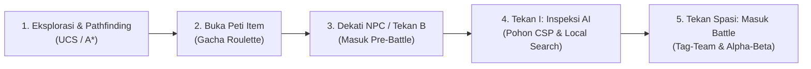

# Bakekok - Dokumentasi Lengkap Sistem Game AI (Tahap 1 - 4)

> **Tugas Besar Mata Kuliah Kecerdasan Buatan**  
> Program Studi Ilmu Komputer — Universitas Pendidikan Indonesia  
> **Kelompok 7**

---

## 1. Identitas Anggota Kelompok 7

| No | Nama Anggota | Peran / Fokus Pengembangan |
|:---:|:---|:---|
| 1 | **Muhammad Hanif Muyassar** | Integrasi Sistem, Engine AI & Algoritma Search |
| 2 | **Moch Fadillah Pratama** | Desain Antarmuka, Visualizer AI & Interaksi Game |
| 3 | **Muhammad Zidan Mirza Fedrieka** | Logika Pertarungan, Constraint Solver & Analisis Data |

---

## 2. Panduan Cepat: Cara Mencoba & Memainkan Game

Bagian ini dirancang agar Dosen Penguji atau Evaluator dapat langsung menjalankan dan menguji seluruh modul kecerdasan buatan di dalam game dalam hitungan menit.

### 1. Prasyarat Sistem
* **Python**: Versi `3.10` atau lebih baru (direkomendasikan `3.11` / `3.12` / `3.14`).
* **Sistem Operasi**: Windows, macOS, atau Linux.

### 2. Instalasi Dependensi
Buka terminal/PowerShell pada folder proyek `Game-AI`, lalu jalankan:

```bash
pip install -r requirements.txt
```
*(Dependensi utama hanyalah `pygame-ce >= 2.5.0`)*

### 3. Menjalankan Permainan
```bash
python main.py
```

---

## 3. Skenario Panduan Uji Coba Fitur AI untuk Dosen / Evaluator

Ikuti 5 langkah demonstrasi berikut untuk melihat seluruh modul materi kuliah bekerja secara nyata:



### Langkah 1: Eksplorasi Peta & Pathfinding (Materi Tahap 1)
* Gerakkan karakter utama (**Bolu**) menggunakan tombol **`W, A, S, D`** atau **Tombol Panah**.
* Tekan tombol **`[Spasi]`** untuk memanggil NPC Kucing Oyen agar mengejar Bolu.
* Tekan tombol **`[Ctrl]`** untuk menampilkan **Debug Overlay Pathfinding**:
  * Anda akan melihat visualisasi petak yang di-expand (*closed set*), jalur terpendek (*path*), metrik waktu eksekusi (ms), serta perbandingan algoritma **Uniform Cost Search (UCS)** vs **A\*** dengan berbagai heuristik (*Manhattan*, *Euclidean*, *Chebyshev*).

### Langkah 2: Interaksi Item & Mini-Game Gacha
* Dekati salah satu peti harta karun di peta (berjarak $\le 1$ langkah ubin), lalu tekan **`[E]`**.
* Akan muncul roda *roulette* gacha item yang memberikan buff serangan (**ATK**), pertahanan (**DEF**), atau ramuan (**Potion**) kepada Bolu. Buff ini nantinya akan memicu sistem **Dynamic Difficulty Adjustment (DDA)** saat skuad musuh dibentuk!

### Langkah 3: Masuk ke Fase Pre-Battle (Materi Tahap 3 & 4)
* Tabrak / dekati NPC musuh atau tekan tombol **`[B]`** dari mana saja untuk langsung memicu fase **Pre-Battle**.
* Di fase ini, sistem AI di balik layar secara otomatis menjalankan:
  1. **CSP Solver (Backtracking + MRV + LCV + AC-3)** untuk memastikan komposisi tim musuh mematuhi 8 batasan legalitas ($C_1 - C_8$).
  2. **Local Search Optimizer** untuk menyesuaikan tingkat kesulitan skuad musuh agar seimbang dengan status Bolu (Target Difficulty $\approx 0.55$).
* Anda dapat mencoba mengganti algoritma optimasi secara instan dengan menekan tombol angka **`[1]` s/d `[5]`**:
  * `[1]`: *Hill Climbing (Steepest-Ascent)*
  * `[2]`: *Hill Climbing with Sideways Move* (mengatasi Plateau)
  * `[3]`: *Random Restart Hill Climbing* (mengatasi Local Maximum)
  * `[4]`: *Simulated Annealing* (probabilitas langkah downhill $e^{\Delta E / T}$)
  * `[5]`: *Genetic Algorithm* (crossover skuad & mutasi)
* Tekan **`[R]`** untuk me-*reroll* skuad dengan seed acak baru.

### Langkah 4: Buka Inspeksi Visualizer AI Pre-Battle (Pohon CSP & Grafik)
* Pada layar Pre-Battle, klik tombol **`[INSPEKSI AI]`** atau tekan tombol **`[I]`**.
* Jendela visualizer interaktif akan terbuka dengan dua tab utama:
  * **Tab 1: Pohon CSP & Pruning**:
    * Menampilkan pohon pencarian Backtracking CSP secara 2D.
    * Gunakan tombol kontrol bawah (**Play, Step Next, Step Back, Reset, Speed**) atau geser *scrubber slider* untuk melihat jalannya pembentukan skuad langkah demi langkah.
    * Klik simpul mana saja pada pohon untuk melihat detail di kolom samping kanan: **Mengapa anakan ini dipilih (MRV & LCV)** dan **Mengapa anakan lain dipangkas/di-prune (Forward Checking)**.
    * Klik tombol **`[?] Aturan C1-C8`** di samping tab atas untuk melihat modal ringkasan seluruh aturan konsistensi.
    * Kanvas pohon dapat di-*pan* (klik-tahan & geser mouse) dan di-*zoom* (**`+` / `-` / Reset**).
  * **Tab 2: Optimasi Local Search**:
    * Menampilkan grafik konvergensi 2D hubungan antara iterasi vs Difficulty / Fitness.
    * Panel kanan menampilkan evaluasi detail setiap transisi langkah (*Move*, *Sideways*, *Restart*, *Cooling*, dll).

### Langkah 5: Masuk ke Arena Duel Tag-Team (Materi Tahap 2)
* Tekan **`[Spasi]`** atau **`[Enter]`** untuk masuk ke arena pertarungan turn-based.
* Pilih aksi bertarung Anda:
  * `[1 / A]`: Serangan biasa (*Attack*).
  * `[2 / S]`: Serangan kuat (*Heavy Attack*).
  * `[3 / D]`: Bertahan dengan perisai (*Defend*, reduksi damage 65%).
  * `[4 / W]`: Minum ramuan (*Potion*).
* Giliran musuh dikendalikan oleh **Adversarial Search (Minimax / Alpha-Beta Pruning / Expectimax)**.
* Tekan tombol **`[T]`** saat giliran NPC untuk membuka **Decision Tree Modal Overlay**, yang memperlihatkan cabang evaluasi nilai utilitas *minimax* dan pemangkasan cabang *alpha-beta*.
* Jika frontline musuh gugur, anggota cadangan (*bench*) akan maju secara otomatis via sistem **Tag-Team Battle**.

---

## 4. Ringkasan Kontrol Permainan (Keybindings Cheat-Sheet)

| Mode Permainan | Tombol Keyboard | Aksi / Fungsi |
|:---|:---|:---|
| **Eksplorasi (Peta)** | `W, A, S, D` / `Panah` | Menggerakkan Player (Bolu) pada grid ubin |
| | `E` | Membuka peti harta karun terdekat (Gacha Item) |
| | `Spasi` | Memanggil NPC Oyen melacak Bolu via pathfinding |
| | `Ctrl` | Membuka/menutup Debug Overlay Pathfinding |
| | `B` | Masuk ke fase Pre-Battle |
| | `Esc` | Keluar dari aplikasi |
| **Fase Pre-Battle** | `1, 2, 3, 4, 5` | Mengganti algoritma Local Search |
| | `R` | Re-roll / optimasi ulang skuad musuh |
| | `I` / Klik Tombol | **Membuka Inspeksi Visualizer AI Pre-Battle** |
| | `Spasi` / `Enter` | Memulai duel turn-based |
| | `Tab` / `Esc` | Kembali ke mode eksplorasi peta |
| **Visualizer Pre-Battle** | Klik Tab Atas | Beralih antara **Tab 1 (CSP Tree)** & **Tab 2 (Local Search)** |
| | Klik `[?] Aturan C1-C8` | Menampilkan popup dialog ringkasan 8 aturan konsistensi |
| | Drag Mouse / Tombol Zoom | Menggeser (*pan*) dan memperbesar/memperkecil kanvas pohon |
| | Play / Step / Scrubber | Mengendalikan simulasi langkah algoritma |
| | Scroll Mouse di Panel | Menggulir teks penjelasan teori & analisis simpul |
| | `X` / `Esc` | Menutup jendela visualizer |
| **Arena Pertarungan** | `1` / `A` | Serangan Biasa (*Attack*) |
| | `2` / `S` | Serangan Kuat (*Heavy Attack*) |
| | `3` / `D` | Bertahan (*Defend*) |
| | `4` / `W` | Menggunakan Potion |
| | `T` | **Membuka Fullscreen Decision Tree Modal AI Battle** |
| | `R` | Reset duel dari awal |
| | `Tab` | Menyerah dan kembali ke peta |

---

## 5. Arsitektur Sistem & Struktur Direktori

Kode program dibangun secara modular menggunakan Python 3.10+ berbasis pustaka `pygame-ce`:

```
Game-AI/
├── main.py                     # Entry point utama aplikasi
├── requirements.txt            # Dependensi pustaka (pygame-ce)
├── README.md                   # Dokumentasi teknis & panduan permainan
├── template_laporan.md         # Template acuan penyusunan laporan akademik lengkap
├── assets/                     # Spritesheet karakter, potret NPC, dan atlas ubin
├── data/
│   └── map_tubes.json          # Peta ubin 2D, koordinat, layer medan, dan collision
├── game/
│   ├── __init__.py             # Inisialisasi package
│   ├── app.py                  # Loop utama, event loop, kamera, state machine (Explore/Pre-Battle/Battle)
│   ├── config.py               # Konstanta global, palet warna antislop, domain stat, budget CSP
│   ├── events.py               # Event dispatcher & sinyal komunikasi antar-modul
│   ├── mapdata.py              # Parser ubin peta, terrain cost (jalan tanah vs rumput), koordinat grid
│   ├── player.py               # Karakter pemain (Bolu), inventaris item, status HP/potion
│   ├── npc.py                  # Karakter NPC di peta, waypoint patroli, palette swap tint
│   ├── npc_squad.py            # Model skuad musuh (frontline aktif, bench cadangan, rotasi tag-team)
│   ├── search.py               # Modul Tahap 1: PathNode, UCS, A*, heuristik (Manhattan, Euclidean, Chebyshev)
│   ├── battle_ai.py            # Modul Tahap 2: Minimax, Alpha-Beta Pruning, Expectimax, BattleState
│   ├── battle_system.py        # Logika duel turn-based, giliran, kalkulasi damage, logging aksi
│   ├── battle_vfx.py           # Efek visual animasi prosedural (pedang berayun, perisai, hit shake)
│   ├── difficulty.py           # Rumus evaluasi tingkat kesulitan dan fungsi fitness DDA
│   ├── npc_config_csp.py       # Modul Tahap 4: CSP Solver, Backtracking, MRV, LCV, AC-3, Constraint C1-C8
│   ├── npc_config_optimizer.py # Modul Tahap 3: Local Search Engine (5 algoritma optimasi difficulty)
│   ├── pre_battle_visualizer.py# Visualizer Akademis Interaktif Pre-Battle (Pohon CSP & Grafik Konvergensi)
│   ├── tree_overlay.py         # Visualizer Decision Tree Minimax/Alpha-Beta Battle
│   └── overlay.py              # In-game HUD & Debug Overlay Pathfinding / Battle
└── scratch/
    ├── run_tahap3_experiments.py # Skrip benchmark otomatis CSP Solver & 5 Algoritma Local Search
    ├── run_experiments.py        # Skrip benchmark otomatis Minimax, Alpha-Beta, & Expectimax
    ├── test_app_integration.py   # Headless end-to-end integration test
    ├── test_csp.py               # Unit test kepatuhan constraint CSP Solver
    └── test_optimizer.py         # Unit test 5 algoritma Local Search
```

---

## 6. Landasan Teori & Pemetaan Materi Kuliah

Sistem AI di dalam game ini mengimplementasikan 4 pilar materi perkuliahan secara terintegrasi:

### 1. Tahap 1: Informed Search & Navigasi Grid (Modul 2 & Slide 03)
* **Uniform Cost Search (UCS)**: Menemukan jalur terpendek berdasarkan akumulasi biaya riil $g(n)$ dengan $h(n) = 0$.
* **A\* Search**: Mengarahkan pencarian menggunakan fungsi evaluasi:
  $$f(n) = g(n) + h(n)$$
* **Fungsi Heuristik Terverifikasi**:
  * *Manhattan Distance* (Grid 4-connected, terbukti *admissible* & *consistent*):
    $$h(n) = |x_n - x_{\text{goal}}| + |y_n - y_{\text{goal}}|$$
  * *Euclidean Distance* (Garis lurus, *admissible*):
    $$h(n) = \sqrt{(x_n - x_{\text{goal}})^2 + (y_n - y_{\text{goal}})^2}$$
  * *Chebyshev Distance*:
    $$h(n) = \max(|x_n - x_{\text{goal}}|, |y_n - y_{\text{goal}}|)$$
* **Weighted Terrain Cost**: Langkah di jalan tanah/jembatan memiliki biaya $c = 1.0$, sedangkan medan berumput berbiaya $c = 2.0$.

### 2. Tahap 2: Adversarial Search Turn-Based Battle (Slide Review & Modul 1)
* **Minimax**: Mengevaluasi seluruh kemungkinan langkah pemain dan musuh untuk memaksimalkan utilitas giliran.
* **Alpha-Beta Pruning**: Memangkas cabang-cabang pohon permainan yang terbukti tidak akan dipilih oleh pemain rasional, menurunkan kompleksitas dari $O(b^d)$ menjadi mendekati $O(b^{d/2})$.
* **Expectimax**: Memodelkan ketidakpastian aksi jika pemain dianggap tidak selalu bermain optimal (*bounded rationality*).
* **Tag-Team Battle**: Jika frontline NPC tumbang, sistem mengaktifkan anggota berikutnya dari *bench*, menjaga kesinambungan duel.

### 3. Tahap 3: Local Search & Dynamic Difficulty Adjustment (Slide 05)
Local search mencari konfigurasi akhir optimal di mana lintasan (*path*) tidak penting dengan konsumsi memori konstan $O(1)$.
* **Fungsi Objektif (Fitness Function)**:
  $$\text{Fitness}(s) = -|\text{Difficulty}(s) - \text{TargetDifficulty}|$$
* **5 Algoritma yang Disediakan**:
  1. **Hill Climbing (Steepest-Ascent)**: Memilih tetangga dengan kenaikan fitness terbesar.
  2. **Hill Climbing with Sideways Move**: Mengizinkan transisi antar-tetangga bernilai sama hingga 15 langkah untuk melintasi area datar (*plateau* & *shoulder*).
  3. **Random Restart Hill Climbing**: Menjalankan ulang pendakian bukit dari *seed* awal legal CSP yang berbeda untuk meloloskan diri dari *local optimum*.
  4. **Simulated Annealing (SA)**: Mengadopsi prinsip termodinamika metalurgi; gerakan yang memperburuk fitness tetap dapat diterima dengan probabilitas Boltzmann:
     $$P(\text{accept}) = e^{\frac{\Delta E}{T}}, \quad T \leftarrow T \times \text{cooling\_rate}$$
  5. **Genetic Algorithm (GA)**: Mengoperasikan populasi konfigurasi skuad melalui seleksi turnamen, rekombinasi (*crossover*), dan mutasi acak.

### 4. Tahap 4: Constraint Satisfaction Problem (CSP) (Slide 06)
CSP merumuskan pembentukan skuad sebagai masalah kepatuhan batasan:
* **Himpunan Variabel ($X$)**: Atribut setiap anggota skuad ($\text{Role}_i, \text{HP}_i, \text{Potion}_i, \text{ATK\_Bonus}_i, \text{Eval\_Profile}_i$).
* **Himpunan Domain ($D$)**: Nilai diskret stat game (HP $\in [70, 110]$, Potion $\in [0, 2]$, dsb).
* **8 Batasan Konsistensi ($C_1 - C_8$)**:
  * **$C_1$ (Budget HP)**: $\sum \text{HP} \le 200$ (atau 260 untuk 3 NPC).
  * **$C_2$ (Budget Potion)**: $\sum \text{Potion} \le 2$ (atau 3 untuk 3 NPC).
  * **$C_3$ (Syarat Tank)**: Jika Role = Tank, maka $\text{HP} \ge 90$.
  * **$C_4$ (Syarat Ranger)**: Jika Role = Ranger, maka $\text{ATK\_Bonus} \ge 5$.
  * **$C_5$ (Keunikan Role)**: Tidak boleh ada role kembar jika jumlah anggota $\ge 2$.
  * **$C_6$ (Mage Sinergi)**: $\text{HP} \le 90$, profil AI $\in \{\text{BALANCED}, \text{AGGRESSIVE}\}$.
  * **$C_7$ (Tank Sinergi)**: Profil AI $\in \{\text{BALANCED}, \text{DEFENSIVE}\}$.
  * **$C_8$ (Assassin Sinergi)**: $\text{ATK\_Bonus} \ge 10$, $\text{HP} \le 90$, total budget $\text{ATK} \le 12$.
* **Mekanisme Penyelesaian**:
  * **AC-3 Filtering**: Menyaring domain *unary* sebelum pencarian dimulai.
  * **MRV (Minimum Remaining Values)**: Memilih variabel paling kritis (*fail-first*) yang memiliki sisa domain tersedikit.
  * **LCV (Least Constraining Value)**: Memprioritaskan nilai yang paling ramah dan tidak mematikan domain variabel lain (*succeed-first*).
  * **Forward Checking**: Langsung memangkas cabang simpul jika terdeteksi melanggar batasan konsistensi.

---

## 7. Hasil Eksperimen & Analisis Benchmark

Seluruh eksperimen dapat direproduksi secara instan menggunakan skrip di folder `scratch/`.

### 1. Kinerja CSP Solver (`scratch/run_tahap3_experiments.py`)

| Metrik Evaluasi CSP | Hasil Pengukuran | Keterangan |
|:---|:---:|:---|
| **Waktu AC-3 Preprocessing** | **0.005 ms** | Pemangkasan apriori berlangsung sub-milidetik |
| **Waktu Solve 2 Anggota NPC** | **0.175 ms** | Backtracking + MRV + LCV |
| **Waktu Solve 3 Anggota NPC** | **0.299 ms** | Menemukan solusi lengkap instan |
| **Tingkat Kepatuhan Aturan $C_1 - C_8$** | **100% (0 Pelanggaran)** | Seluruh solusi terbukti konsisten |
| **Komposisi Default 3 NPC** | Warrior + Tank + Assassin | Komposisi kelas sinergis dan seimbang |

### 2. Perbandingan 5 Algoritma Local Search (Target Difficulty = 0.55)

| Algoritma Local Search | Waktu Eksekusi (ms) | Rata-rata Iterasi | Nilai Fitness | Difficulty Dicapai | Kepatuhan Legalitas CSP |
|:---|:---:|:---:|:---:|:---:|:---:|
| **Hill Climbing (HC)** | 3.93 ms | 5.0 | -0.0028 | 0.5528 | **100% Valid** |
| **HC with Sideways Move** | **2.84 ms** | 5.0 | -0.0028 | 0.5528 | **100% Valid** |
| **Random Restart HC** | 11.98 ms | 5.6 | **-0.0016** | **0.5516** | **100% Valid** |
| **Simulated Annealing (SA)** | 29.97 ms | 136.0 | -0.0072 | 0.5572 | **100% Valid** |
| **Genetic Algorithm (GA)** | 65.30 ms | 30.0 gen | -0.0025 | 0.5480 | **100% Valid** |

> **Temuan Kunci:**
> * **HC with Sideways Move** adalah algoritma tercepat (**2.84 ms**), sangat ideal untuk transisi *gameplay* waktu nyata tanpa jeda.
> * **Random Restart HC** menghasilkan solusi paling presisi mendekati target ($0.5516$, deviasi hanya $0.0016$).
> * Integrasi CSP sebagai validator menghasilkan tingkat kepatuhan **100% legal** pada seluruh algoritma.

---

## 8. Skrip Pengujian Otomatis & Benchmark

Anda dapat menjalankan skrip pengujian mandiri tanpa membuka jendela grafis game:

1. **Benchmark Lengkap Tahap 3 & 4 (CSP + 5 Local Search)**:
   ```bash
   python scratch/run_tahap3_experiments.py
   ```
2. **Benchmark AI Battle Tahap 2 (Minimax vs Alpha-Beta vs Expectimax)**:
   ```bash
   python scratch/run_experiments.py
   ```
3. **Pengujian Integrasi End-to-End Game Loop**:
   ```bash
   python scratch/test_app_integration.py
   ```
4. **Unit Test Aturan CSP & Validator**:
   ```bash
   python scratch/test_csp.py
   ```
5. **Unit Test Local Search Optimizer**:
   ```bash
   python scratch/test_optimizer.py
   ```

---

## 9. Dokumen Pendukung Lainnya
* Untuk panduan penyusunan laporan akademik, silakan merujuk ke [`template_laporan.md`](file:///c:/Users/Pavilion/Documents/DOKUMEN%20TUGAS/Kuliah/Tubes_ai_kel7/Fix_nya/Game-AI/template_laporan.md) yang memuat tinjauan pustaka matematis, pseudocode lengkap Russell & Norvig, metodologi pengujian, dan analisis empiris komprehensif.
