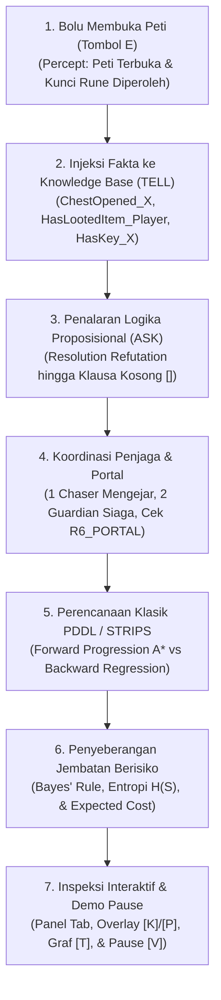

# Bakekok — Dokumentasi Sistem Game AI

> **Tugas Besar Mata Kuliah Kecerdasan Buatan**  
> Program Studi Ilmu Komputer — Universitas Pendidikan Indonesia  
> **Kelompok 7**

---

## 1. Identitas Anggota Kelompok 7
1. **Muhammad Hanif Muyassar**
2. **Moch Fadillah Pratama**
3. **Muhammad Zidan Mirza Fedrieka**

---

## 2. Panduan Menjalankan Game

### 1. Prasyarat Sistem
* **Python**: Versi `3.10` atau lebih baru (direkomendasikan `3.11` / `3.12` / `3.14`).
* **Sistem Operasi**: Windows, macOS, atau Linux.

### 2. Instalasi Dependensi
Buka terminal/PowerShell pada folder proyek `Game-AI`, lalu jalankan:

```bash
pip install -r requirements.txt
```
*(Dependensi utama adalah `pygame-ce >= 2.5.0`)*

### 3. Menjalankan Permainan
```bash
python main.py
```

---

## 3. Ringkasan Permainan & Sistem AI Utama

**Bakekok** adalah game petualangan 2D berbasis grid (`44 × 40` ubin pada `data/map_tubes.json`) di mana pemain (**Bolu**, spawn awal di `(22, 20)`) harus mengumpulkan **3 Kunci Rune** dari peti harta karun untuk membuka **Portal Menara Kuno** (`(38, 5)`) dan menghadapi **Boss Kage** (*Kage the Shadow Lord*), sambil menghindari atau menghadapi 3 penjaga pulau:
* **Oyen** (*Warrior*): berpatroli di sektor kiri bawah sekitar **Peti B** `(5, 24)`.
* **Kuro** (*Ranger*): berpatroli di sektor kanan bawah sekitar **Peti C** `(34, 28)`.
* **Shiro** (*Mage*): berpatroli di sektor kiri atas sekitar **Peti A** `(9, 3)`.

Selain sistem pencarian jalur (*Pathfinding* UCS/A*), pertarungan *turn-based* (*Minimax & Alpha-Beta Pruning*), dan optimasi skuad lawan (*CSP & Local Search*), game ini mengintegrasikan tiga sistem kecerdasan buatan tingkat lanjut:

1. **Logika Proposisional & Basis Pengetahuan (*Knowledge Representation & Resolution Refutation*)**
2. **Perencanaan Otomatis (*Automated Classical Planning — PDDL / STRIPS*)**
3. **Pengambilan Keputusan di Bawah Ketidakpastian (*Decision Under Uncertainty — Bayes' Rule, Shannon Entropy & Expected Cost*)**



---

## 4. Fitur AI & Cara Menggunakannya di Dalam Game

### A. Logika Proposisional & Basis Pengetahuan (`game/logic/`)
* **Pemisahan KB dan Mesin Inferensi**: Aturan logika disimpan secara deklaratif dalam bentuk *Conjunctive Normal Form* (CNF) pada `KnowledgeBase` (`game/logic/kb_rules.py`), terpisah dari algoritma pembuktian pada `ResolutionRefutationEngine` (`game/logic/inference_engine.py`).
* **Siklus `TELL` → `ASK`**:
  1. Saat Bolu membuka peti dengan **`[E]`** (jarak `<= 1` ubin), sistem memanggil `TELL` fakta `ChestOpened_{A/B/C}`, `HasLootedItem_Player`, serta `HasKey_{A/B/C}`.
  2. Sistem melakukan `ASK` (`engine.prove(kb, query)`) untuk menentukan satu NPC pengejar (`AssignChaser`: Peti A → Shiro, Peti B → Oyen, Peti C → Kuro) dan dua NPC penjaga peti tersisa (`AssignTightGuard`).
  3. Aturan **`R6_PORTAL`** (`HasKey(A) ∧ HasKey(B) ∧ HasKey(C) => PortalActive`) memverifikasi bahwa Portal Menara Kuno `(38, 5)` hanya aktif setelah ketiga Kunci Rune terkumpul.
* **Inspeksi di Game**:
  * Buka **Tab ke-5 (`07: LOGIC & REASONING`)** untuk melihat percept `TELL`, daftar aturan CNF KB (termasuk `R6_PORTAL`), jejak resolusi refutasi, kesimpulan `ASK`, dan status `Portal (R6)`.
  * Tekan **`[K]`** untuk membuka overlay alur `TELL -> KB CNF -> ASK -> []` di atas peta, atau klik **`Buka Pembuktian Resolusi [K]`** untuk membuka pohon resolusi lengkap di `UnifiedGraphModal`.

### B. Perencanaan Otomatis — PDDL / STRIPS (`game/planning/`)
* **Dua Mesin Perencana (`planner_engine.py`)**:
  * **Forward Progression (`A*`)**: mencari maju dari `Initial State (s0)` ke `Goal State` menggunakan heuristik jumlah predikat goal yang belum terpenuhi.
  * **Backward Regression (`STRIPS`)**: mencari mundur dari `Goal State` ke `s0` menggunakan aksi yang *relevant* dan *consistent*, lalu memvalidasi rencana secara maju.
* **Dua Domain Perencanaan**:
  1. **Domain Patroli Dunia (`domain_world_patrol.py`)**: menyusun 4 langkah terstruktur (`MoveToChokePoint` → `InterceptPlayer` → `MoveToSector` → `ReinforceGuard`) dan dieksekusi ke perilaku NPC melalui `TaskExecutor`.
  2. **Domain Taktik Duel (`domain_battle_tactics.py`)**: saat duel *Tag-Team* dan HP petarung garis depan kritis, perencana menyusun rotasi tim otomatis (`SwapRetreat` → `CastDefend` → `HealTeammate`).
* **Inspeksi di Game**:
  * Buka **Tab ke-6 (`08: AUTOMATED PLANNING`)** untuk mengganti algoritma perencana, melihat `State Awal (s0)` vs `Sasaran (Goal)`, serta daftar sekuens aksi STRIPS.
  * Tekan **`[P]`** (atau klik **`Lihat Info Rencana PDDL [P]`**) untuk membuka overlay rincian *Preconditions*, *Add List*, dan *Delete List*, lalu tekan **`[T]`** (atau klik **`Buka Pohon Rencana PDDL [T]`**) untuk membuka pohon rencana PDDL.

### C. Pengambilan Keputusan di Bawah Ketidakpastian (`game/ai/uncertainty.py`)
* **3 Jembatan Pintas Berisiko vs Jembatan Aman**:
  * Tiga jembatan pintas antarpulau (**Atas** `(23..27, 6)`, **Kiri** `(5, 19..22)`, **Bawah** `(22..27, 36)`) memiliki probabilitas ambruk tersembunyi (*Hidden State*: `RAPUH` vs `KOKOH`).
  * Jembatan melalui **Pulau Tengah** memiliki risiko ambruk **$0\%$** sebagai rute memutar yang selalu aman.
* **Bayesian Belief Update, Entropi, & Expected Cost (`BridgeUncertaintyEngine`)**:
  * **Prior Cuaca**: `10%` saat **Cerah**, dan default `40%` saat **Hujan Deras** (dapat diatur `5%–95%` melalui slider).
  * **Cek Jembatan (Observasi Bayes)**: menekan tombol **`Cek Jembatan (Observasi Bayes)`** (maksimal 4 kali per jembatan per siklus cuaca) menghasilkan observasi sensor ber-*noise* (`Derit Retak` atau `Terlihat Kokoh` sesuai slider **Akurasi Sensor Cek** `65%–95%`), memperbarui **Posterior $P(\text{Ambruk})$** melalui *Bayes' Rule*, menurunkan **Entropi $H(S)$**, dan mengevaluasi ulang rekomendasi rute (*Redo Decision*).
  * **Expected Cost**: membandingkan nilai harapan biaya jembatan pintas (`shortcut_cost = 12.0`, `safe_detour_cost = 28.0`, `item_penalty_cost = 20.0`) terhadap rute aman Pulau Tengah (`28.0`) untuk menentukan status **`Aman Dilintasi`** atau **`Disarankan Memutar`**.
  * **Konsekuensi Ambruk**: jika nekat melintas dan jembatan ambruk, ubin jembatan diblokir permanen (`X` merah) sehingga pathfinding otomatis memutar lewat Pulau Tengah, karakter didorong ke tepi aman, dan pemain kehilangan 1 item non-kunci (atau `-10 HP` jika tas kosong), sementara **Kunci Rune tetap aman**.
* **Inspeksi di Game**:
  * Buka **Tab ke-7 (`09: UNCERTAINTY`)** untuk memilih jembatan (`Atas` / `Kiri` / `Bawah`), mengubah cuaca (`Hujan Deras` / `Cerah`), mengatur slider `Prior Hujan` dan `Akurasi Sensor Cek`, melakukan `Cek Jembatan`, serta menggunakan tombol **`Perbaiki Jembatan`** untuk memulihkan jembatan yang ambruk.
  * Klik ubin jembatan di peta untuk melihat popup status, $P(\text{Ambruk})$, Entropi, dan rekomendasi rute.

---

## 5. Kontrol & Pintasan Keyboard Lengkap

| Mode / Konteks | Tombol / Klik | Fungsi |
|:---|:---|:---|
| **Global / Panel** | `Tab` | Membuka / menutup Panel Inspektur di sisi kiri |
| | `Alt + Tab` / `Ctrl + Tab` | Berpindah tab AI ke tab berikutnya (`Shift` untuk mundur) |
| | `H` atau klik **`[H] Buku Panduan`** | Membuka / menutup modal Misi, Panduan Tab, & Metode AI |
| | `F11` | Masuk / keluar mode layar penuh (*fullscreen*) |
| | `+` / `-` | Memperbesar / memperkecil zoom kamera peta |
| **Eksplorasi Peta** | `W, A, S, D` / `Panah` | Menggerakkan Bolu pada grid peta |
| | `E` | Membuka peti harta (`<= 1` ubin) atau interaksi Portal Menara Kuno (`<= 2` ubin) |
| | `Spasi` | Membunyikan peluit pemancing NPC ke posisi suara |
| | `V` atau klik **`[V] Pause`** | Menjeda (*Demo Pause*) gerak Bolu, NPC, & pemicu Pre-Battle agar demonstrasi tab/pohon lebih leluasa (data tab tetap *live*) |
| | `K` | Membuka / menutup overlay Logika Proposisional & Resolusi (mengaktifkan *Auto-Pause*) |
| | `P` | Membuka / menutup overlay Perencanaan PDDL / STRIPS (mengaktifkan *Auto-Pause*) |
| | `Ctrl` | Menampilkan / menyembunyikan garis jalur *Pathfinding* di peta |
| | `Klik Ubin Peta` | Menginspeksi koordinat ubin, terrain cost, atau status jembatan |
| | `B` | Pintasan langsung masuk ke fase *Pre-Battle* |
| **Pre-Battle & Duel** | `1–5` / `R` (Pre-Battle) | Memilih algoritma optimasi skuad / mengacak ulang skuad lawan |
| | `T` | Membuka / menutup visualizer CSP/Local Search (Pre-Battle) atau Pohon Minimax (Battle) |
| | `Spasi` / `Enter` (Pre-Battle) | Memulai pertarungan duel (*Battle*) |
| | `1` / `W`, `2` / `A`, `3` / `D`, `4` / `S` (Battle) | Memilih aksi *Attack*, *Heavy*, *Defend*, atau *Potion* |
| | `Esc` / klik `[ESC] Keluar` | Menutup modal/overlay atau keluar damai dari pertarungan ke peta |

---

## 6. Struktur Direktori Utama

```
Game-AI/
├── main.py                           # Entry point aplikasi Bakekok
├── requirements.txt                  # Dependensi (pygame-ce >= 2.5.0)
├── README.md                         # Dokumentasi proyek ini
│
├── game/
│   ├── app.py                        # Orkestrator utama (loop, event, resize, Demo Pause)
│   ├── core/config.py                # Konfigurasi warna, skala UI, & ukuran layar
│   ├── ai/
│   │   ├── pathfinding.py            # Pencarian rute UCS & A*
│   │   ├── minimax.py                # AI duel turn-based (Minimax & Alpha-Beta)
│   │   ├── csp.py & optimizer.py     # CSP & Local Search optimasi skuad
│   │   └── uncertainty.py            # BridgeUncertaintyEngine (Bayes, Entropi, Expected Cost)
│   ├── logic/
│   │   ├── kb_rules.py               # KnowledgeBase deklaratif (CNF, R1-R4 & R6_PORTAL)
│   │   ├── inference_engine.py       # ResolutionRefutationEngine (KB ∪ {¬α} ⊢ [])
│   │   └── inter_npc_manager.py      # Siklus TELL/ASK koordinasi NPC & portal
│   ├── planning/
│   │   ├── pddl_types.py             # Predicate, State, ActionSchema, PlanStep
│   │   ├── domain_world_patrol.py    # Domain PDDL patroli & penjagaan pulau
│   │   ├── domain_battle_tactics.py  # Domain PDDL rotasi taktik duel tag-team
│   │   ├── planner_engine.py         # ForwardProgressionPlanner (A*) & BackwardRegressionPlanner
│   │   └── task_executor.py          # Eksekutor rencana PDDL ke NPC
│   ├── modes/
│   │   ├── exploration_mode.py       # Logika eksplorasi, peti, stealth, jembatan, & HUD
│   │   ├── pre_battle_mode.py        # Fase persiapan & optimasi skuad lawan
│   │   └── battle_mode.py            # Fase duel turn-based & boss battle
│   ├── ui/
│   │   ├── inspector_dock.py         # Panel inspektur dengan resize & scroll vertikal
│   │   ├── nav_rail.py               # Navigasi ikon tab di sisi paling kiri
│   │   ├── logic_overlay.py          # Overlay pembuktian logika [K]
│   │   ├── planning_overlay.py       # Overlay rencana PDDL [P]
│   │   ├── graph_modal.py            # Modal graf pohon resolusi, PDDL, & Minimax
│   │   ├── guide_modal.py            # Modal Buku Panduan [H]
│   │   └── tabs/                     # Implementasi Tab 0..7 (Companion hingga Settings)
│   └── world/
│       ├── mapdata.py                # Peta grid, peti, portal, & dynamic_blocked_set
│       └── npc.py                    # Agen NPC (Oyen, Kuro, Shiro)
│
└── scratch/                          # Skrip pengujian integrasi & verifikasi otomatis
```

---

## 7. Skrip Pengujian Otomatis

Seluruh pengujian dapat dijalankan langsung dari folder `Game-AI` menggunakan terminal:

```bash
python scratch/test_tahap4_integration.py
python scratch/test_plan_dev_boss_integration.py
python scratch/test_fullscreen_tab_fix.py
python scratch/test_logic_resolution.py
python scratch/test_automated_planning.py
```
