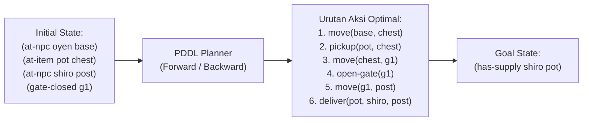
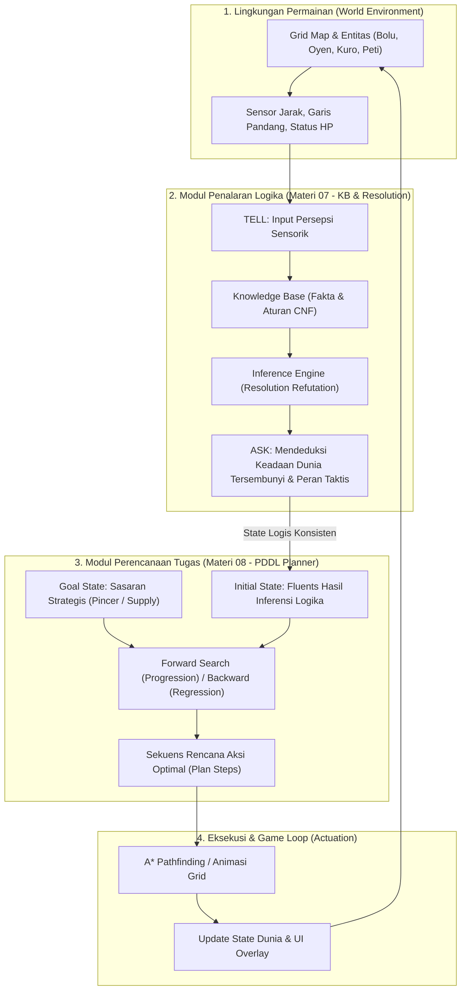

# Eksplorasi Ide & Perancangan Lanjutan: Knowledge-Based Agent (Materi 07) & Automated Planning (Materi 08)
## Proyek Game AI: *Bakekok* (Bolu Kesepian)

> **Mata Kuliah**: Kecerdasan Buatan (Semester 3) — Universitas Pendidikan Indonesia  
> **Kelompok**: 7 (Muhammad Hanif Muyassar, Moch Fadillah Pratama, Muhammad Zidan Mirza Fedrieka)  
> **Dokumen**: `ide_tahap_4_part2.md`  
> **Tujuan**: Menghimpun perancangan ide sebanyak-banyaknya secara mendalam, terstruktur, dan akademis untuk mengimplementasikan kurikulum **07_Logic & Representasi Pengetahuan.pdf** dan **08_Automated Planning.pdf**.

---

## DAFTAR ISI
1. [Landasan Teori & Pemetaan Instruksi Dosen](#1-landasan-teori--pemetaan-instruksi-dosen)
2. [Kumpulan Ide Implementasi Materi 07: Logic & Knowledge Representation](#2-kumpulan-ide-implementasi-materi-07-logic--knowledge-representation)
   - [Ide 7.1: Taktik Perburuan Pengepungan Antar-NPC (Pack Hunting & Pincer Ambush)](#ide-71-taktik-perburuan-pengepungan-antar-npc-pack-hunting--pincer-ambush)
   - [Ide 7.2: Jaringan Peringatan Bahaya & Permintaan Bantuan (Distress Signal & Alarm)](#ide-72-jaringan-peringatan-bahaya--permintaan-bantuan-distress-signal--alarm)
   - [Ide 7.3: Sinergi Pembagian Sumber Daya Pre-Battle (Inter-NPC Resource Sharing)](#ide-73-sinergi-pembagian-sumber-daya-pre-battle-inter-npc-resource-sharing)
   - [Ide 7.4: Penalaran Bahaya Sensorik ala Wumpus World (Sensory Trap & Bait Deduction)](#ide-74-penalaran-bahaya-sensorik-ala-wumpus-world-sensory-trap--bait-deduction)
   - [Ide 7.5: Moral, Loyalitas & Negosiasi Menyerah (Morale & Surrender Negotiation)](#ide-75-moral-loyalitas--negosiasi-menyerah-morale--surrender-negotiation)
   - [Ide 7.6: Penalaran Resonansi Kombo & Elemen Tag-Team (Elemental Combo Deduction)](#ide-76-penalaran-resonansi-kombo--elemen-tag-team-elemental-combo-deduction)
   - [Ide 7.7: Jaringan Gosip & Validasi Rumor Intelijen (Gossip & Rumor Verification)](#ide-77-jaringan-gosip--validasi-rumor-intelijen-gossip--rumor-verification)
   - [Ide 7.8: Deduksi Pola Kebiasaan Lawan (Counter-Tactic Habit Deduction)](#ide-78-deduksi-pola-kebiasaan-lawan-counter-tactic-habit-deduction)
3. [Kumpulan Ide Implementasi Materi 08: Automated Planning (PDDL / STRIPS)](#3-kumpulan-ide-implementasi-materi-08-automated-planning-pddl--strips)
   - [Ide 8.1: Misi Logistik Kurir Pasokan Antar-Pos (NPC Supply Courier Mission)](#ide-81-misi-logistik-kurir-pasokan-antar-pos-npc-supply-courier-mission)
   - [Ide 8.2: Rekayasa Jebakan & Barikade Taktis (Dynamic Ambush Trap Engineering)](#ide-82-rekayasa-jebakan--barikade-taktis-dynamic-ambush-trap-engineering)
   - [Ide 8.3: Operasi Evakuasi & Penyelamatan Rekan Terluka (Search & Rescue Extraction)](#ide-83-operasi-evakuasi--penyelamatan-rekan-terluka-search--rescue-extraction)
   - [Ide 8.4: Perencanaan Kombo Pertarungan Multi-Giliran (Multi-Turn Battle GOAP)](#ide-84-perencanaan-kombo-pertarungan-multi-giliran-multi-turn-battle-goap)
   - [Ide 8.5: Pendamping Otonom Bolu (Bolu's Autonomous Companion Kitty Planner)](#ide-85-pendamping-otonom-bolu-bolus-autonomous-companion-kitty-planner)
   - [Ide 8.6: Pemecahan Teka-Teki Gerbang & Relik Kuno (Dungeon Mechanism Solver)](#ide-86-pemecahan-teka-teki-gerbang--relik-kuno-dungeon-mechanism-solver)
   - [Ide 8.7: Rantai Produksi & Penempaan Senjata Regu (Squad Armory Crafting Pipeline)](#ide-87-rantai-produksi--penempaan-senjata-regu-squad-armory-crafting-pipeline)
   - [Ide 8.8: Perencanaan Rute Temu Pengepungan Tersinkronisasi (Synchronized Pincer Routing)](#ide-88-perencanaan-rute-temu-pengepungan-tersinkronisasi-synchronized-pincer-routing)
4. [Arsitektur Kognitif Terpadu: Sinergi Logic 07 & Planning 08](#4-arsitektur-kognitif-terpadu-sinergi-logic-07--planning-08)
5. [Rekomendasi Pemilihan & Roadmap Pengembangan](#5-rekomendasi-pemilihan--roadmap-pengembangan)

---

## 1. Landasan Teori & Pemetaan Instruksi Dosen

### 1.1 Mandat Materi 07: Logic & Knowledge Representation (Slide 30)
> *"Tubes Tahap 4: Tambahkan KB untuk menentukan interaksi NPC dengan NPC lain (bentuk interaksi dan isi KB bebas, sesuaikan dengan karakteristik game). Boleh menggunakan lib untuk inferensi KB, yang penting KB harus terpisah. Overlay memperlihatkan proses inferensi."*

#### Parameter Penilaian Utama:
1. **Fokus Skenario**: Mengatur **interaksi NPC dengan sesama NPC** (*Inter-NPC Interaction / Squad Coordination*), bukan sekadar respons NPC terhadap aksi pemain.
2. **Pemisahan Deklaratif**: Basis pengetahuan (*Knowledge Base*) berisi aturan (*rules*) dan fakta (*facts*) didefinisikan secara independen, terpisah dari algoritma inferensi (*Inference Engine*) dan kode game loop.
3. **Mekanisme Inferensi Formal**: Menggunakan representasi bentuk standar **Conjunctive Normal Form (CNF)** dan algoritma **Resolution Refutation** (menambahkan negasi hipotesis $\neg\alpha$ dan membuktikan kontradiksi dengan menghasilkan klausa kosong $\square$).
4. **Visualisasi GUI / Overlay**: Terdapat antarmuka yang memperlihatkan alur penalaran deklaratif: fakta sensorik yang masuk (`TELL`), aturan yang terpicu, langkah resolusi pasangan klausa, hingga penarikan kesimpulan akhir (`ASK`).

### 1.2 Mandat Materi 08: Automated Planning (PDDL / STRIPS)
Pada materi ini, agen AI ditingkatkan dari sekadar reaktif/pencarian ubin lokal menjadi mampu merencanakan rantai aksi majemuk (*sequential task planning*):
1. **Representasi PDDL (Planning Domain Definition Language)**:
   - **Predikat / Fluents**: Fakta logika yang mendefinisikan status dunia pada suatu saat (contoh: `(at-npc oyen pos1)`, `(holding oyen potion)`).
   - **Action Schema**: Aksi deklaratif dengan parameter, prasyarat (*preconditions*), dan dampak (*effects* yang terdiri dari *Add List* dan *Delete List*):
     $$\text{Result}(s, a) = (s \setminus \text{del}(a)) \cup \text{add}(a)$$
2. **Pencarian Ruang Keadaan (*State-Space Planning*)**:
   - **Forward Search (Progression)**: Memulai dari *Initial State* ($s_0$), menerapkan aksi yang *applicable* ($pre(a) \subseteq s$), dan mencari jalur ke *Goal State* dengan algoritma BFS / A\* (heuristik *ignore-delete-lists*).
   - **Backward Search (Regression)**: Memulai dari target *Goal State* ($g$), mencari aksi yang relevan ($add(a) \cap g \neq \emptyset$) dan konsisten ($del(a) \cap g = \emptyset$), lalu meregresi sub-goal:
     $$g' = (g \setminus \text{add}(a)) \cup pre(a)$$
     berhenti saat $g' \subseteq s_0$.
3. **Pembeda Konseptual**: Berbeda dari A\* pathfinding biasa di mana status hanyalah sebuah label node grid tanpa semantik, pada Automated Planning status adalah **himpunan relasi logis** yang dapat berubah dan dirangkai secara dinamis.

---

## 2. Kumpulan Ide Implementasi Materi 07: Logic & Knowledge Representation

Berikut adalah 8 rancangan ide interaksi antar-NPC berbasis Knowledge Base yang dirancang secara spesifik untuk dunia *Bakekok*:

---

### Ide 7.1: Taktik Perburuan Pengepungan Antar-NPC (Pack Hunting & Pincer Ambush)
> **Prioritas Rekomendasi**: ⭐⭐⭐⭐⭐ (Sangat Tinggi — Selaras Sempurna dengan Eksplorasi Map & Karakter Kucing)

#### 1. Deskripsi & Konsep Skenario
Di peta dunia terdapat 3 NPC: **Oyen** (Kucing Pemburu Utama), **Kuro** (Patroli Sektor Barat), dan **Shiro** (Patroli Sektor Timur). Ketika Oyen mendeteksi keberadaan Bolu di dekat jalan sempit atau jembatan, Oyen tidak langsung mengejar membabi buta seorang diri. Melalui jaringan komunikasi suara (*Cat Meow Signal*), Oyen mengirimkan data posisinya ke Knowledge Base bersama. 

Inference engine menalar status koordinasi antar-kucing. Jika Oyen dan Kuro berada dalam radius koordinasi dan Bolu berada di koridor sempit (*chokepoint*), sistem menyimpulkan bahwa taktik **Pincer Maneuver** harus dieksekusi: Oyen bertindak sebagai *Chaser* (mendorong Bolu maju), sementara Kuro berganti peran menjadi *Ambusher* (bergerak memotong jalur keluar Bolu di ujung lorong).

```mermaid
flowchart TD
    O["Oyen (Melihat Bolu)"] -->|TELL Fakta| KB[Knowledge Base Bersama]
    K["Kuro (Patroli Terdekat)"] -->|TELL Status Posisi| KB
    KB -->|Proses Resolusi CNF| IE["Inference Engine (Resolution Refutation)"]
    IE -->|Mencapai Empty Clause []| Decision{"Keputusan Taktis"}
    Decision -->|Oyen: Chaser| A1["Tetap Mengikuti Jalur Bolu"]
    Decision -->|Kuro: Ambusher| A2["Kalkulasi Titik Potong (Interception Waypoint)"]
```

#### 2. Deklarasi Knowledge Base (Fakta & Aturan)
* **Fakta Masukan (`TELL`):**
  - `SeesPlayer(Oyen)` : Oyen melihat posisi Bolu.
  - `NearAlly(Oyen, Kuro)` : Jarak Manhattan antara Oyen dan Kuro $\le 12$ ubin.
  - `InChokepoint(Player)` : Bolu berada pada petak jalan dengan opsi gerakan terbatas ($\le 2$ ubin tetangga bebas).
  - `IsAvailable(Kuro)` : Kuro tidak sedang dalam pertarungan.
* **Aturan Logika (Rules $\implies$ CNF):**
  - **Rule 1 (Panggilan Siaga)**: Jika seorang NPC melihat pemain dan ada sekutu di dekatnya, sekutu tersebut diberi sinyal siaga.
    $$\text{FOL}: \forall x \forall y \, (\text{SeesPlayer}(x) \land \text{NearAlly}(x, y) \implies \text{AlertAlly}(y))$$
    $$\text{CNF}: \neg \text{SeesPlayer}(x) \lor \neg \text{NearAlly}(x, y) \lor \text{AlertAlly}(y)$$
  - **Rule 2 (Evaluasi Taktik Pincer)**: Jika sekutu siaga, tersedia, dan pemain di koridor sempit, maka aktifkan manuver pengepungan.
    $$\text{FOL}: \forall y \, (\text{AlertAlly}(y) \land \text{IsAvailable}(y) \land \text{InChokepoint}(\text{Player}) \implies \text{ExecutePincer}(y))$$
    $$\text{CNF}: \neg \text{AlertAlly}(y) \lor \neg \text{IsAvailable}(y) \lor \neg \text{InChokepoint}(\text{Player}) \lor \text{ExecutePincer}(y)$$
  - **Rule 3 (Penetapan Rute Ambush)**: Eksekusi pincer mewajibkan sekutu mengunci titik potong rute.
    $$\text{FOL}: \forall y \, (\text{ExecutePincer}(y) \implies \text{AssignAmbushPath}(y))$$
    $$\text{CNF}: \neg \text{ExecutePincer}(y) \lor \text{AssignAmbushPath}(y)$$

#### 3. Proses Inferensi (Resolution Refutation)
* **Query (`ASK`)**: `ASK(KB, AssignAmbushPath(Kuro))`
* **Negasi Target**: Tambahkan klausa $\neg \text{AssignAmbushPath}(\text{Kuro})$ ke dalam KB.
* **Langkah Resolusi**:
  1. Resolve $\neg \text{AssignAmbushPath}(\text{Kuro})$ dengan Rule 3 $\implies \neg \text{ExecutePincer}(\text{Kuro})$.
  2. Resolve $\neg \text{ExecutePincer}(\text{Kuro})$ dengan Rule 2 $\implies \neg \text{AlertAlly}(\text{Kuro}) \lor \neg \text{IsAvailable}(\text{Kuro}) \lor \neg \text{InChokepoint}(\text{Player})$.
  3. Resolve dengan fakta `IsAvailable(Kuro)` $\implies \neg \text{AlertAlly}(\text{Kuro}) \lor \neg \text{InChokepoint}(\text{Player})$.
  4. Resolve dengan fakta `InChokepoint(Player)` $\implies \neg \text{AlertAlly}(\text{Kuro})$.
  5. Resolve dengan Rule 1 $\implies \neg \text{SeesPlayer}(\text{Oyen}) \lor \neg \text{NearAlly}(\text{Oyen}, \text{Kuro})$.
  6. Resolve dengan fakta `SeesPlayer(Oyen)` dan `NearAlly(Oyen, Kuro)` berturut-turut.
  7. Menghasilkan klausa kosong: **$\square$ (CONTRADICTION FOUND!)**.
* **Kesimpulan**: Query terbukti sah ($KB \models \text{AssignAmbushPath}(\text{Kuro})$). Kuro mengubah target A\* pathfinding ke simpul di depan Bolu.

#### 4. Rancangan Visualizer Overlay
Layar HUD overlay (dapat dibuka dengan tombol `[K]` atau `[L]`):
* **Kolom Kiri**: Daftar fakta dunia aktif yang di-`TELL` ke KB secara dinamis.
* **Kolom Tengah**: Diagram alur resolusi klausa demi klausa lengkap dengan tanda pembatalan literal saling berkomplemen ($P$ vs $\neg P$) hingga memunculkan kotak merah kontradiksi $\square$.
* **Kolom Kanan**: Status aksi taktis (*"Kuro beralih ke Mode Ambush! Titik potong: Grid (14, 18)"*).

---

### Ide 7.2: Jaringan Peringatan Bahaya & Permintaan Bantuan (Distress Signal & Alarm)
> **Prioritas Rekomendasi**: ⭐⭐⭐⭐ (Sangat Menarik & Realistis)

#### 1. Deskripsi & Konsep Skenario
Saat Bolu membuka peti harta karun dan mendapatkan buff status besar (misal ATK +6 dan Pedang Legendaris), NPC yang berpapasan dengan Bolu akan menyadari bahwa ia kalah kuat secara satu lawan satu (*Overpowered Opponent*). Alih-alih bertarung langsung dan kalah, NPC tersebut meniup peluit alarm atau membunyikan lonceng desa (*Distress Beacon*).

NPC lain yang mendengar sinyal bahaya akan menalar apakah posisinya cukup dekat, apakah dirinya membawa senjata perisai/tank, dan apakah ia harus segera berlari memberikan bantuan pengawalan (*Escort & Reinforce*).

#### 2. Formulasi Logika KB
* **Fakta:**
  - `PlayerBuffed(Bolu)` : Bolu memiliki ATK $\ge 4$ atau Pedang.
  - `LowCombatPower(Oyen)` : HP Oyen rendah atau perlengkapan minim.
  - `HasShield(Shiro)` : Shiro bertipe Defender/Tank.
  - `WithinAcousticRange(Oyen, Shiro)` : Jarak suara alarm mencukupi.
* **Aturan (Rules):**
  $$R_1: \text{PlayerBuffed}(\text{Bolu}) \land \text{LowCombatPower}(x) \implies \text{TriggerDistressAlarm}(x)$$
  $$R_2: \text{TriggerDistressAlarm}(x) \land \text{WithinAcousticRange}(x, y) \land \text{HasShield}(y) \implies \text{ReinforceAlly}(y, x)$$
* **Hasil Inferensi**: Shiro langsung membatalkan rute patrolinya dan bergegas menuju koordinat Oyen untuk membentuk perlindungan gabungan.

---

### Ide 7.3: Sinergi Pembagian Sumber Daya Pre-Battle (Inter-NPC Resource Sharing)
> **Prioritas Rekomendasi**: ⭐⭐⭐⭐⭐ (Sangat Cocok untuk Fase Pre-Battle & Skuad Tag-Team)

#### 1. Deskripsi & Konsep Skenario
Setelah CSP Solver dan Local Search merumuskan skuad musuh (misalnya terdiri dari 1 *Warrior* dan 1 *Mage*), sebelum pemain menekan `[Spasi]` untuk memulai duel, antar-anggota regu NPC berkumpul di balik layar untuk mengevaluasi inventaris mereka.

Mage memiliki pertahanan rendah (*Glass Cannon*) dan tidak memiliki ramuan pemulih (`potions = 0`), sementara Warrior membawa 2 ramuan pemulih. Basis pengetahuan menalar aturan persahabatan regu: *"Jika rekan tim adalah perapal mantra rapuh yang tidak memiliki ramuan pemulih, dan rekan garda depan membawa kelebihan ramuan, maka lakukan transfer 1 ramuan kepada rekan tersebut sebelum duel dimulai."*

#### 2. Formulasi Logika KB
* **Fakta:**
  - `Class(NPC_1, Warrior)`, `Class(NPC_2, Mage)`
  - `PotionCount(NPC_1, 2)`, `PotionCount(NPC_2, 0)`
  - `FragileDefender(NPC_2)`
* **Aturan CNF:**
  $$R_1: \text{Class}(x, \text{Warrior}) \land \text{PotionCount}(x, 2) \implies \text{HasSurplusPotion}(x)$$
  $$\text{CNF: } \neg \text{Class}(x, \text{Warrior}) \lor \neg \text{PotionCount}(x, 2) \lor \text{HasSurplusPotion}(x)$$
  $$R_2: \text{HasSurplusPotion}(x) \land \text{Class}(y, \text{Mage}) \land \text{PotionCount}(y, 0) \implies \text{TransferPotion}(x, y)$$
  $$\text{CNF: } \neg \text{HasSurplusPotion}(x) \lor \neg \text{Class}(y, \text{Mage}) \lor \neg \text{PotionCount}(y, 0) \lor \text{TransferPotion}(x, y)$$
* **Dampak Gameplay**: Tampil jendela dialog komik interaktif di layar Pre-Battle: *"Oyen memberikan 1 Ramuan kepada Shiro demi keselamatan bersama!"* sehingga komposisi ramuan tim ter-update secara dinamis sebelum masuk ke Arena Duel.

---

### Ide 7.4: Penalaran Bahaya Sensorik ala Wumpus World (Sensory Trap & Bait Deduction)
> **Prioritas Rekomendasi**: ⭐⭐⭐⭐ (Nilai Edukatif Teori AI Sangat Tinggi)

#### 1. Deskripsi & Konsep Skenario
Mengadopsi skenario legendaris **Wumpus World** dari buku Russell & Norvig. Di peta terdapat petak rahasia yang berisi:
- **Jebakan Tikus / Perangkap Berduri (*Pit Trap*)**
- **Umpan Ikan Asin Lezat (*Fish Bait*)**

NPC tidak dapat melihat petak perangkap secara langsung, namun dapat merasakan tanda-tanda sensorik di petak tetangga:
- Udara berbau anyir ikan (*Smell* $\implies$ ada umpan ikan di salah satu petak tetangga).
- Suara gemerisik dedaunan (*Rustle* $\implies$ ada perangkap duri di salah satu petak tetangga).

NPC bertukar persepsi sensorik saat berpatroli: *"Saya mencium bau amis di (12, 14), dan kamu mendengar gemerisik di (13, 15)!"*. Inference engine membuktikan petak mana yang pasti aman (*Safe*), petak mana yang pasti jebakan (*Hazard*), dan petak mana yang berisi hadiah ikan untuk diperebutkan.

#### 2. Formulasi Logika KB
* **Aturan Ekuivalensi Sensasi:**
  $$\text{Rustle}(x, y) \iff \text{Trap}(x+1, y) \lor \text{Trap}(x-1, y) \lor \text{Trap}(x, y+1) \lor \text{Trap}(x, y-1)$$
* **Inferensi Resolusi**:
  Jika NPC mengetahui petak utara dan barat telah terbukti aman, maka kontradiksi resolusi memastikan petak selatan adalah perangkap. NPC menandai peta dengan ubin peringatan merah di HUD.

---

### Ide 7.5: Moral, Loyalitas & Negosiasi Menyerah (Morale & Surrender Negotiation)
#### 1. Deskripsi & Konsep Skenario
Di dalam pertarungan Tag-Team, ketika anggota lini depan (misal Oyen) kalah telak hanya dalam 2 giliran tanpa sempat melukai Bolu, anggota cadangan yang berada di bangku cadangan (*bench*, misal Shiro) mengalami guncangan moral (*Panic State*). 

Sebelum melangkah masuk ke arena duel (*Tag-In*), Shiro menalar situasinya:
- *"Apakah Bolu memiliki HP penuh?"*
- *"Apakah aku sendirian tanpa cadangan tersisa?"*
- *"Apakah aku bertipe pengecut (Coward trait)?"*

Jika resolusi menyimpulkan `OfferTruce(Shiro)`, Shiro tidak menyerang Bolu melainkan mengangkat bendera putih, menawarkan pertukaran damai berupa emas/ramuan sebagai imbalan agar tidak dihajar.

---

### Ide 7.6: Penalaran Resonansi Kombo & Elemen Tag-Team (Elemental Combo Deduction)
#### 1. Deskripsi & Konsep Skenario
Pertarungan turn-based ditingkatkan dengan efek status elemen (*Element Affinities*):
- Serangan Mage menimbulkan status `Soaked(Player)` (Basah).
- Serangan Assassin menimbulkan status `Bleeding(Player)` (Pendarahan).

Ketika anggota tim musuh tumbang dan anggota kedua melakukan *Tag-In*, sistem menjalankan penalaran logika First-Order Logic (FOL) untuk mendeteksi potensi kombo sinergi antar-rekan:
$$\text{Status}(p, \text{Soaked}) \land \text{WeaponElement}(\text{NextNPC}, \text{Lightning}) \implies \text{TriggerElectroShock}(NextNPC, p)$$
Jika terbukti benar, giliran pertama anggota baru langsung mengeksekusi serangan kombo kritis ganda (*Critical Elemental Burst*) dengan dialog seru: *"Kuro memanfaatkan kelemahan basah yang ditinggalkan Shiro!"*.

---

### Ide 7.7: Jaringan Gosip & Validasi Rumor Intelijen (Gossip & Rumor Verification)
#### 1. Deskripsi & Konsep Skenario
Ketika NPC Kuro dan Shiro berpapasan di titik temu rute patroli mereka di peta, mereka berhenti selama 1 detik dan saling bertukar balon obrolan (*Gossip Speech Bubble*). 
- Kuro mengabarkan: *"Peti di koordinat (22, 10) sudah dijarah Bolu!"*.
- Shiro mengabarkan: *"Bolu baru saja meminum ramuan, status HP-nya kembali penuh!"*.

Inference engine memvalidasi apakah rumor tersebut konsisten dengan basis pengetahuan yang sudah ada. Jika konsisten, status dunia diperbarui secara terpusat tanpa perlu Oyen melihat peti tersebut secara langsung.

---

### Ide 7.8: Deduksi Pola Kebiasaan Lawan (Counter-Tactic Habit Deduction)
#### 1. Deskripsi & Konsep Skenario
NPC menyimpan memori 5 duel terakhir dengan Bolu. Jika inferensi KB mendapati bahwa pada setiap pembukaan ronde Bolu selalu menggunakan `Heavy Attack`, KB mendeduksi hipotesis `EnemyHabit(Bolu, OpeningHeavy)`. 
Aturan logika menyatakan:
$$\text{EnemyHabit}(\text{Bolu}, \text{OpeningHeavy}) \implies \text{MandateOpeningAction}(\text{ActiveNPC}, \text{Defend})$$
Dengan demikian, pada giliran pertama pertarungan berikutnya, AI musuh tidak perlu menebak-nebak di Minimax, melainkan langsung secara rasional memasang perisai (*Defend*) untuk memangkas 65% damage serangan berat Bolu.

---

## 3. Kumpulan Ide Implementasi Materi 08: Automated Planning (PDDL / STRIPS)

Materi 08 memperkenalkan perencanaan aksi tugas (*task planning*) dengan sintaks deklaratif PDDL (Planning Domain Definition Language):
- **Objek / Tipe**: Elemen di dunia permainan.
- **Predikat**: Proposisi berparameter yang menggambarkan relasi keadaan saat ini.
- **Action Schema**: Operator dengan `:parameters`, `:precondition`, dan `:effect` (Add / Delete lists).

Berikut adalah 8 rancangan ide Automated Planning untuk game *Bakekok*:

---

### Ide 8.1: Misi Logistik Kurir Pasokan Antar-Pos (NPC Supply Courier Mission)
> **Prioritas Rekomendasi**: ⭐⭐⭐⭐⭐ (Sangat Selaras dengan Slide Materi 08 Contoh Ojek & Paket)

#### 1. Deskripsi Skenario
Di peta dunia terdapat pos penjagaan benteng musuh di Sektor Selatan yang dijaga oleh Shiro. Shiro kehabisan persediaan ramuan (`out-of-supply`). Markas utama musuh di Sektor Utara memiliki peti logistik berisi ramuan penyembuh. NPC Oyen ditugaskan sebagai kurir logistik otonom untuk mengambil paket ramuan di markas, membuka gerbang penghalang, dan menyerahkannya ke tangan Shiro.

Rencana tidak diprogram secara *hardcoded*, melainkan dirumuskan sendiri oleh modul **Automated Planner** menggunakan algoritma *Forward State-Space Search (Progression)* atau *Backward Regression*.



#### 2. Definisi Domain PDDL Formal
```lisp
(define (domain bakekok-logistics)
  (:requirements :strips :typing)
  (:types npc location item gate)
  (:predicates
    (at-npc ?n - npc ?loc - location)
    (at-item ?i - item ?loc - location)
    (holding ?n - npc ?i - item)
    (connected ?from - location ?to - location)
    (gate-at ?g - gate ?loc - location)
    (gate-open ?g - gate)
    (gate-closed ?g - gate)
    (has-supply ?n - npc ?i - item)
  )

  ;; Aksi 1: Berpindah lokasi
  (:action move
    :parameters (?n - npc ?from - location ?to - location)
    :precondition (and (at-npc ?n ?from) (connected ?from ?to))
    :effect (and (at-npc ?n ?to) (not (at-npc ?n ?from)))
  )

  ;; Aksi 2: Membuka gerbang pembatas
  (:action open-gate
    :parameters (?n - npc ?g - gate ?loc - location)
    :precondition (and (at-npc ?n ?loc) (gate-at ?g ?loc) (gate-closed ?g))
    :effect (and (gate-open ?g) (not (gate-closed ?g)))
  )

  ;; Aksi 3: Mengambil item dari peti/lokasi
  (:action pickup
    :parameters (?n - npc ?i - item ?loc - location)
    :precondition (and (at-npc ?n ?loc) (at-item ?i ?loc))
    :effect (and (holding ?n ?i) (not (at-item ?i ?loc)))
  )

  ;; Aksi 4: Menyerahkan pasokan ke rekan
  (:action deliver
    :parameters (?giver - npc ?receiver - npc ?i - item ?loc - location)
    :precondition (and (at-npc ?giver ?loc) (at-npc ?receiver ?loc) (holding ?giver ?i))
    :effect (and (has-supply ?receiver ?i) (not (holding ?giver ?i)))
  )
)
```

#### 3. Definisi Masalah (Problem Definition)
```lisp
(define (problem supply-shiro)
  (:domain bakekok-logistics)
  (:objects
    oyen shiro - npc
    base chest-loc gate-loc post-loc - location
    potion-pack - item
    gate1 - gate
  )
  (:init
    (at-npc oyen base)
    (at-npc shiro post-loc)
    (at-item potion-pack chest-loc)
    (gate-at gate1 gate-loc)
    (gate-closed gate1)
    (connected base chest-loc)
    (connected chest-loc gate-loc)
    (connected gate-loc post-loc)
  )
  (:goal
    (has-supply shiro potion-pack)
  )
)
```

#### 4. Penelusuran Pencarian Rencana (Search Trace)
* **Forward State-Space Search**:
  - $s_0$: `{(at-npc oyen base), (at-npc shiro post-loc), (at-item potion-pack chest-loc), (gate-closed gate1)}`
  - $a_1$: `move(oyen, base, chest-loc)` $\rightarrow$ state baru: `(at-npc oyen chest-loc)`
  - $a_2$: `pickup(oyen, potion-pack, chest-loc)` $\rightarrow$ state baru: `(holding oyen potion-pack)`
  - $a_3$: `move(oyen, chest-loc, gate-loc)`
  - $a_4$: `open-gate(oyen, gate1, gate-loc)` $\rightarrow$ `(gate-open gate1)`
  - $a_5$: `move(oyen, gate-loc, post-loc)`
  - $a_6$: `deliver(oyen, shiro, potion-pack, post-loc)` $\rightarrow$ Goal tercapai!
* **Visualizer Planner di Game**:
  Layar modal visualizer interaktif yang memperlihatkan graf pohon rencana (*Planning Tree*), status *Add/Delete list* pada tiap langkah eksekusi, dan animasi pergerakan karakter kurir di peta secara otomatis.

---

### Ide 8.2: Rekayasa Jebakan & Barikade Taktis (Dynamic Ambush Trap Engineering)
> **Prioritas Rekomendasi**: ⭐⭐⭐⭐⭐ (Sangat Seru & Taktis)

#### 1. Deskripsi Skenario
Sebelum Bolu mencapai area kuil kucing, Kuro dan Oyen merencanakan pembangunan jebakan perangkap di jalan masuk:
- Syarat memasang jebakan duri: harus memiliki bambu runcing dan tali tambang.
- Bambu harus ditebang dari hutan bambu di ubin barat.
- Tali harus diambil dari gubuk persediaan di ubin timur.
- Setelah kedua bahan terkumpul di tas, Kuro merakit (*Craft*) menjadi `TrapKit`, lalu membawanya ke titik ambush dan mengaktifkannya (*Deploy & Arm*).

#### 2. Skema Aksi PDDL Inti
* `gather-resource(?npc, ?mat, ?source-loc)`:
  - Precond: `(at-npc ?npc ?source-loc)`, `(resource-available ?mat ?source-loc)`
  - Effect: `(holding-resource ?npc ?mat)`, `del(resource-available ?mat ?source-loc)`
* `craft-trap(?npc, ?loc)`:
  - Precond: `(at-npc ?npc ?loc)`, `(holding-resource ?npc bamboo)`, `(holding-resource ?npc rope)`
  - Effect: `(has-trap-kit ?npc)`, `del(holding-resource bamboo)`, `del(holding-resource rope)`
* `deploy-trap(?npc, ?ambush-loc)`:
  - Precond: `(at-npc ?npc ?ambush-loc)`, `(has-trap-kit ?npc)`
  - Effect: `(trap-active-at ?ambush-loc)`, `del(has-trap-kit ?npc)`

---

### Ide 8.3: Operasi Evakuasi & Penyelamatan Rekan Terluka (Search & Rescue Extraction)
#### 1. Deskripsi Skenario
Setelah pertarungan sengit di eksplorasi, NPC Shiro pingsan / terluka parah di balik reruntuhan bangunan labirin dan tidak bisa berjalan (`(immobilized shiro)`).
Goal: Membawa Shiro kembali ke tenda medis utama (`(at-npc shiro med-tent)`).
Langkah rencana yang disusun planner:
1. Oyen mencari kunci pintu darurat di peti perkakas.
2. Membuka pintu reruntuhan.
3. Memberikan obat pertolongan pertama kepada Shiro (`(revive shiro)`).
4. Mengangkat/mengawal Shiro melintasi rute aman menuju tenda medis.

---

### Ide 8.4: Perencanaan Kombo Pertarungan Multi-Giliran (Multi-Turn Battle GOAP)
> **Prioritas Rekomendasi**: ⭐⭐⭐⭐ (Inovasi Besar untuk Sistem Battle Tag-Team)

#### 1. Deskripsi Skenario
Alih-alih hanya menggunakan *Adversarial Search (Minimax)* yang berorientasi pada nilai utilitas numerik jangka pendek per ronde, giliran musuh dikendalikan oleh **Goal-Oriented Action Planning (GOAP)**.
NPC memiliki target jangka panjang: **"Kalahkan Bolu dengan Kombo Lethal Burst"** (`(target-defeated player)`).

Kondisi awal: Bolu sedang dalam posisi bertahan (`(defending player)`), HP Bolu = 60. Serangan biasa tidak akan membunuhnya.
Rangkaian aksi yang dirumuskan Planner:
1. `BreakGuard` : Menghilangkan status pertahanan lawan (`del(defending player)`).
2. `CastPoisonMist` : Memberikan status keracunan pada lawan (`add(poisoned player)`).
3. `EmpowerNextStrike` : Mengisi daya serangan sendiri (`add(empowered npc)`).
4. `ExecuteAssassinate` : Melancarkan serangan pamungkas yang menghabisi sisa HP Bolu.

---

### Ide 8.5: Pendamping Otonom Bolu (Bolu's Autonomous Companion Kitty Planner)
> **Prioritas Rekomendasi**: ⭐⭐⭐⭐⭐ (Sangat Interaktif bagi Pemain)

#### 1. Deskripsi Skenario
Pemain (Bolu) memiliki anak kucing pendamping bernama **Cimol**. Pemain tidak perlu mengontrol Cimol secara manual petak demi petak. Pemain cukup memilih instruksi tingkat tinggi dari menu roda aksi:
- *"Cimol, ambilkan kunci gerbang di seberang sungai dan bukakan pintu untukku!"*
- *"Cimol, bersihkan petak jebakan di depan!"*

Begitu instruksi dipilih, modul PDDL Planner langsung menghasilkan urutan 8 aksi atomik (berpindah, menyeberangi jembatan, membuka peti, mengambil kunci perak, mendekati gerbang, memutar kunci) dan mengeksekusinya secara otonom di depan mata pemain.

---

### Ide 8.6: Pemecahan Teka-Teki Gerbang & Relik Kuno (Dungeon Mechanism Solver)
#### 1. Deskripsi Skenario
Di bagian tengah peta terdapat gerbang relik kuno bertingkat 3 yang terkunci rapat. Untuk membukanya, harus terpenuhi syarat:
- Tuas A ditekan saat Obor 1 menyala.
- Tuas B ditekan saat air di kanal surut.
- Bola batu dorong ditempatkan di atas pelat penekan (*pressure plate*).

NPC regu saling membagi peran dan menjalankan PDDL Planner untuk memecahkan urutan penekanan tuas tanpa terjadi *deadlock*.

---

### Ide 8.7: Rantai Produksi & Penempaan Senjata Regu (Squad Armory Crafting Pipeline)
#### 1. Deskripsi Skenario
Untuk menghadapi Bolu yang bertambah kuat, pandai besi kucing (*Blacksmith NPC*) memiliki goal melengkapi seluruh skuad dengan *Epic Fire Claws*.
Planner menyusun rangkaian aksi pengrajin:
1. `mine-iron-ore` di tambang gua.
2. `smelt-ingot` di tungku api.
3. `forge-blade` di landasan tempa.
4. `quench-in-oil` di bejana pendingin.
5. `equip-member` kepada Warrior lini depan.

---

### Ide 8.8: Perencanaan Rute Temu Pengepungan Tersinkronisasi (Synchronized Pincer Routing)
#### 1. Deskripsi Skenario
Mengintegrasikan PDDL dengan batasan waktu/durasi langkah (*Temporal Planning*):
- Oyen dan Kuro harus tiba di dua pintu keluar lorong pada giliran / detik yang bersamaan ($t_1 = t_2$).
- Planner merumuskan kombinasi aksi `move` dan aksi `wait / observe` agar kecepatan kedua NPC terkoordinasi secara presisi, mencegah Bolu kabur sebelum jebakan kedua sisi tertutup rapat.

---

## 4. Arsitektur Kognitif Terpadu: Sinergi Logic 07 & Planning 08

Puncak keunggulan sistem AI adalah menggabungkan **Materi 07 (Logic & Knowledge Representation)** dengan **Materi 08 (Automated Planning)** menjadi satu kesatuan siklus kognitif agen (*Sense-Reason-Plan-Act Architecture*):



### Penjelasan Siklus Kerja:
1. **Sensory Perception (Sensor)**: Oyen mendeteksi Bolu berada di jalan setapak sempit, sementara Kuro berada di rute patroli barat.
2. **Logic & Knowledge Representation (Materi 07)**:
   - Fakta di-`TELL` ke KB terpisah deklaratif.
   - Inference Engine menjalankan **Resolution Refutation** membuktikan query `ExecutePincerManeuver(Kuro)`.
   - Hasil inferensi menyimpulkan fakta tingkat tinggi baru: `(is-role oyen chaser)`, `(is-role kuro ambusher)`, `(chokepoint-exit corridor_1 pos_exit)`.
3. **Automated Planning (Materi 08)**:
   - Fakta hasil inferensi logika tersebut dijadikan sebagai **`:init` (Initial State)** pada PDDL problem.
   - Sasaran strategis didefinisikan sebagai **`:goal (and (at-npc oyen pos_chase) (at-npc kuro pos_exit))`**.
   - PDDL Planner mencari urutan langkah aksi optimal (`move`, `wait`, `block`, `ambush`).
4. **Action Execution**: Rangkaian aksi dijalankan secara mulus di peta permainan, dan proses penalaran serta perencanaannya ditampilkan langsung pada layar **Debug & Academic Overlay**.

---

## 5. Rekomendasi Pemilihan & Roadmap Pengembangan

### 5.1 Kombinasi Terbaik yang Sangat Direkomendasikan
Berdasarkan kriteria kemudahan integrasi dengan codebase eksisting, kejelasan visualisasi saat demo di hadapan dosen/asisten, dan kepatuhan 100% terhadap slide perkuliahan:

| Materi | Pilihan Rekomendasi Utama | Alasan Kunci |
|:---|:---|:---|
| **Materi 07 (Logic & KB)** | **Ide 7.1: Taktik Pengepungan Pincer Antar-NPC (Oyen & Kuro)** | * Memenuhi mandat interaksi NPC dengan NPC lain.<br/>* KB fakta & aturan terpisah rapi di `game/logic/kb_rules.py`.<br/>* Visualisasi resolusi refutasi $\square$ sangat jelas dan dramatis di overlay. |
| **Materi 08 (Planning)** | **Ide 8.1: Misi Logistik Kurir Pasokan Ramuan (Supply Courier)** | * Sangat persis dengan contoh slide dosen (Ojek & Pengantaran Paket).<br/>* Aksi PDDL (`move`, `pickup`, `open-gate`, `deliver`) mudah dipetakan ke grid map.<br/>* Demonstrasi Forward vs Backward Search mudah diukur kinerjanya. |
| **Kombinasi Sinergi** | **Siklus Kognitif Oyen & Kuro** | Logika 07 memutuskan *kapan* dan *siapa* yang harus menjadi kurir/ambusher, lalu Planning 08 merumuskan *bagaimana urutan langkahnya*. |

### 5.2 Rencana Struktur Berkas Baru
```
game/
├── logic/                      # Modul Materi 07: Logic & Knowledge Representation
│   ├── __init__.py
│   ├── kb_rules.py             # Basis Pengetahuan terpisah (Fakta & Aturan CNF)
│   ├── inference_engine.py     # Engine Resolution Refutation murni (Mencari [])
│   └── inter_npc_manager.py    # Koordinator interaksi sensorik antar-NPC di peta
├── planning/                   # Modul Materi 08: Automated Planning
│   ├── __init__.py
│   ├── pddl_types.py           # Struktur data Predicate, ActionSchema, State
│   ├── domain_definitions.py   # Definisi Domain & Problem PDDL formal
│   ├── forward_planner.py      # Forward State-Space Search (Progression via A*)
│   ├── backward_planner.py     # Backward Regression Search (Relevant & Consistent)
│   └── task_executor.py        # Penggerak NPC sesuai jadwal langkah rencana
└── ui/
    ├── logic_overlay.py        # Visualizer GUI proses inferensi resolusi CNF (Materi 07)
    └── planning_overlay.py     # Visualizer GUI pohon rencana & timeline aksi PDDL (Materi 08)
```

Dengan struktur dokumen PRD (`prd.md`) dan bank ide komprehensif (`ide_tahap_4_part2.md`) ini, tim pengembang maupun rekan kolaborator AI memiliki panduan yang sangat jelas, rinci, dan siap dieksekusi ke tahap pengkodean selanjutnya!

