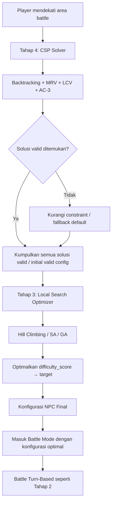
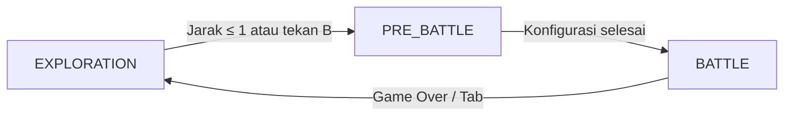

# 📋 Plan Implementasi Tahap 3 & 4 — Bakekok Game AI

> **Proyek**: Bakekok (Tugas Besar Kecerdasan Buatan — Kelompok 7)  
> **Tanggal**: Oktober 2026  
> **Tujuan**: Mengintegrasikan materi **Local Search & Optimization** (Tahap 3) dan **Constraint Satisfaction Problem** (Tahap 4) ke dalam game yang sudah ada.

---

## 1. Kondisi Proyek Saat Ini (Baseline)

### 1.1 Fitur yang Sudah Ada ✅

Proyek Bakekok saat ini sudah memiliki **2 tahap** yang berfungsi penuh:

| Tahap | Fitur | File Utama |
|---|---|---|
| **Tahap 1** — Pathfinding | UCS, A* (Manhattan/Euclidean/Chebyshev), Grid weighted terrain, visualisasi jalur | [search.py](file:///c:/Users/Pavilion/Documents/DOKUMEN%20TUGAS/Kuliah/Tubes_ai_kel7/Fix_nya/Game-AI/game/search.py), [npc.py](file:///c:/Users/Pavilion/Documents/DOKUMEN%20TUGAS/Kuliah/Tubes_ai_kel7/Fix_nya/Game-AI/game/npc.py), [mapdata.py](file:///c:/Users/Pavilion/Documents/DOKUMEN%20TUGAS/Kuliah/Tubes_ai_kel7/Fix_nya/Game-AI/game/mapdata.py) |
| **Tahap 2** — Adversarial Search | Minimax, Alpha-Beta Pruning, Expectimax, 3 Evaluation Functions, Move Ordering, Decision Tree Overlay | [battle_ai.py](file:///c:/Users/Pavilion/Documents/DOKUMEN%20TUGAS/Kuliah/Tubes_ai_kel7/Fix_nya/Game-AI/game/battle_ai.py), [battle_system.py](file:///c:/Users/Pavilion/Documents/DOKUMEN%20TUGAS/Kuliah/Tubes_ai_kel7/Fix_nya/Game-AI/game/battle_system.py), [tree_overlay.py](file:///c:/Users/Pavilion/Documents/DOKUMEN%20TUGAS/Kuliah/Tubes_ai_kel7/Fix_nya/Game-AI/game/tree_overlay.py) |

### 1.2 Arsitektur Kode Saat Ini

```
Game-AI/
├── main.py                  # Entry point
├── game/
│   ├── app.py               # Main loop, Camera, Event handling, Render
│   ├── battle_ai.py         # BattleState, BattleAISolver (Minimax/AB/Expectimax)
│   ├── battle_system.py     # BattleSystem (turn manager, damage calc, logs)
│   ├── config.py            # Konstanta global
│   ├── events.py            # Event dispatcher
│   ├── mapdata.py           # Map parser, terrain costs
│   ├── npc.py               # NPC entity (pathfinding chase)
│   ├── overlay.py           # Debug sidebar panel
│   ├── player.py            # Player entity
│   ├── search.py            # UCS & A* pathfinding engine
│   ├── tree_overlay.py      # Decision tree visualization
│   └── animation.py         # Sprite animation
├── assets/                  # Spritesheet karakter
└── data/map_tubes.json      # Metadata peta
```

### 1.3 Sistem Battle Saat Ini (Penting untuk dipahami)

Saat ini, battle selalu **1 vs 1** (Player Bolu vs NPC Kucing Oyen) dengan stat tetap:
- HP: 100, Potion: 2, 4 aksi (Attack/Heavy/Defend/Potion)
- NPC menggunakan Adversarial Search (Minimax/Alpha-Beta/Expectimax) untuk memilih aksi
- Konfigurasi stat **tidak bisa diubah** dan **hardcoded**

> [!IMPORTANT]
> Semua fitur di atas **WAJIB dipertahankan** tanpa perubahan. Tahap 3 & 4 menambahkan layer baru di atas fondasi ini.

---

## 2. Analisis Kebutuhan Tahap 3 & 4

### 2.1 Tahap 3: Local Search — Konfigurasi NPC Sebelum Menyerang

**Ketentuan dari materi** ([05_Local_Search_and_Optimization.md](file:///c:/Users/Pavilion/Documents/DOKUMEN%20TUGAS/Kuliah/Tubes_ai_kel7/Fix_nya/Game-AI/05_Local_Search_and_Optimization.md)):

- **Masalah**: Konfigurasi NPC sebelum menyerang player
- **Variabel konfigurasi**:
  - Jumlah dan karakter NPC penyerang (formasi tim NPC)
  - Konfigurasi item yang digunakan NPC (loadout: jumlah potion, damage bonus, dll.)
- **Goal**: Tingkat kesulitan seimbang — tidak terlalu gampang (player bosan) dan tidak terlalu sulit (player frustasi)
- **Teknik**: Hill Climbing, Simulated Annealing, dan/atau Genetic Algorithm

### 2.2 Tahap 4: CSP + Local Search — Konfigurasi dengan Constraint

**Ketentuan dari materi** ([06_Constraint_Satisfaction_Problem.md](file:///c:/Users/Pavilion/Documents/DOKUMEN%20TUGAS/Kuliah/Tubes_ai_kel7/Fix_nya/Game-AI/06_Constraint_Satisfaction_Problem.md)):

- Gabungan **Local Search (Tahap 3)** + **CSP** (Backtracking dengan MRV, LCV, AC-3)
- CSP meng-enforce constraint agar konfigurasi NPC valid dan fair
- Local Search mengoptimalkan konfigurasi agar difficulty score mendekati target

---

## 3. Desain Solusi: "NPC Squad Configurator"

### 3.1 Konsep Utama

Sebelum battle dimulai, sistem akan **secara otomatis mengonfigurasi tim NPC** yang akan melawan player. Alih-alih selalu 1 NPC dengan stat identik, sistem akan:

1. **CSP (Tahap 4)** menentukan konfigurasi yang **valid** (memenuhi semua constraint)
2. **Local Search (Tahap 3)** mengoptimalkan konfigurasi agar **difficulty score** mendekati zona "fun" (tidak terlalu mudah, tidak terlalu sulit)

### 3.2 Formulasi CSP

#### Variables (X)

| Variabel | Deskripsi | Per NPC |
|---|---|---|
| `npc_count` | Jumlah NPC penyerang | Global (1–3) |
| `char_type[i]` | Tipe karakter NPC ke-i | ✅ |
| `hp[i]` | HP awal NPC ke-i | ✅ |
| `potions[i]` | Jumlah potion NPC ke-i | ✅ |
| `atk_bonus[i]` | Bonus damage NPC ke-i | ✅ |
| `def_bonus[i]` | Bonus defense NPC ke-i | ✅ |
| `eval_profile[i]` | Profil evaluasi AI NPC ke-i | ✅ |

#### Domains (D)

| Variabel | Domain |
|---|---|
| `npc_count` | {1, 2, 3} |
| `char_type[i]` | {"warrior", "tank", "assassin"} |
| `hp[i]` | {60, 70, 80, 90, 100, 110, 120} |
| `potions[i]` | {0, 1, 2, 3} |
| `atk_bonus[i]` | {0, 5, 10, 15} |
| `def_bonus[i]` | {0.0, 0.10, 0.20, 0.30} |
| `eval_profile[i]` | {"BALANCED", "AGGRESSIVE", "DEFENSIVE"} |

#### Constraints (C)

| ID | Constraint | Tipe | Penjelasan |
|---|---|---|---|
| C1 | `∑ hp[i] ≤ budget_hp` | Global | Total HP tim NPC dibatasi budget (misal: 250) agar tidak terlalu kuat |
| C2 | `∑ potions[i] ≤ budget_pot` | Global | Total potion tim dibatasi (misal: 5) |
| C3 | `if char_type[i] == "tank" → hp[i] ≥ 90` | Unary | Tank harus punya HP tinggi |
| C4 | `if char_type[i] == "assassin" → atk_bonus[i] ≥ 10` | Unary | Assassin harus punya bonus serangan |
| C5 | `if npc_count ≥ 2 → char_type[i] ≠ char_type[j]` | Binary | Tidak boleh ada 2 NPC dengan tipe yang sama (variasi) |
| C6 | `if char_type[i] == "warrior" → eval_profile[i] ∈ {"BALANCED", "AGGRESSIVE"}` | Unary | Warrior tidak boleh terlalu defensif |
| C7 | `if char_type[i] == "tank" → eval_profile[i] ∈ {"BALANCED", "DEFENSIVE"}` | Unary | Tank tidak boleh terlalu agresif |
| C8 | `∑ atk_bonus[i] ≤ budget_atk` | Global | Total bonus serangan dibatasi |

### 3.3 Formulasi Local Search (Objective Function)

**Objective Function**: Meminimalkan jarak antara estimated difficulty score dan target difficulty.

```
difficulty_score(config) = w1 * normalized_total_hp(config)
                         + w2 * normalized_total_potions(config)
                         + w3 * normalized_total_atk_bonus(config)
                         + w4 * normalized_def_bonus(config)
                         + w5 * npc_count_factor(config)
                         + w6 * aggression_factor(config)

target_difficulty = 0.55   # zona "fun" (skala 0.0 - 1.0)

fitness(config) = -|difficulty_score(config) - target_difficulty|
```

> **Semakin tinggi fitness** → konfigurasi semakin mendekati tingkat kesulitan ideal.

#### Metode Local Search yang Diimplementasikan

| Metode | Penjelasan | Kapan Cocok |
|---|---|---|
| **Hill Climbing** | Cari neighbour terbaik, pindah jika lebih baik | Baseline, cepat |
| **Hill Climbing + Sideways Move** | Izinkan pindah ke neighbour dengan skor sama | Mengatasi plateau |
| **Hill Climbing + Random Restart** | Restart dari random jika terjebak | Banyak local optima |
| **Simulated Annealing** | Kadang terima langkah lebih buruk (prob. e^(ΔE/T)) | Landscape kompleks |
| **Genetic Algorithm** | Populasi + crossover + mutasi | Ruang pencarian sangat besar |

#### Neighbour Function

Dari konfigurasi saat ini, **satu variabel** diubah ke nilai domain lain yang tetap memenuhi semua constraint CSP:
- Ubah HP satu NPC (±10 atau ±20)
- Ubah jumlah potion satu NPC (±1)
- Ubah bonus attack/defense satu NPC
- Tambah/kurangi jumlah NPC (±1)
- Ganti char_type satu NPC
- Ganti eval_profile satu NPC

### 3.4 Alur Gabungan CSP + Local Search (Tahap 4)



**Penjelasan alur**:
1. **CSP (Backtracking + MRV + LCV + AC-3)** menemukan konfigurasi NPC yang **valid** (memenuhi semua constraint)
2. **Local Search** mengambil konfigurasi valid tersebut sebagai **initial state**, lalu mengoptimalkan agar difficulty score mendekati target
3. Setiap langkah Local Search yang menghasilkan neighbour, **di-validate ulang oleh CSP** agar tetap konsisten
4. Konfigurasi final digunakan untuk memulai battle

---

## 4. Perubahan Arsitektur & File Baru

### 4.1 File Baru yang Akan Dibuat

| File | Deskripsi |
|---|---|
| `game/npc_config_csp.py` | **CSP Solver** — Definisi variabel, domain, constraint, Backtracking + MRV + LCV + AC-3 untuk konfigurasi NPC |
| `game/npc_config_optimizer.py` | **Local Search Optimizer** — Hill Climbing, Sideways Move, Random Restart, Simulated Annealing, Genetic Algorithm untuk optimasi difficulty |
| `game/npc_squad.py` | **NPC Squad Manager** — Mengelola tim NPC (multiple NPC dengan stat berbeda), integrasi dengan battle system |
| `game/difficulty.py` | **Difficulty Evaluator** — Fungsi objektif difficulty score, normalisasi, target difficulty, weight tuning |

### 4.2 File yang Dimodifikasi (Tanpa Menghilangkan Fitur Lama)

| File | Perubahan |
|---|---|
| [battle_ai.py](file:///c:/Users/Pavilion/Documents/DOKUMEN%20TUGAS/Kuliah/Tubes_ai_kel7/Fix_nya/Game-AI/game/battle_ai.py) | Tambahkan parameter stat variabel pada `BattleState` (HP awal, atk_bonus, def_bonus) agar mendukung NPC dengan stat berbeda. **Semua kode lama tetap ada**, hanya ditambahkan parameter opsional |
| [battle_system.py](file:///c:/Users/Pavilion/Documents/DOKUMEN%20TUGAS/Kuliah/Tubes_ai_kel7/Fix_nya/Game-AI/game/battle_system.py) | Tambahkan method `reset_with_config(config)` untuk reset battle dengan konfigurasi NPC yang dioptimasi. Method `reset()` lama **tidak diubah** (backward compatible) |
| [app.py](file:///c:/Users/Pavilion/Documents/DOKUMEN%20TUGAS/Kuliah/Tubes_ai_kel7/Fix_nya/Game-AI/game/app.py) | Tambahkan state `"PRE_BATTLE"` antara EXPLORATION dan BATTLE — menampilkan UI konfigurasi NPC yang sedang dioptimasi. Tambahkan render arena untuk multi-NPC. **Semua kode exploration & battle lama tidak diubah** |
| [overlay.py](file:///c:/Users/Pavilion/Documents/DOKUMEN%20TUGAS/Kuliah/Tubes_ai_kel7/Fix_nya/Game-AI/game/overlay.py) | Tambahkan panel baru untuk menampilkan: (a) parameter CSP & constraint, (b) progress Local Search (iterasi, fitness, temperature/SA), (c) konfigurasi NPC final. **Panel lama (pathfinding & battle debug) tidak diubah** |
| [config.py](file:///c:/Users/Pavilion/Documents/DOKUMEN%20TUGAS/Kuliah/Tubes_ai_kel7/Fix_nya/Game-AI/game/config.py) | Tambahkan konstanta baru: budget HP/potion/atk, weight difficulty function, parameter SA (T0, cooling), parameter GA (pop_size, mutation_rate) |

### 4.3 Arsitektur Setelah Implementasi

```
Game-AI/
├── main.py
├── game/
│   ├── app.py                    # + state PRE_BATTLE, multi-NPC arena render
│   ├── battle_ai.py              # + parameter stat variabel (backward compatible)
│   ├── battle_system.py          # + reset_with_config() method
│   ├── config.py                 # + konstanta Tahap 3 & 4
│   ├── difficulty.py             # 🆕 Difficulty evaluator & objective function
│   ├── npc_config_csp.py         # 🆕 CSP Solver (Backtracking + MRV + LCV + AC-3)
│   ├── npc_config_optimizer.py   # 🆕 Local Search (HC/SA/GA)
│   ├── npc_squad.py              # 🆕 NPC Squad Manager (multi-NPC)
│   ├── events.py
│   ├── mapdata.py
│   ├── npc.py                    # Tidak diubah
│   ├── overlay.py                # + panel CSP & Local Search stats
│   ├── player.py                 # Tidak diubah
│   ├── search.py                 # Tidak diubah
│   ├── tree_overlay.py           # Tidak diubah
│   └── animation.py              # Tidak diubah
├── assets/
└── data/map_tubes.json
```

---

## 5. Detail Implementasi Per Modul

### 5.1 `game/npc_config_csp.py` — CSP Solver

```python
# Struktur utama:

class NPCConfigCSP:
    """CSP Solver untuk konfigurasi NPC sebelum battle."""
    
    # Variables: npc_count, char_type[], hp[], potions[], atk_bonus[], def_bonus[], eval_profile[]
    # Domains: didefinisikan per variabel
    # Constraints: C1-C8 (lihat Bagian 3.2)
    
    def backtrack(assignment, domains):
        """Backtracking search dengan MRV + LCV + AC-3."""
    
    def select_variable_mrv(assignment, domains):
        """MRV: pilih variabel dengan legal values tersisa paling sedikit."""
    
    def order_values_lcv(var, assignment, domains):
        """LCV: urutkan value yang paling sedikit menghilangkan opsi tetangga."""
    
    def ac3(domains, constraints):
        """AC-3: propagasi arc consistency ke seluruh constraint graph."""
    
    def revise(xi, xj, domains):
        """Hapus value dari domain Xi yang tidak punya support di Xj."""
    
    def is_consistent(var, value, assignment):
        """Cek apakah assignment value ke var konsisten dengan constraint."""
    
    def solve():
        """Mengembalikan satu atau beberapa konfigurasi valid."""
    
    def solve_all(limit=50):
        """Mengembalikan hingga `limit` konfigurasi valid untuk Local Search."""
```

#### Implementasi AC-3

```
AC-3(csp):
    queue ← semua arcs (constraint binary dua arah)
    while queue is not empty:
        (Xi, Xj) ← pop dari queue
        if REVISE(Xi, Xj):
            if D(Xi) is empty: return failure
            for each Xk ∈ neighbors(Xi) - {Xj}:
                add (Xk, Xi) to queue
    return success
```

#### Implementasi MRV + Degree Tie-Breaker

```
SELECT-VARIABLE(assignment, domains):
    unassigned ← variabel yang belum di-assign
    return argmin(len(legal_values(var, domains)) for var in unassigned)
    # Tie-breaker: pilih var dengan degree (jumlah constraint ke unassigned vars) terbanyak
```

### 5.2 `game/npc_config_optimizer.py` — Local Search Optimizer

```python
class NPCConfigOptimizer:
    """Local Search optimizer untuk konfigurasi NPC."""
    
    def __init__(self, csp_solver, difficulty_evaluator):
        self.csp = csp_solver
        self.evaluator = difficulty_evaluator
    
    # --- Hill Climbing ---
    def hill_climbing(initial_config, max_steps=200):
        """Steepest-ascent hill climbing."""
    
    def hill_climbing_sideways(initial_config, max_sideways=100):
        """Hill climbing dengan sideways moves."""
    
    def hill_climbing_random_restart(n_restarts=10):
        """Random restart hill climbing."""
    
    # --- Simulated Annealing ---
    def simulated_annealing(initial_config, T0=1.0, cooling=0.995, min_temp=0.001):
        """Simulated Annealing dengan cooling schedule."""
    
    # --- Genetic Algorithm ---
    def genetic_algorithm(pop_size=20, generations=50, mutation_rate=0.1):
        """GA dengan crossover dan mutasi pada konfigurasi NPC."""
    
    # --- Helper ---
    def get_neighbors(config):
        """Generate semua neighbour valid (validated by CSP)."""
    
    def random_valid_config():
        """Generate konfigurasi random yang valid via CSP."""
    
    # --- Logging & Stats ---
    def get_optimization_trace():
        """Mengembalikan history fitness score per iterasi untuk visualisasi."""
```

#### Encoding Genetic Algorithm

Kromosom = vektor konfigurasi NPC:
```
[npc_count, char_type_1, hp_1, pot_1, atk_1, def_1, eval_1, char_type_2, hp_2, ...]
```

- **Crossover**: Single-point crossover per NPC boundary (substring bermakna karena setiap NPC adalah unit independen)
- **Mutasi**: Ubah satu gen (variabel) ke nilai domain lain
- **Selection**: Tournament selection (size 3)
- **Validasi**: Setiap offspring di-validasi oleh CSP; jika tidak valid, dilakukan repair atau regenerasi

### 5.3 `game/difficulty.py` — Difficulty Evaluator

```python
class DifficultyEvaluator:
    """Menghitung difficulty score konfigurasi NPC."""
    
    TARGET_DIFFICULTY = 0.55  # Zona "fun" (0.0 = sangat mudah, 1.0 = sangat sulit)
    
    # Bobot per komponen
    WEIGHTS = {
        "total_hp": 0.25,
        "total_potions": 0.15,
        "total_atk_bonus": 0.20,
        "total_def_bonus": 0.10,
        "npc_count": 0.15,
        "aggression": 0.15,
    }
    
    def difficulty_score(config) -> float:
        """Hitung skor kesulitan (0.0 - 1.0)."""
    
    def fitness(config) -> float:
        """fitness = -|difficulty_score - target|, semakin tinggi semakin baik."""
    
    def classify_difficulty(score) -> str:
        """Klasifikasi: 'Terlalu Mudah', 'Mudah', 'Seimbang', 'Sulit', 'Terlalu Sulit'."""
```

### 5.4 `game/npc_squad.py` — NPC Squad Manager

```python
class NPCSquadMember:
    """Satu anggota tim NPC dengan stat yang bisa dikustomisasi."""
    
    def __init__(self, char_type, hp, potions, atk_bonus, def_bonus, eval_profile):
        # ...

class NPCSquad:
    """Mengelola tim NPC (1-3 anggota) untuk battle."""
    
    members: List[NPCSquadMember]
    
    def from_config(config_dict):
        """Buat squad dari hasil CSP + Local Search."""
    
    def get_active_member():
        """NPC yang sedang bertarung (tag-team: jika satu kalah, giliran NPC berikutnya)."""
    
    def is_all_defeated():
        """True jika semua anggota tim HP <= 0."""
```

---

## 6. Perubahan UI & Game Flow

### 6.1 Game State Baru: PRE_BATTLE



**PRE_BATTLE Screen** menampilkan:
1. Animasi "Menyiapkan Lawan..." dengan progress bar
2. Panel CSP: menampilkan variabel, domain, constraint yang sedang diproses
3. Panel Local Search: fitness score per iterasi (mini chart/progress), metode yang digunakan
4. Hasil akhir: kartu-kartu NPC yang akan dilawan (tipe, HP, potion, bonus, profil AI)
5. Tombol **"Mulai Battle!"** atau auto-start setelah 2 detik
6. Tombol **switch metode** Local Search (HC / SA / GA) di debug panel

### 6.2 Perubahan Battle Arena (Multi-NPC)

- Jika 1 NPC: layout arena **sama persis** dengan saat ini
- Jika 2-3 NPC: tampilkan NPC aktif di tengah, NPC lain (menunggu/kalah) di sisi sebagai thumbnail kecil
- Sistem **tag-team**: jika NPC aktif kalah, NPC berikutnya maju (sequential, bukan simultaneous)
- HP bar menampilkan **semua NPC** (aktif = besar, menunggu = kecil di bawah)

### 6.3 Perubahan Debug Overlay Panel

Di mode PRE_BATTLE dan BATTLE, panel debug (sidebar kiri) mendapatkan **tab/section baru**:

| Section | Konten |
|---|---|
| **CSP Config** | Daftar variabel + domain saat ini, constraint yang aktif, jumlah solusi valid ditemukan, statistik (nodes explored, backtracks, arc revisions) |
| **Local Search** | Metode yang digunakan (HC/SA/GA), iterasi saat ini, fitness score, temperature (SA), generation (GA), history fitness (mini sparkline) |
| **NPC Squad** | Kartu visual setiap NPC: tipe, HP, potion, bonus atk/def, profil AI, difficulty class |
| **Difficulty** | Skor difficulty akhir, klasifikasi (Mudah/Seimbang/Sulit), target vs actual |

---

## 7. Fitur yang DIPERTAHANKAN (Tidak Berubah)

> [!CAUTION]
> Fitur berikut **WAJIB tetap berfungsi** tanpa perubahan perilaku:

- ✅ Mode Eksplorasi: pergerakan Player WASD, NPC chase, pathfinding UCS/A*
- ✅ Visualisasi pathfinding (expanded nodes, jalur optimal, overlay warna)
- ✅ Pemicu duel proximity (jarak Manhattan ≤ 1) dan tombol `[B]`
- ✅ Semua mekanisme battle turn-based: 4 aksi, damage calc, cooldown, potion
- ✅ Adversarial Search: Minimax, Alpha-Beta, Expectimax — semua tetap bisa dipilih
- ✅ 3 Evaluation Functions: Balanced, Aggressive, Defensive
- ✅ 3 Move Ordering Modes: OFF, HEURISTIC, REVERSED
- ✅ Decision Tree Overlay (visualisasi pohon keputusan, panning, scrolling)
- ✅ Debug Panel sidebar (pathfinding stats, battle AI stats)
- ✅ Battle Log scrollable
- ✅ Kamera zoom, NPC offscreen indicator, call bubble "Bolu!!"
- ✅ Benchmark scripts (`scratch/run_experiments.py`, `scratch/test_depth.py`)

---

## 8. Tahapan Implementasi (Urutan Kerja)

### Phase 0: Pre-Requisites & Fondasi Sistem (Pencegahan Masalah) ✅ SELESAI
1. [x] **Penyiapan Stat Buff di `BattleState` (`game/battle_ai.py`):**
   - Tambahkan atribut `player_atk_bonus=0`, `npc_atk_bonus=0`, `player_def_bonus=0`, `npc_def_bonus=0` dengan nilai default ke dalam `__slots__` agar kompatibel 100% dan tidak merusak Minimax saat ada item.
2. [x] **Optimasi Struktur Data CSP & Local Search:**
   - Gunakan representasi data berbasis tuple/dict ringan (tanpa `copy.deepcopy()` berulang di loop) agar waktu pencarian dijamin **< 5 milidetik (bebas lag/stutter)** saat masuk Pre-Battle.
3. [x] **Logika Pergantian Tag-Team di `BattleSystem`:**
   - Siapkan metode transisi `squad.has_next()` agar duel tidak langsung selesai saat NPC pertama gugur.
4. [x] **Logika Jarak Interaksi Peti (`MapData`):**
   - Siapkan fungsi deteksi proximity ubin (jarak Manhattan $\le 1$) untuk membuka peti interaktif tanpa terhambat status rintangan (*obstacle*).

### Phase 1: Foundation (Core CSP & Difficulty) ✅ SELESAI
1. [x] Buat `game/difficulty.py` — fungsi evaluasi kesulitan & breakdown bobot normalisasi
2. [x] Buat `game/npc_config_csp.py` — CSP solver lengkap (Backtracking + MRV + LCV + AC-3)
3. [x] Buat unit test `scratch/test_csp.py` untuk validasi constraint C1-C8

### Phase 2: Local Search Optimizer ✅ SELESAI
4. [x] Buat `game/npc_config_optimizer.py` — 5 algoritma Local Search (HC, Sideways, Random Restart, SA, GA)
5. [x] Hubungkan CSP sebagai validator untuk setiap neighbour/offspring
6. [x] Buat unit test `scratch/test_optimizer.py` — pastikan optimasi mendekati target 0.55 ("Fun Zone")

### Phase 3: Game Integration ✅ SELESAI
7. [x] Buat `game/npc_squad.py` — manager tim NPC & rotasi Tag-Team
8. [x] Modifikasi `battle_ai.py` — kompatibilitas stat buff tanpa regresi
9. [x] Modifikasi `battle_system.py` — `reset_with_squad()` dan `on_action_callback`
10. [x] Modifikasi `app.py` — state machine PRE_BATTLE, 3 NPC map, peti gacha, persistent player

### Phase 4: UI & Overlay ✅ SELESAI
11. [x] Modifikasi `overlay.py` — panel grid ber-tile dengan clipping mask (0% text overflow)
12. [x] Implementasi PRE_BATTLE screen (pratinjau squad, re-roll R, ganti algo 1-5, mulai battle)
13. [x] Implementasi multi-NPC arena rendering (lencana antrean bench cadangan)
14. [x] Implementasi Fullscreen Semi-Transparent Decision Tree Modal Overlay (`[T]`)

### Phase 5: Polish, Benchmark & Battle VFX ✅ SELESAI
15. [x] Buat modul animasi prosedural `game/battle_vfx.py` (Tweening pedang meluncur/berputar, pulsing perisai, pouring ramuan, hit shake)
16. [x] Hubungkan `BattleVFXManager` ke action callback `BattleSystem` dan rendering battle arena di `app.py`
17. [x] Buat script benchmark baru `scratch/run_tahap3_experiments.py` (CSP performance, 5 Local Search benchmark, dynamic adaptive balancing)
18. [x] Update `README.md` dengan dokumentasi lengkap Tahap 3 & 4
19. [x] Testing end-to-end menyeluruh via `scratch/test_app_integration.py` (100% test lulus tanpa regresi)


---

## 9. Contoh Skenario Gameplay Baru

### Skenario: Player Mendekati NPC

1. Player berjalan mendekati NPC di peta (jarak Manhattan ≤ 1)
2. Masuk **PRE_BATTLE**: layar menampilkan "Menyiapkan Tim Lawan..."
3. CSP solver berjalan:
   - Variabel: 3 NPC, masing-masing dengan char_type, HP, potions, atk_bonus, def_bonus, eval_profile
   - MRV memilih variabel paling terbatas lebih dulu
   - AC-3 mempropagasi constraint → menghilangkan nilai domain yang tidak konsisten
   - Ditemukan 12 konfigurasi valid
4. Local Search (Simulated Annealing) berjalan:
   - Initial config: konfigurasi valid acak dari CSP
   - T0 = 1.0, cooling = 0.995
   - Iterasi 200, fitness konvergen ke -0.02 (mendekati target 0.55)
5. Konfigurasi final:
   - NPC 1: Warrior, HP=90, Pot=2, Atk+10, Def+0%, AI=Aggressive
   - NPC 2: Tank, HP=100, Pot=1, Atk+0, Def+20%, AI=Defensive
   - Difficulty Score: 0.53 → "Seimbang ✅"
6. Battle dimulai: Player vs NPC 1 (Warrior) dahulu
7. Jika NPC 1 kalah → NPC 2 (Tank) maju (tag-team)
8. Player menang jika semua NPC kalah

---

## 10. Ringkasan Teknik AI yang Diimplementasikan

| Tahap | Teknik AI | Penggunaan dalam Game |
|---|---|---|
| **Tahap 1** | UCS, A* (Manhattan/Euclidean/Chebyshev) | Pathfinding NPC di peta grid |
| **Tahap 2** | Minimax, Alpha-Beta Pruning, Expectimax | Keputusan aksi NPC di battle turn-based |
| **Tahap 3** | Hill Climbing, Sideways Move, Random Restart, Simulated Annealing, Genetic Algorithm | Optimasi konfigurasi tim NPC (difficulty balancing) |
| **Tahap 4** | Backtracking + MRV + LCV + AC-3 (CSP) | Validasi constraint konfigurasi NPC (memastikan fair & valid) |

---

> [!TIP]
> Plan ini dirancang agar **setiap phase bisa diuji secara independen**. Phase 1-2 bisa dijalankan tanpa mengubah game sama sekali (pure algorithmic). Phase 3-4 mengintegrasikan ke game. Phase 5 memoles UI dan dokumentasi.

---

## 11. Ringkasan Sederhana Alur Game & Letak Implementasi AI

### 11.1 Alur Bermain Game Secara Simpel (Gameplay Loop)

Secara garis besar, alur permainan nantinya terbagi menjadi 5 langkah runtut:

```
[1. Eksplorasi Peta] ──(NPC tabrak Player)──> [2. Pre-Battle: CSP & Local Search]
                                                           │
                                                           ▼
[4. Hasil & Kembali] <──(Selesai Battle)─── [3. Battle Turn-Based: Minimax]
```

1. **Eksplorasi (Peta Grid)**
   - Player berjalan di map menggunakan keyboard.
   - NPC berkeliaran/mengejar player di map menggunakan algoritma **Tahap 1 (A* / UCS)**.

2. **Pre-Battle (Persiapan Sebelum Menyerang - Tahap 3 & 4)**
   - Saat NPC berhasil menyentuh Player, game **tidak langsung masuk ke pertarungan acak**.
   - Sistem AI di balik layar (hitungan milidetik) menyusun konfigurasi musuh yang adil dan pas:
     - **CSP** menyaring kombinasi agar mematuhi aturan/batasan (*valid & fair rules*).
     - **Local Search** memilih kombinasi terbaik agar tingkat kesulitannya seimbang (*balanced difficulty* — tidak bikin bosan, tidak bikin frustasi).
   - Tampil layar pratinjau musuh (*Pre-Battle Overlay*) yang memperlihatkan squad NPC penyerang dan item yang dibawanya.

3. **Pertarungan Turn-Based (Battle Arena - Tahap 2)**
   - Player bertarung melawan squad NPC hasil racikan Pre-Battle secara berurutan (*Tag-Team*).
   - Setiap giliran NPC bertindak, langkah serang/potion-nya diputuskan oleh algoritma **Adversarial Search (Minimax / Alpha-Beta / Expectimax)**.

4. **Selesai Pertarungan & Kembali ke Map**
   - Jika Player menang: Kembali ke mode eksplorasi, NPC yang dikalahkan menghilang dari peta.
   - Jika Player kalah: Tampil layar Game Over / respawn.

---

### 11.2 Di Mana Letak Implementasi Local Search dan CSP?

Keduanya bekerja bersamaan pada **Fase Pre-Battle (Sebelum Menyerang)** di dalam modul baru:

| AI Teknik | Letak / Waktu Eksekusi | Peran & Tugas Spesifik | Mengapa Diperlukan? |
|---|---|---|---|
| **CSP**<br>*(Constraint Satisfaction Problem)* | Tepat saat transisi dari Eksplorasi ke Battle (Modul `npc_config_csp.py`) | **Penyaring Aturan & Pengecek Batasan (Rule Enforcer):**<br>Memastikan squad NPC valid secara logika game, seperti: total budget HP wajar, batas maksimal potion, kombinasi job tidak curang, dan role-nya konsisten.<br>*(Menggunakan Backtracking + MRV + LCV + AC-3)* | Mencegah game men-generate komposisi yang mustahil, glitch, atau curang (misal NPC punya 99 potion atau HP tak terbatas). |
| **Local Search**<br>*(Optimization)* | Berjalan berdampingan dengan CSP di Pre-Battle (Modul `npc_config_optimizer.py`) | **Penyeimbang Tingkat Kesulitan (Difficulty Balancer):**<br>Mengevaluasi state squad NPC dan mencari nilai optimum ke arah *Target Fun Zone* (~0.55). Menentukan jumlah NPC (1-3), tipe kelas, dan item yang dibawa agar pas dengan kondisi player saat itu.<br>*(Menggunakan Hill Climbing, Simulated Annealing, atau Genetic Algorithm)* | Menjamin game tidak terlalu mudah (bikin bosan) dan tidak terlalu sulit (bikin frustasi). |

#### Hubungan Kerja CSP + Local Search:
```
[Kondisi Player Saat Ini: HP, Potion, dll.]
                   │
                   ▼
       [ CSP: Backtracking + AC-3 ]  ──>  Menghasilkan kandidat squad yang VALID & ADIL
                   │
                   ▼
  [ Local Search: Hill Climbing / SA / GA ] ──>  Mencari konfigurasi dengan DIFFICULTY TERBAIK (~0.55)
                   │
                   ▼
         [ Squad NPC Siap Menyerang Masuk Arena Battle ]
```

---

## 12. Kebutuhan Aset Gambar & Prompt Generator (Untuk Digenerate Nanti)

Berikut adalah daftar aset gambar yang akan digenerate saat tahap implementasi visual, lengkap dengan prompt untuk *image generator*:

### 12.1 Aset Item Konsumsi (Consumables) — `assets/items/`
Diletakkan di kartu profil squad NPC dan inventory pertarungan:

1. **`health_potion.png`**
   * **Fungsi:** Item restorasi HP standar (+30 HP) untuk NPC/Player.
   * **Prompt:** `A small glass potion bottle containing glowing red healing liquid, retro 16-bit pixel art RPG icon, clean outlines, vibrant fantasy game asset, isolated on black background, 1:1 aspect ratio.`

2. **`mega_potion.png`**
   * **Fungsi:** Item restorasi HP besar/penuh (+70 HP) untuk NPC tipe Tank/Boss.
   * **Prompt:** `An ornate golden flask potion bottle filled with glowing cyan elixir liquid, sparkles, retro 16-bit pixel art RPG icon, luxury potion asset, isolated on black background, 1:1 aspect ratio.`

### 12.2 Aset Item Equipment / Buff (Konfigurasi Item NPC) — `assets/items/`
Mempengaruhi kalkulasi fungsi objektif Local Search dan status pertarungan:

3. **`item_sword.png`** (Attack Buff)
   * **Fungsi:** Meningkatkan ATK bonus NPC (+Serangan fisik).
   * **Prompt:** `A sharp iron fantasy short sword with a leather grip, glowing metallic edge, 16-bit retro pixel art RPG item icon, game sprite asset, isolated on black background, 1:1 aspect ratio.`

4. **`item_shield.png`** (Defense Buff)
   * **Fungsi:** Memberikan DEF bonus NPC (Damage reduction).
   * **Prompt:** `A sturdy medieval wooden round shield with reinforced iron rim and cross boss, 16-bit retro pixel art RPG item icon, game sprite asset, isolated on black background, 1:1 aspect ratio.`

5. **`item_boots.png`** (Utility / Speed Buff)
   * **Fungsi:** Memberikan inisiatif giliran atau bonus kelincahan.
   * **Prompt:** `A pair of lightweight swift leather adventurer boots with tiny wings motif, glowing teal highlights, 16-bit retro pixel art RPG item icon, isolated on black background, 1:1 aspect ratio.`

### 12.3 Aset Portrait Avatar Karakter NPC — `assets/portraits/`
Ditampilkan pada kartu squad di **Pre-Battle Overlay**:

6. **`portrait_warrior.png`** (Kelas: Warrior)
   * **Fungsi:** Avatar kartu NPC bertipe Warrior (HP tebal, serangan kuat).
   * **Prompt:** `Front-facing portrait avatar of a brave cat warrior wearing a steel knight helmet and armor, determined expression, 16-bit pixel art style, RPG character portrait badge, isolated on black background, 1:1 aspect ratio.`

7. **`portrait_mage.png`** (Kelas: Mage)
   * **Fungsi:** Avatar kartu NPC bertipe Mage (Damage tinggi, HP tipis).
   * **Prompt:** `Front-facing portrait avatar of a mystical cat wizard wearing a pointed wizard hat with magical glowing purple eyes, 16-bit pixel art style, RPG character portrait badge, isolated on black background, 1:1 aspect ratio.`

8. **`portrait_ranger.png`** (Kelas: Ranger)
   * **Fungsi:** Avatar kartu NPC bertipe Ranger (Seimbang, gesit).
   * **Prompt:** `Front-facing portrait avatar of an agile cat rogue ranger wearing a green hooded cloak and leather eyepatch, 16-bit pixel art style, RPG character portrait badge, isolated on black background, 1:1 aspect ratio.`

9. **`portrait_assassin.png`** (Kelas: Assassin)
   * **Fungsi:** Avatar kartu NPC bertipe Assassin (Burst damage kritis tinggi, lincah mematikan).
   * **Prompt:** `Front-facing portrait avatar badge of a stealth cat ninja assassin named Kage, sleek dark charcoal fur, wearing a black shinobi cowl and dark face mask with striking glowing purple eyes, 16-bit pixel art style, RPG character portrait badge, centered, isolated on pure black background, 1:1 aspect ratio.`

> [!NOTE]
> Semua aset di atas akan digenerate ke format gambar resolusi persegi (1:1), kemudian di-convert dan disimpan dengan transparan background ke folder `assets/items/` dan `assets/portraits/` saat fase integrasi UI dimulai.

---

## 13. Mekanisme Gameplay Lanjutan: Player Inventory, Peti Gacha Acak, dan Persistent HP

Bagian ini melengkapi perancangan game agar ekosistem permainannya terasa hidup dan mendukung penuh adaptabilitas AI:

### 13.1 Sistem Persistent HP & Tas Inventory Player
- **Kondisi Berkelanjutan (Persistent HP):** 
  - Saat pertarungan selesai, sisa HP dan sisa Potion Player disimpan ke state pemain di mode eksplorasi (tidak langsung reset otomatis ke 100).
  - Jika Player mengalami pertarungan beruntun dalam kondisi terluka, AI (Local Search & CSP) membaca kondisi riil ini dan menyesuaikan tingkat kesulitan squad lawan berikutnya.
- **Inventory Player:**
  - Player memiliki tas bawaan:
    - Slot Potion: `health_potion` (+30 HP) dan `mega_potion` (+70 HP).
    - Slot Perlengkapan Aktif: `item_sword` (+ATK), `item_shield` (+DEF), `item_boots` (+Speed/Evasion).

### 13.2 Peti Harta Interaktif (Chest Loot) dengan Animasi Acak/Gacha di Map
- **Interaksi Map:**
  - Ubin Peti (*Chest*) di peta dapat didekati oleh Player. Saat berada di dekatnya, muncul petunjuk tombol interaksi (`[E] Buka Peti`).
- **Animasi Pop-up Gacha / Rolling Item:**
  - Saat dibuka, muncul overlay pop-up mini berupa animasi putaran/roulette item (*gacha roll*) berputar selama 1–1.5 detik sebelum berhenti pada satu item hadiah.
  - Efek visual kilauan (*sparkles*) menyertai perolehan item.
- **Dampak ke AI:**
  - Item yang didapatkan langsung masuk ke tas Player.
  - Perubahan kekuatan Player ini menjadi sinyal dinamis bagi Local Search pada pertarungan berikutnya.

### 13.3 Konsep NPC di Map: 1 Pengejar Utama + 2 Patroli Waypoint (Opsi B)
- **Komposisi 3 NPC di Peta (Palette Swap):**
  - **NPC 1 (Oyen - Oranye):** NPC Utama pengejar player (aset asli `assets/oyen/`).
  - **NPC 2 (Kuro - Hitam):** NPC Patroli wilayah utara/hutan (menggunakan palette swap / surface tinting).
  - **NPC 3 (Shiro - Abu-abu/Silver):** NPC Patroli wilayah timur/pemukiman (menggunakan palette swap / surface tinting).
- **Mekanisme Pengejaran Anti-Clash Visual (Opsi B):**
  - **Tombol `[SPASI]`:** Hanya memicu **1 NPC Utama (Oyen)** untuk mengejar Player.
  - **Alasan Desain:** Mencegah garis jalur (*path nodes*) dan ubin eksplorasi (*expanded nodes*) di Debug Overlay saling tumpang-tindih (*clashing*) jika banyak NPC mengejar bersamaan, sehingga metrik A*/UCS tetap bersih dan akurat.
- **Mekanisme Patroli Pos (Waypoint Patrol):**
  - 2 NPC lainnya (Kuro & Shiro) bergerak santai bolak-balik menyusuri titik pos koordinat ubin (Waypoint A ↔ B ↔ C) menggunakan algoritma **A*/UCS**.
- **Mekanisme Pemicu Duel (Encounter Leader):**
  - Jika **Oyen** berhasil menabrak Player saat mengejar, **ATAU** jika Player bertubrukan dengan salah satu NPC patroli saat eksplorasi, fase Pre-Battle langsung aktif.
  - NPC yang terlibat bertindak sebagai *Encounter Leader* yang memanggil bala bantuan **Squad (1-3 karakter)** hasil racikan CSP & Local Search!

### 13.4 Mode Simulator di Pre-Battle Overlay (Kemudahan Evaluasi Dosen)
- Pada Pre-Battle Overlay disediakan kontrol simulasi:
  - Slider/input manual kondisi Player (contoh: ubah HP Player ke 30 dan Potion ke 0).
  - Tombol **"Re-Optimize / Evaluasi Ulang"** untuk mendemokan respons adaptif AI secara instan di hadapan dosen/penguji tanpa perlu sengaja membuat Player terluka saat bermain.

### 13.5 Layout Arena Pertarungan: Tag-Team 1v1 Aktif + Antrean Cadangan Squad
- **Tampilan Arena Bersih & Terfokus:**
  - **Sisi Kiri:** Karakter Player (Bolu) beserta bar HP dan status item.
  - **Sisi Kanan Depan:** 1 NPC Aktif yang sedang bertarung (misal: Warrior).
  - **Pojok Kanan Atas:** Indikator antrean cadangan squad (badge mini avatar & bar HP kecil untuk NPC cadangan ke-2 dan ke-3 yang sedang menunggu giliran).
- **Mekanisme Tag-Team Turn-Based:**
  - Pertarungan berjalan 1v1 murni, menjaga validitas teori Minimax / Alpha-Beta (2-Player Zero-Sum Game).
  - Ketika NPC aktif kehabisan HP, NPC cadangan berikutnya otomatis melangkah maju ke arena (*"NPC Berikutnya Masuk!"*).
- **Profil Evaluasi Heuristik Dinamis Berdasarkan Kelas:**
  - AI menyesuaikan mode evaluasi secara otomatis terhadap kelas NPC aktif:
    - **Mage:** Evaluasi `AGGRESSIVE` (prioritas damage tinggi).
    - **Warrior:** Evaluasi `DEFENSIVE / BALANCED` (fokus bertahan & counter).
    - **Ranger:** Evaluasi `BALANCED` (seimbang & adaptif).

### 13.6 Full-Screen Modal Decision Tree Overlay (Semi-Transparan)
- **Eliminasi Kotak Sempit di Bawah Layar:**
  - Area bawah battle arena kini bersih dan lapang dari visualisasi pohon statis.
- **Tombol & Shortcut Pembuka:**
  - Disediakan tombol elegan di layar: `[🌲 Lihat Decision Tree]` serta shortcut keyboard `[T]`.
- **Tampilan Modal Layar Penuh (Pop-up):**
  - Saat dibuka, muncul overlay layar penuh dengan latar belakang gelap semi-transparan (opasitas ~85%).
  - Pertarungan di belakang tetap terlihat samar, sementara pohon pencarian Minimax digambar dengan ukuran **luas, besar, dan bebas overlap**.
  - Dilengkapi fitur navigasi geser (pan 2D), zoom, dan tombol `[✕ Tutup / ESC / T]` di pojok kanan atas untuk kembali ke arena pertempuran secara instan.

### 13.7 Desain Grid Kotak-Kotak (Dashboard Metric Tiles) pada Debug Overlay
- **Peningkatan Visual dari Teks Memanjang ke Sistem Kartu/Grid:**
  - Sidebar kiri dibagi menjadi kartu-kartu metrik terstruktur (grid 2 kolom untuk angka ringkas, kartu 1 kolom penuh untuk judul/status panjang).
- **Jaminan 100% Bebas Text Overflow:**
  - Pengukuran dimensi teks via `font.size(text)` sebelum digambar.
  - Teks panjang otomatis di-*wrap* atau di-elipsis secara rapi.
  - Pemasangan batas potong (*clipping mask*) via `surface.set_clip(card_rect)` sehingga mustahil ada pixel teks menembus batas kotak.
- **Konservasi Data 100% (Tidak Ada Metrik yang Dihapus):**
  - **Mode Eksplorasi:** Dropdown Algo, Node Dikunjungi, Panjang Jalur, Biaya Jalur, Waktu Eksekusi, Perbandingan vs UCS (Node, Cost, Waktu, Rasio Hemat), dan Panduan Kontrol tetap tampil lengkap.
  - **Mode Battle:** Dropdown Algo/Eval, Slider Depth, Move Ordering, Status Giliran, Tombol Aksi, Komparasi Metode, Pilihan Terbaik, Tabel Scoring Root Node, dan Shortcut Footer tetap tampil lengkap.

### 13.8 Sistem Animasi Battle VFX (Programmatic Tweening)
- **Prinsip Utama:**
  - Dikerjakan secara terisolasi pada tahap akhir setelah seluruh logika AI (CSP, Local Search, Tag-Team) dan UI utama dinyatakan aman dan stabil.
- **Pemanfaatan Aset VFX:**
  - **Aksi ATTACK & HEAVY ATTACK:** Sprite pedang meluncur cepat (`lerp` posisi), berputar (`pygame.transform.rotate`) ke arah target dengan efek getar (*hit shake*) saat mengenai musuh.
  - **Aksi DEFEND:** Sprite perisai muncul melayang di depan karakter dengan denyut pulsing glow.
  - **Aksi POTION:** Sprite ramuan muncul di atas kepala karakter, miring menuang, diiringi angka pemulihan hijau yang melayang ke atas (+25 HP).
  - **Hit Feedback:** Karakter penerima damage bergetar (*sprite shake offset*) saat terkena serangan.

### 13.9 Aset Visual Karakter Full-Body Battle Sprites (Selesai Diterapkan ✅)
- **Eliminasi "Bentuk Kartu Melayang" di Mode Duel:**
  - Sebelumnya, arena pertempuran merender avatar portrait kotak (112x112 px) yang tampak seperti kartu profil.
  - Telah di-*generate* dan diproses 5 aset **Full-Body Battle Sprites** (pixel-art 16-bit JRPG dengan background transparan bersih via BFS exterior edge flood-fill):
    1. **Bolu (Player):** Kucing putih pahlawan menghadap ke kanan, mengenakan bandana jubah merah, memegang pedang & perisai kayu (`assets/battle_sprites/battle_bolu.png`).
    2. **Oyen (Warrior):** Kucing oranye ksatria menghadap ke kiri, mengenakan zirah pelat perak lengkap, memegang pedang baja & tameng logam (`assets/battle_sprites/battle_warrior.png`).
    3. **Kuro (Ranger):** Kucing hitam rogue pemanah menghadap ke kiri, mengenakan jubah bertudung hijau hutan dan zirah kulit, memegang busur panah tempur (`assets/battle_sprites/battle_ranger.png`).
    4. **Shiro (Mage):** Kucing putih penyihir menghadap ke kiri, mengenakan jubah & topi penyihir biru malam berbintang emas, memegang tongkat kristal bercahaya (`assets/battle_sprites/battle_mage.png`).
    5. **Kage (Assassin):** Kucing ninja abu-gelap penyelinap menghadap ke kiri, mengenakan busana shinobi hitam & masker kain, mata ungu menyala, memegang belati kembar beracun (`assets/battle_sprites/battle_assassin.png`).
- **Integrasi Arena Duel & Pre-Battle:**
  - Di **Battle Arena**, kedua karakter berdiri berhadapan secara proporsional (tinggi ~135 px) dengan efek getar hit reaksi yang dinamis.
  - Di **Pre-Battle Arena**, kartu Bolu dan setiap kartu anggota squad musuh menampilkan miniatur siluet petarung penuh (*full-body character thumbnail*).
- **Perbaikan Ergonomi Battle Log:**
  - Kotak *Battle Log* diletakkan di bagian terbawah layar (`h - log_h - 14`) dengan tombol modal *Decision Tree* di atasnya, menghasilkan arena duel yang sangat luas, bersih, dan memanjakan mata.

### 13.10 Keseimbangan Gauntlet Duel, Second Wind, & Rampasan Perang (Spoils of War) (Selesai Diterapkan ✅)
- **Tantangan Permainan Gauntlet Squad:**
  - Menghadapi 2–3 NPC berturut-turut dalam satu pertempuran menghadirkan tantangan ketahanan sumber daya (*attrition*). Tanpa mekanisme pemulihan, pemain hampir dipastikan kehabisan HP dan ramuan saat menghadapi lawan kedua atau ketiga.
- **Mekanik 1: Second Wind (Pemulihan Ronde Tag-In):**
  - Setiap kali pemain berhasil menumbangkan 1 anggota squad NPC:
    - **HP Recovery:** Pulih sebesar **+45 HP** (dibatasi `max_hp`).
    - **Potion Refill:** Stok Potion terisi ulang **+1 botol** (maksimal 3).
    - **Cooldown Reset:** Cooldown *Heavy Attack* pemain di-reset menjadi **0 (Siap)**.
    - **Visual Feedback:** Notifikasi teks aksi zamrud melayang `SECOND WIND! (+45 HP, +1 Pot)` dan efek partikel ramuan hijau di atas Bolu.
- **Mekanik 2: Rampasan Perang (Spoils of War / Roguelike Boon):**
  - Pemain yang menumbangkan NPC berhak merebut perlengkapan musuh untuk meningkatkan stat tempur melawan petarung berikutnya:
    - **Warrior Tumbang:** Menjatuhkan *Pedang Ksatria Oyen* (**+4 ATK, +1 DEF**).
    - **Ranger Tumbang:** Menjatuhkan *Busur Presisi Kuro* (**+3 ATK, +1 Potion**).
    - **Assassin Tumbang:** Menjatuhkan *Belati Bayangan Kage* (**+5 ATK**).
    - **Mage Tumbang:** Menjatuhkan *Tongkat Sihir Shiro* (**+3 ATK, +2 DEF**).
  - **Tampilan UI:** Banner pop-up animasi elegan *“⚔️ RAMPASAN PERANG DIPEROLEH!”* berlatar gelap semi-transparan dengan border bercahaya sesuai warna kelas karakter.
  - **Proyeksi Real-Time:** Angka damage terproyeksi pada tombol aksi pemain (`Attack (X)`, `Heavy (Y)`) langsung meningkat secara instan di layar.
- **Kesesuaian Teoretis AI (CSP, Local Search, & Minimax):**
  - **Terhadap CSP (Tahap 4):** Sama sekali **tidak melanggar CSP**. Aturan constraint C1–C8 mengatur pembentukan legalitas squad lawan pada fase Pre-Battle. Peningkatan stat internal pemain tidak memodifikasi batasan validitas squad yang telah sah.
  - **Terhadap Local Search (Tahap 3):** Memperkuat **Dynamic Difficulty Adjustment (DDA)**. Stat ATK/DEF yang diraih pemain tersimpan secara persistent (`player.atk_bonus`, `player.def_bonus`). Pada pertempuran berikutnya di peta, modul `npc_config_optimizer.py` otomatis membaca stat pemain yang lebih tangguh melalui `player_context` dan mengadaptasikan target tingkat kesulitan squad baru yang seimbang.
  - **Terhadap Minimax & Alpha-Beta (Tahap 2):** Algoritma *game tree search* pada NPC ronde berikutnya otomatis mengevaluasi `player_atk_bonus` yang baru ke dalam fungsi evaluasi daun (*leaf evaluation*). Akibatnya, AI musuh ronde berikutnya bertindak lebih waspada (lebih responsif menangkis/meminum potion) terhadap peningkatan kekuatan pemain.

### 13.11 Modal Showcase Rampasan Perang Berlatar Gelap & Tag-In Terkendali (Selesai Diterapkan ✅)
- **Latar Belakang & Masalah User Experience:**
  - Sebelumnya, notifikasi rampasan perang hanya ditampilkan berupa banner mengambang kecil di bagian atas layar selama beberapa detik, sementara animasi kartu musuh berikutnya langsung meluncur. Pemain sering kali tidak sempat melihat senjata apa yang didapat dan berapa peningkatan stat yang diperoleh.
- **Implementasi Modal Dialog Berlatar Gelap (Dimmed Backdrop):**
  - **Layar Gelap Pekat (Dimmed Overlay):** Saat musuh tumbang, seluruh layar duel arena diselimuti bayangan gelap pekat (`(4, 6, 12, 225)`), memfokuskan 100% perhatian pemain ke artefak senjata yang diraih.
  - **Kotak Modal Elegan di Tengah Layar (530x390 px):**
    - **Header Badge:** `⚔️ RAMPASAN PERANG DIPEROLEH! ⚔️` dengan lis emas kemilau.
    - **Keterangan Penumbangan:** Menampilkan nama musuh yang berhasil ditumbangkan (misal: *“Bolu berhasil menumbangkan Oyen!”*).
    - **Frame Showcase Item (108x108 px):** Bingkai bercahaya di tengah menampilkan gambar aset item beresolusi tinggi (96x96 px) sesuai kelas lawan:
      - *Pedang Ksatria Oyen* (`assets/items/item_sword.png`)
      - *Busur Presisi Kuro* (`assets/items/item_bow.png`)
      - *Belati Bayangan Kage* (`assets/items/item_dagger.png`)
      - *Tongkat Sihir / Elixir Mana Shiro* (`assets/items/mega_potion.png`)
      - *Perisai Tempur Tank* (`assets/items/item_shield.png`)
    - **Nama Senjata & Lencana Efek Bonus:** Badge hijau zamrud bertuliskan `⚡ BONUS: +4 ATK, +1 DEF` (atau stat relevan lainnya) beserta deskripsi kegunaan senjata.
    - **Tombol Konfirmasi Interaktif:** Tombol berdenyut `▶ Tekan [ENTER] / [SPASI] untuk Hadapi Lawan Berikutnya` (atau klik mouse di mana saja pada layar).
- **Penundaan Animasi Tag-In (Deferred Summon Flow):**
  - Animasi kartu musuh berikutnya yang meluncur ke arena (`_start_card_summon_anim`) ditahan sepenuhnya selama modal rampasan perang terbuka.
  - Duel terkunci (`is_locked = True`), giliran NPC berhenti sejenak.
  - Begitu pemain menekan tombol `[ENTER]`, `[SPASI]`, atau melakukan klik mouse:
    1. Modal tertutup secara mulus.
    2. Animasi kartu musuh berikutnya meluncur ke tengah arena, disusul dentuman ledakan partikel 360 derajat yang mengubah kartu menjadi karakter utuh.
    3. Duel berlanjut dengan status stat baru pemain yang sudah diperkuat.


