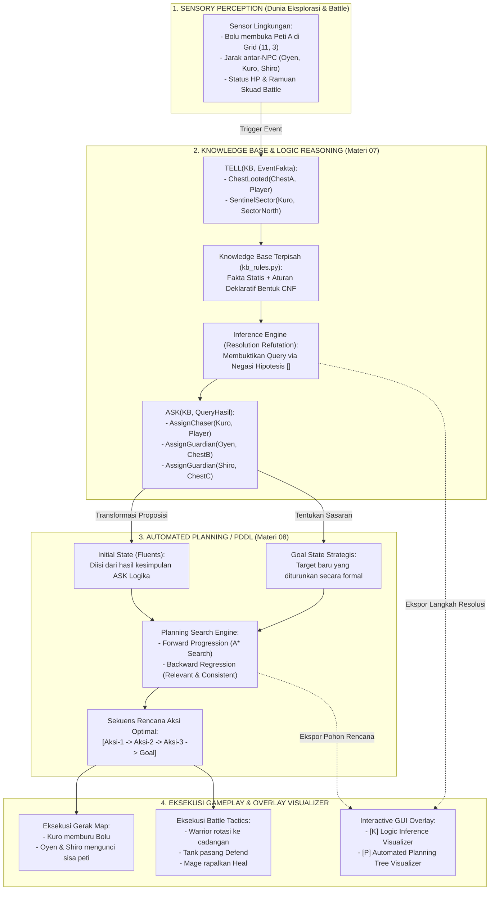

# Rencana Induk Implementasi Tubes Tahap 4: Logic & Automated Planning
## Proyek Game AI: *Bakekok* (Bolu Kesepian)

> **Mata Kuliah**: Kecerdasan Buatan (Semester 3) — Universitas Pendidikan Indonesia  
> **Kelompok**: 7  
> **Anggota**: Muhammad Hanif Muyassar, Moch Fadillah Pratama, Muhammad Zidan Mirza Fedrieka  
> **Berkas Acuan**: `kata_teman.md`, `ide_tahap_4_part2.md`, Slide Dosen `07_Logic & Representasi Pengetahuan.pdf`, dan `08_Automated Planning.pdf`  
> **Berkas Rencana**: `plan_tahap_4_fix.md`  
> **Status Dokumen**: Rencana Final Terstruktur & Siap Eksekusi (*Ready for Implementation*)

---

## DAFTAR ISI
1. [Ringkasan Eksekutif & Harmonisasi Ide](#1-ringkasan-eksekutif--harmonisasi-ide)
2. [Pemetaan Instruksi Dosen & Batasan Akademis](#2-pemetaan-instruksi-dosen--batasan-akademis)
   - [2.1 Target Pencapaian Kunci & Debug Overlay](#21-target-pencapaian-kunci--debug-overlay)
3. [Arsitektur Konseptual Terpadu: Sinergi Logic 07 & Planning 08](#3-arsitektur-konseptual-terpadu-sinergi-logic-07--planning-08)
4. [Skenario Permainan & Alur Perilaku NPC](#4-skenario-permainan--alur-perilaku-npc)
   - [Skenario A: Koordinasi Intelijen 3 Peti di Dunia Eksplorasi (Materi 07 $\rightarrow$ 08)](#skenario-a-koordinasi-intelijen-3-peti-di-dunia-eksplorasi-materi-07--08)
   - [Skenario B: Taktik Rotasi & Pemulihan Skuad Battle Tag-Team (Materi 08)](#skenario-b-taktik-rotasi--pemulihan-skuad-battle-tag-team-materi-08)
   - [4.2.1 Mekanisme Keseimbangan Duel & Counter-Play Pemain](#421-mekanisme-keseimbangan-duel--counter-play-pemain-game-balancing)
5. [Desain Teknis Modul 07: Logic & Knowledge Representation](#5-desain-teknis-modul-07-logic--knowledge-representation)
   - [5.1 Deklarasi Basis Pengetahuan (Fakta & Aturan CNF)](#51-deklarasi-basis-pengetahuan-fakta--aturan-cnf)
   - [5.2 Mesin Inferensi Mandiri (Resolution Refutation Engine)](#52-mesin-inferensi-mandiri-resolution-refutation-engine)
   - [5.3 Antarmuka Visualizer Overlay Logika GUI](#53-antarmuka-visualizer-overlay-logika-gui)
6. [Desain Teknis Modul 08: Automated Planning (PDDL / STRIPS)](#6-desain-teknis-modul-08-automated-planning-pddl--strips)
   - [6.1 Struktur Data PDDL (Predikat, Fluent, dan Skema Aksi)](#61-struktur-data-pddl-predikat-fluent-dan-skema-aksi)
   - [6.2 Dua Mesin Perencana: Forward Progression & Backward Regression](#62-dua-mesin-perencana-forward-progression--backward-regression)
   - [6.3 Domain & Problem Formal (Eksplorasi & Battle)](#63-domain--problem-formal-eksplorasi--battle)
   - [6.4 Antarmuka Visualizer Overlay Planning GUI](#64-antarmuka-visualizer-overlay-planning-gui)
7. [Rancangan Integrasi Sistem & Struktur Berkas Baru](#7-rancangan-integrasi-sistem--struktur-berkas-baru)
8. [Roadmap Pelaksanaan Bertahap (Sprint Execution Plan)](#8-roadmap-pelaksanaan-bertahap-sprint-execution-plan)
9. [Prosedur Verifikasi, Pengujian Otomatis & Rubrik Evaluasi](#9-prosedur-verifikasi-pengujian-otomatis--rubrik-evaluasi)

---

## 1. Ringkasan Eksekutif & Harmonisasi Ide

Dokumen ini merupakan **rencana final terpadu** yang memadukan saran tim dari `kata_teman.md` dengan elaborasi teknis akademis dari `ide_tahap_4_part2.md`. 

### Titik Temu Gagasan Utama:
1. **Ide Teman 1 (Materi 07 - Logic KB)**:
   - Menggunakan siklus formal: **Percept $\rightarrow$ TELL $\rightarrow$ ASK**.
   - Di awal, terdapat 3 NPC (Oyen, Kuro, Shiro) yang masing-masing berpatroli menjaga 3 sektor peti harta.
   - Saat Bolu (Player) membuka salah satu peti, NPC pengawas zona tersebut mendeteksi kejadian sebagai fakta baru (`Percept`).
   - Fakta dimasukkan ke Knowledge Base bersama (`TELL`).
   - Mesin inferensi resolusi (`ASK`) menyimpulkan pembagian tugas baru:
     - 1 NPC yang petinya kecolongan berubah peran menjadi **Memburu Player** (*Hunter/Chaser*).
     - 2 NPC lainnya saling mengabari (*Inter-NPC alert*) dan bertransisi menjaga **2 peti tersisa dengan lebih ketat** (*Tight Chest Guardians*).
   - **Kesimpulan dari proses `ASK` ini langsung menjadi `Goal State` bagi Materi 08!**
2. **Ide Teman 2 / Hanif (Materi 08 - Automated Planning)**:
   - **Di Dunia Eksplorasi**: Pola rotasi NPC berubah secara otonom untuk menjaga sisa peti melalui rencana sekuensial yang disusun oleh Automated Planner.
   - **Di Mode Battle (Duel Arena)**: Skuad NPC bertarung secara terkoordinasi dan cerdas menggunakan perencanaan aksi (*Battle Planning / GOAP*):
     - Menghadapi Player yang membawa item jarahan peti.
     - *Warrior* (Oyen) menyerang di garis depan.
     - Saat HP Warrior sekarat ($\le 35\%$), Warrior mundur ke barisan cadangan (*Tag-Out*), digantikan oleh *Defender/Tank* yang maju memasang pertahanan (*Defend*).
     - Selagi di bangku cadangan, *Mage* (Shiro) merapalkan mantra penyembuh (*Cast Heal*) kepada Warrior hingga HP-nya pulih.
3. **Harmonisasi Nilai Tambah**:
   - Seluruh alur membentuk satu kesatuan siklus AI yang kohesif: **Persepsi $\rightarrow$ Penalaran Logika (07) $\rightarrow$ Perencanaan Tugas (08) $\rightarrow$ Eksekusi Aksi di Dunia & Battle**.
   - Memenuhi seluruh instruksi dosen, rubrik tugas besar, dan kaidah keilmuan tanpa ada bagian yang terputus.

---

## 2. Pemetaan Instruksi Dosen & Batasan Akademis

Berdasarkan slide perkuliahan **07_Logic & Representasi Pengetahuan.pdf** (Slide 30) dan **08_Automated Planning.pdf** (Slide 20-30):

| Kriteria Penilaian | Instruksi Dosen | Solusi Implementasi di Proyek |
|:---|:---|:---|
| **Fokus Skenario KB (Modul 07)** | *Tambahkan KB untuk menentukan interaksi NPC dengan NPC lain (sesuaikan dengan karakteristik game).* | Interaksi koordinasi 3 NPC saat salah satu peti dijarah Bolu (saling memberi tahu status bahaya dan rotasi peran). |
| **Arsitektur KB (Modul 07)** | *Boleh menggunakan lib untuk inferensi KB, yang penting KB harus terpisah.* | KB didefinisikan secara deklaratif di berkas mandiri `game/logic/kb_rules.py`, terpisah dari engine inferensi dan game loop. |
| **Metode Inferensi (Modul 07)** | *Pembuktian kontradiksi klausa kosong $\square$ via Resolution Refutation.* | Mesin inferensi mandiri (*native*) `inference_engine.py` yang memproses klausa CNF murni dan menurunkan resolusi hingga $\square$. |
| **Representasi Planning (Modul 08)** | *PDDL / STRIPS (Predicates, Initial State, Goal State, Action Schema dengan Precondition, Add List, Delete List).* | Kelas deklaratif PDDL murni di `game/planning/pddl_types.py` dengan formula efek $\text{Result}(s, a) = (s \setminus \text{del}(a)) \cup \text{add}(a)$. |
| **Metode Pencarian Planning (Modul 08)** | *Forward Progression vs Backward Regression.* | Mengimplementasikan **keduanya**: Forward Search (A\*) dan Backward Regression ($g' = (g \setminus \text{add}(a)) \cup \text{pre}(a)$ dengan uji *relevant & consistent*). |
| **Antarmuka GUI / Visualisasi** | *Overlay memperlihatkan proses inferensi.* | Dua modal overlay terdedikasi: **Logic Visualizer Overlay** (tombol `[K]`) dan **Planning Visualizer Overlay** (tombol `[P]`). |

### 2.1 Target Pencapaian Kunci & Debug Overlay (Key Deliverables)

Sebagai bagian terpenting dari evaluasi akademik Tubes Tahap 4, **salah satu poin pencapaian utama yang wajib ada adalah Debug Overlay Interaktif yang memperlihatkan proses kerja internal AI secara transparan di layar**.

Dosen tidak hanya menilai output akhir karakter bergerak, melainkan **bagaimana cara AI berpikir dan merencanakan aksinya**:

1. **Pencapaian 1: Debug Overlay Logika & Representasi Pengetahuan (`[K]`)**:
   - Menampilkan secara visual proses **Percept $\rightarrow$ TELL $\rightarrow$ ASK**:
     - **Visualisasi Masukan Sensorik**: Menampilkan lencana fakta-fakta dunia yang di-`TELL` ke KB secara dinamis saat kejadian berlangsung di peta.
     - **Visualisasi Aturan Deklaratif**: Menampilkan daftar aturan FOL dan representasi bentuk klausa CNF-nya.
     - **Visualisasi Langkah Resolusi Refutasi Lengkap**: Memperlihatkan pohon penurunan resolusi dari pasangan klausa saling berkomplemen ($P$ vs $\neg P$), langkah demi langkah, hingga memunculkan kotak kontradiksi klausa kosong ($\square$).
     - **Visualisasi Hasil Deduksi**: Menampilkan kesimpulan peran baru NPC yang terbukti sah secara logika formal.

2. **Pencapaian 2: Debug Overlay Automated Planning PDDL (`[P]`)**:
   - Menampilkan secara visual proses perumusan rantai aksi majemuk:
     - **Visualisasi Status Fluents**: Menampilkan daftar fakta pada *Initial State* ($s_0$) dan *Goal State* ($g$).
     - **Visualisasi Pohon Pencarian Ruang Keadaan**: Memperlihatkan eksplorasi simpul Forward Progression vs Backward Regression, lengkap dengan metrik pencarian (jumlah *nodes evaluated*, waktu eksekusi ms, dan heuristik).
     - **Visualisasi Transisi State (Add & Del Lists)**: Memperlihatkan bagaimana setiap aksi mengubah keadaan dunia (efek `+Add` hijau dan `-Del` merah).
     - **Timeline Rencana Tugas (*Action Sequence*)**: Menampilkan kartu urutan aksi yang sedang aktif dan sedang dieksekusi oleh NPC di peta maupun arena battle.

3. **Pencapaian 3: Pembagian Tugas Multi-NPC Otonom di Dunia Eksplorasi**:
   - Terbukti 3 NPC mampu merespons pembukaan 3 peti: 1 NPC beralih menjadi pemburu (*chaser*) dan 2 NPC lainnya saling mengabari untuk mengunci sisa peti.

4. **Pencapaian 4: Kerja Sama Taktis Skuad di Arena Battle (Tag-Team Planning)**:
   - Terbukti skuad musuh mampu merencanakan rotasi darurat saat sekarat (Warrior mundur, Tank maju memasang Defend, Mage merapalkan Heal), dengan batas kuota 1x pemakaian dan indikator niat musuh (*intent preview*) di layar.

5. **Pencapaian 5: Kode Bersih, Pengujian Otomatis 100%, dan Kinerja Stabil (60 FPS)**:
   - Terintegrasi mulus tanpa lag, lolos seluruh rangkaian unit test dan integration test.

---

## 3. Arsitektur Konseptual Terpadu: Sinergi Logic 07 & Planning 08

Sistem AI Tahap 4 menghubungkan penalaran deduktif logika dengan perencana tugas otomatis ke dalam arsitektur **Sense - Reason - Plan - Act**:



---

## 4. Skenario Permainan & Alur Perilaku NPC

### Skenario A: Koordinasi Intelijen 3 Peti di Dunia Eksplorasi (Materi 07 $\rightarrow$ 08)

#### Kondisi Awal (*Initial Setup*):
- Terdapat 3 Peti Utama di peta:
  1. **Peti A (Sektor Utara-Barat)**: Grid `(11, 3)` — diawasi oleh **Kuro (Ranger)**.
  2. **Peti B (Sektor Timur-Tengah)**: Grid `(41, 24)` — diawasi oleh **Shiro (Mage/Defender)**.
  3. **Peti C (Sektor Selatan-Barat)**: Grid `(10, 28)` — diawasi oleh **Oyen (Warrior)**.
- Masing-masing NPC berpatroli santai di sekitar sektornya masing-masing (*Routine Sector Patrol*).

```
   [Peti A (11, 3)] ---------------------- [Peti B (41, 24)]
    (Dijaga Kuro)                           (Dijaga Shiro)
           \                                      /
            \                                    /
             ------ [Peti C (10, 28)] -----------
                     (Dijaga Oyen)
```

#### Alur Koordinasi Percept $\rightarrow$ TELL $\rightarrow$ ASK:
1. **Percept**: Bolu mendekati Peti A dan membukanya (`[E] Buka Peti`), mengambil Pedang Legendaris.
2. **TELL**: Sensor mendeteksi kejadian ini. Fakta di-`TELL` ke KB:
   - `ChestOpened(ChestA)`
   - `NearestSentinel(Kuro, ChestA)`
   - `LootTaken(Bolu, Sword)`
   - `RemainingChests([ChestB, ChestC])`
3. **ASK & Resolution Refutation**:
   - Sistem menanyakan ke KB: `ASK(KB, RoleAssignment(x, y))`
   - Melalui Resolution Refutation, KB membuktikan:
     - Kuro bertanggung jawab mengejar: `AssignChaser(Kuro, Bolu)`.
     - Oyen dan Shiro menerima sinyal peringatan: `AlertSentinels(Oyen, Shiro)`.
     - Aturan koordinasi membagi sisa peti: `AssignTightGuard(Shiro, ChestB)` dan `AssignTightGuard(Oyen, ChestC)`.
4. **Handoff ke Automated Planner (Materi 08)**:
   - Kesimpulan KB menjadi input PDDL Problem:
     - `:init` memuat posisi Kuro, Oyen, Shiro, dan status peti.
     - `:goal` menetapkan: `(and (in-chase kuro bolu) (perimeter-secured shiro chest_b) (perimeter-secured oyen chest_c))`.
   - Planner menghasilkan rencana rute pengamanan perimeter dan intersepsi. NPC beralih dari patroli santai ke patroli ketat (*tight perimeter sweep*).

---

### Skenario B: Taktik Rotasi & Pemulihan Skuad Battle Tag-Team (Materi 08)

Skenario ini mewujudkan ide brilian Hanif di mode battle turn-based saat duel berlangsung:

#### Latar Belakang & Masalah:
- Player (Bolu) bertarung melawan skuad NPC.
- Frontline lawan adalah **Oyen (Warrior)**.
- Di bangku cadangan (*bench*) terdapat **Kuro (Tank/Defender)** dan **Shiro (Mage/Healer)**.
- Saat HP Oyen turun drastis ($\le 35\%$), Minimax lokal hanya memikirkan 1-2 turn ke depan. Di sinilah **Automated Planner (PDDL/GOAP)** mengambil alih keputusan strategis tingkat tinggi.

#### Definisi Sasaran Planner:
- **Kondisi Awal ($s_0$)**:
  - `(active-frontline oyen)`
  - `(hp-critical oyen)`
  - `(in-bench kuro)`, `(is-role kuro defender)`, `(hp-healthy kuro)`
  - `(in-bench shiro)`, `(is-role shiro healer)`, `(mana-available shiro)`
- **Goal State ($g$)**:
  - `(and (active-frontline kuro) (guard-active kuro) (healed oyen))`

#### Rangkaian Rencana Aksi (*Generated Plan*):
1. **Langkah 1**: `tag_out_retreat(oyen)` $\rightarrow$ Oyen mundur ke bangku cadangan.
2. **Langkah 2**: `tag_in_advance(kuro)` $\rightarrow$ Kuro (Tank) melangkah maju menjadi frontline.
3. **Langkah 3**: `cast_defense_barrier(kuro)` $\rightarrow$ Kuro mengaktifkan perisai ketahanan tinggi.
4. **Langkah 4**: `cast_bench_heal(shiro, oyen)` $\rightarrow$ Shiro merapalkan sihir pemulih ke Oyen di cadangan.
5. **Hasil**: Skuad musuh tidak kehilangan anggota, Tank menahan serangan Bolu, dan Warrior siap maju kembali di giliran berikutnya!

#### 4.2.1 Mekanisme Keseimbangan Duel & Counter-Play Pemain (Game Balancing)
Agar pertempuran tidak menjadi tidak adil (*unfair*), membuat frustrasi, atau menjadi *infinite stall* bagi Player yang bertarung sendirian, diimplementasikan 4 pilar penyeimbang taktis:

1. **Batasan Kuota Heal & Sumber Daya Ketat (*Strict Resource Cap*)**:
   - Sihir penyembuh (*Heal*) milik Mage (Shiro) dibatasi **hanya 1 kali pakai saja per pertempuran** (menggunakan predikat PDDL `(has-heal-charge shiro)`).
   - Besaran pemulihan dibatasi wajar (**+20 s.d. +25 HP**, bukan langsung 100% penuh).
   - Aksi `Swap/Tag-Out` memiliki jeda *cooldown* (tidak bisa di-spam setiap giliran).
2. **Skalasi HP Skuad Musuh yang Ramping (*Lean Squad Health Pool*)**:
   - Karena musuh bertarung bertiga secara sinergis, HP individual masing-masing NPC dirampingkan:
     - **Warrior (Oyen)**: HP 50–60 (serangan cepat, pertahanan moderat).
     - **Tank (Kuro)**: HP 50–60 (ketahanan tebal, tetapi serangan rendah).
     - **Mage (Shiro)**: HP 40 (sangat rapuh bila dipaksa maju ke frontline).
   - Total HP efektif skuad musuh tetap seimbang dengan kapasitas damage Bolu (HP 100 + ramuan).
3. **Sistem Indikator Niat Musuh (*Enemy Intent Preview* ala Slay the Spire)**:
   - Karena AI menyusun rencana beberapa langkah ke depan melalui Automated Planner, rencana taktis tersebut **ditelegasikan secara transparan di layar pertarungan**:
     > ⚠️ **BADGE INTENT**: *"Peringatan Taktis: Oyen sekarat bersiap Swap mundur dan Shiro merapalkan Heal pada giliran depan!"*
   - Memberikan kepuasan intelektual bagi Player untuk membaca taktik lawan, bukan merasa "dicurangi".
4. **Alat *Counter-Play* dari Peti Harta Karun**:
   - Item yang dijarah Bolu sebelum bertarung memberi kemampuan menggagalkan rencana musuh:
     - **Pedang Legendaris (*Burst Cleave*)**: Jika Player memilih `Heavy Attack` tepat saat indikator swap muncul dan HP Oyen $\le 25$, serangan langsung menghabisi Oyen seketika (*instant knockout*) **sebelum sempat melakukan tag-out**! Rencana PDDL musuh buyar dan terganggu (*Interrupted Plan*).

---

## 5. Desain Teknis Modul 07: Logic & Knowledge Representation

### 5.1 Deklarasi Basis Pengetahuan (Fakta & Aturan CNF)

Sesuai mandat dosen, berkas basis pengetahuan dipisahkan secara murni pada berkas:
`Game-AI/game/logic/kb_rules.py`

#### 1. Sintaks Struktur Klausa CNF
Setiap klausa CNF direpresentasikan sebagai himpunan literal (*set of signed literals*):
- Literal positif: `"P"`, `"AssignChaser_Kuro"`
- Literal negatif: `"~P"`, `"~AssignChaser_Kuro"`
- Klausa: `frozenset({"~P", "Q", "R"})` (artinya $\neg P \lor Q \lor R$)

#### 2. Kumpulan Aturan Logika Koordinasi NPC (Rules):
```python
# Rule 1: Jika peti dibuka oleh Player dan ada penjaga terdekat, maka penjaga tersebut siaga
# FOL: ChestOpened(c) & NearestSentinel(n, c) => AlertHunter(n)
# CNF: ~ChestOpened(c) | ~NearestSentinel(n, c) | AlertHunter(n)

# Rule 2: Jika penjaga siaga dan Player membawa senjata jarahan, maka penjaga menjadi pemburu
# FOL: AlertHunter(n) & HasLootedItem(Player) => AssignChaser(n, Player)
# CNF: ~AlertHunter(n) | ~HasLootedItem(Player) | AssignChaser(n, Player)

# Rule 3: Jika pemburu telah ditugaskan, maka beri peringatan darurat ke seluruh rekan sekutu
# FOL: AssignChaser(n, Player) & Ally(n, m) => BroadcastAlarm(m)
# CNF: ~AssignChaser(n, Player) | ~Ally(n, m) | BroadcastAlarm(m)

# Rule 4: Jika sekutu menerima alarm dan masih ada peti lain yang belum dibuka, maka sekutu wajib mengunci peti tersebut
# FOL: BroadcastAlarm(m) & UnopenedChest(c2) & AssignedSector(m, c2) => AssignTightGuard(m, c2)
# CNF: ~BroadcastAlarm(m) | ~UnopenedChest(c2) | ~AssignedSector(m, c2) | AssignTightGuard(m, c2)
```

---

### 5.2 Mesin Inferensi Mandiri (Resolution Refutation Engine)

Berkas: `Game-AI/game/logic/inference_engine.py`

Algoritma Resolution Refutation diimplementasikan secara mandiri (*first-principles* tanpa black-box library):
1. **Input**:
   - `KB`: Himpunan klausa CNF (Fakta + Aturan).
   - $\alpha$: Query yang ingin dibuktikan (misal: `AssignChaser(Kuro, Player)`).
2. **Proses Refutasi**:
   - Tambahkan negasi hipotesis $\neg \alpha$ ke dalam salinan KB:
     $$\text{Clauses} = KB \cup \{\neg \alpha\}$$
   - Lakukan iterasi perpasangan klausa $(C_i, C_j)$.
   - Jika terdapat literal saling berkomplemen ($L \in C_i$ dan $\sim L \in C_j$):
     $$\text{Resolvent} = (C_i \setminus \{L\}) \cup (C_j \setminus \{\sim L\})$$
   - Jika $\text{Resolvent} == \emptyset$ (himpunan kosong $\square$):
     - **Kontradiksi ditemukan!** Hipotesis $\neg \alpha$ mustahil.
     - Maka $KB \models \alpha$ **terbukti bernilai TRUE**.
   - Simpan setiap riwayat pasangan langkah resolusi ke dalam struktur data jejak (*proof trace*) untuk ditampilkan di visualizer GUI.

---

### 5.3 Antarmuka Visualizer Overlay Logika GUI

Berkas: `Game-AI/game/ui/logic_overlay.py`  
Akses Pintas: **Tombol `[K]`** pada keyboard saat permainan berlangsung.

#### Komponen Layar Visualizer Logika:
1. **Panel Fakta Sensorik Aktif (`TELL`)**:
   - Menampilkan daftar fakta dunia saat ini dalam format lencana berwarna:
     `ChestOpened(Chest_A)`, `Sentinel(Kuro)`, `Loot(Sword)`, dll.
2. **Panel Aturan Basis Pengetahuan (`KB Rules`)**:
   - Menampilkan aturan-aturan formal dalam bentuk Implikasi ($P \implies Q$) dan bentuk standar CNF ($\neg P \lor Q$).
3. **Panel Pohon Resolusi Refutasi (`Resolution Trace`)**:
   - Langkah demi langkah penurunan resolusi:
     - `Langkah 1: Resolve(~AssignChaser_Kuro, Rule 2) => Resolvent: ~AlertHunter_Kuro`
     - `Langkah 2: Resolve(~AlertHunter_Kuro, Rule 1) => Resolvent: ~ChestOpened_ChestA`
     - `Langkah 3: Resolve(~ChestOpened_ChestA, Fakta 1) => Resolvent: [] (EMPTY CLAUSE)`
   - Kotak merah dramatis: **$\square$ CONTRADICTION PROVEN! Query Entailed.**
4. **Panel Kesimpulan Aksi (`ASK`)**:
   - Rekomendasi peran baru untuk NPC: *"Kuro ditugaskan mengejar Bolu, Shiro & Oyen mengunci Peti B dan C!"*.

---

## 6. Desain Teknis Modul 08: Automated Planning (PDDL / STRIPS)

### 6.1 Struktur Data PDDL (Predikat, Fluent, dan Skema Aksi)

Berkas: `Game-AI/game/planning/pddl_types.py`

#### 1. Kelas `Predicate`:
Menyimpan relasi logis dengan nama dan argumen objek:
- Contoh: `Predicate("at-npc", ["oyen", "pos_base"])`
- Hashable dan dapat dibandingkan untuk pengecekan kesetaraan himpunan (*set inclusion*).

#### 2. Kelas `State`:
Himpunan dari predikat-predikat yang sedang bernilai benar pada suatu waktu:
$$s = \{p_1, p_2, \dots, p_n\}$$

#### 3. Kelas `ActionSchema`:
Mendefinisikan operator aksi perencana dengan:
- `name`: Nama aksi (misal: `"move"`, `"tag_out_retreat"`)
- `parameters`: Variabel berparameter
- `preconditions`: Himpunan predikat yang wajib terpenuhi sebelum aksi dapat dieksekusi ($pre(a) \subseteq s$)
- `add_list`: Himpunan predikat baru yang menjadi benar setelah aksi dieksekusi
- `del_list`: Himpunan predikat yang dihapus dari state dunia setelah aksi dieksekusi

Rumus transisi keadaan formal:
$$\text{Result}(s, a) = (s \setminus \text{del}(a)) \cup \text{add}(a)$$

---

### 6.2 Dua Mesin Perencana: Forward Progression & Backward Regression

Berkas: `Game-AI/game/planning/planner_engine.py`

Sesuai materi Modul 08 halaman 20-30, kita menyediakan **dua strategi pencarian**:

#### 1. Forward State-Space Search (Progression)
- Memulai dari status awal $s_0$.
- Menguji aksi yang *applicable*: $pre(a) \subseteq s$.
- Menggunakan algoritma **A\* Search** dengan heuristik santai (*Relaxed Problem: Ignore Delete Lists*):
  - $h(s)$ dihitung dari jumlah sisa gol yang belum tercapai dengan mengabaikan efek delete.
- Berhenti saat semua literal goal terpenuhi: $g \subseteq s$.

#### 2. Backward Search (Regression)
- Memulai dari himpunan target *Goal State* $g$.
- Pada setiap iterasi, mencari aksi $a$ yang:
  1. **Relevant**: Menambahkan setidaknya satu fakta pada gol saat ini ($add(a) \cap g \neq \emptyset$).
  2. **Consistent**: Tidak menghapus fakta apapun yang dibutuhkan pada gol saat ini ($del(a) \cap g = \emptyset$).
- Menghitung sub-goal baru melalui regresi:
  $$g' = (g \setminus \text{add}(a)) \cup pre(a)$$
- Berhenti ketika seluruh sub-goal telah terpenuhi oleh status awal: $g' \subseteq s_0$.
- Membalik urutan aksi untuk menghasilkan rencana eksekusi final.

---

### 6.3 Domain & Problem Formal (Eksplorasi & Battle)

#### Domain Eksplorasi: `domain_world_patrol.py`
```lisp
(define (domain world-patrol-defense)
  (:predicates
    (at-npc ?n ?loc)
    (at-player ?loc)
    (connected ?from ?to)
    (guarding-chest ?n ?c)
    (chest-at ?c ?loc)
    (chasing-player ?n)
    (perimeter-locked ?c)
  )

  (:action intercept-player
    :parameters (?n ?loc-from ?loc-to)
    :precondition (and (at-npc ?n ?loc-from) (at-player ?loc-to) (connected ?loc-from ?loc-to))
    :effect (and (chasing-player ?n) (at-npc ?n ?loc-to) (not (at-npc ?n ?loc-from)))
  )

  (:action lock-perimeter
    :parameters (?n ?c ?loc)
    :precondition (and (at-npc ?n ?loc) (chest-at ?c ?loc))
    :effect (and (perimeter-locked ?c) (guarding-chest ?n ?c))
  )
)
```

#### Domain Battle Tag-Team: `domain_battle_tactics.py`
```lisp
(define (domain battle-tagteam-tactics)
  (:predicates
    (active-frontline ?n)
    (in-bench ?n)
    (hp-critical ?n)
    (hp-healthy ?n)
    (is-tank ?n)
    (is-healer ?n)
    (has-heal-charge ?n)
    (guard-active ?n)
    (healed ?n)
  )

  (:action swap-retreat
    :parameters (?retreater ?advancer)
    :precondition (and (active-frontline ?retreater) (in-bench ?advancer) (is-tank ?advancer))
    :effect (and (in-bench ?retreater) (active-frontline ?advancer) 
                 (not (active-frontline ?retreater)) (not (in-bench ?advancer)))
  )

  (:action cast-defend
    :parameters (?n)
    :precondition (and (active-frontline ?n) (is-tank ?n))
    :effect (guard-active ?n)
  )

  (:action heal-teammate
    :parameters (?healer ?target)
    :precondition (and (in-bench ?healer) (is-healer ?healer) (has-heal-charge ?healer) 
                       (in-bench ?target) (hp-critical ?target))
    :effect (and (healed ?target) (hp-healthy ?target) 
                 (not (hp-critical ?target)) (not (has-heal-charge ?healer)))
  )
)
```

---

### 6.4 Antarmuka Visualizer Overlay Planning GUI

Berkas: `Game-AI/game/ui/planning_overlay.py`  
Akses Pintas: **Tombol `[P]`** pada keyboard saat permainan berlangsung.

#### Komponen Layar Visualizer Planning:
1. **Panel Definisi PDDL (State & Goal)**:
   - Menampilkan status fluents saat ini ($s_0$) dan target kondisi akhir ($Goal$).
2. **Pemilih Strategi Perencana**:
   - Tombol tab interaktif untuk membandingkan **Forward Progression vs Backward Regression**.
   - Menampilkan metrik pencarian: Jumlah simpul dievaluasi, waktu komputasi (ms), dan panjang rencana (*Plan Length*).
3. **Pohon Perencanaan / Timeline Rencana (*Plan Execution Timeline*)**:
   - Representasi visual kartu sekuensial:
     `[Aksi 1: SwapRetreat] -> [Aksi 2: CastDefend] -> [Aksi 3: HealTeammate] -> [GOAL REACHED]`
   - Status penambahan (`+Add`) berwarna hijau dan penghapusan (`-Del`) berwarna merah pada tiap transisi state.

---

## 7. Rancangan Integrasi Sistem & Struktur Berkas Baru

Seluruh implementasi baru diletakkan secara terisolasi dan modular di dalam package `game/` tanpa merusak fungsionalitas yang sudah ada:

```
Game-AI/game/
├── logic/                             # MODUL MATERI 07: LOGIC & KB
│   ├── __init__.py
│   ├── kb_rules.py                    # Deklarasi Basis Pengetahuan (Fakta & Aturan CNF)
│   ├── inference_engine.py            # Mesin Resolusi Refutasi Formal (Mencari [])
│   └── inter_npc_manager.py           # Penghubung sensor dunia -> TELL -> ASK
├── planning/                          # MODUL MATERI 08: AUTOMATED PLANNING
│   ├── __init__.py
│   ├── pddl_types.py                  # Struktur Data Predicate, State, ActionSchema
│   ├── planner_engine.py              # Forward Progression & Backward Regression
│   ├── domain_world_patrol.py         # Domain & Problem Penjagaan 3 Peti
│   ├── domain_battle_tactics.py       # Domain & Problem Taktik Tag-Team Battle
│   └── task_executor.py               # Penerjemah rencana PDDL ke aksi gerak NPC
├── ui/
│   ├── logic_overlay.py               # GUI Visualizer Logika KB & Resolution Refutation [K]
│   ├── planning_overlay.py            # GUI Visualizer Automated Planning PDDL [P]
│   └── ... (overlay eksisting tetap aman)
├── world/
│   ├── npc.py                         # Penambahan state patroli ketat & task execution
│   └── mapdata.py
├── battle/
│   ├── battle_system.py               # Integrasi AI Tactical Planner di giliran NPC
│   └── ...
└── app.py                             # Penanganan event keyboard [K], [P], pemicu interaksi peti
```

---

## 8. Roadmap Pelaksanaan Bertahap (Sprint Execution Plan)

Rencana kerja dibagi ke dalam 7 fase berurutan agar setiap modul dapat diverifikasi secara tuntas sebelum melangkah ke tahap berikutnya:

```mermaid
gantt
    title Roadmap Implementasi Tubes Tahap 4
    dateFormat  X
    axisFormat %s
    section Fase 1
    Arsitektur Data & Logic Engine (07)       :active, p1, 0, 2
    section Fase 2
    Knowledge Base 3 Peti & Koordinasi NPC     :p2, 2, 4
    section Fase 3
    GUI Logic Visualizer Overlay [K]           :p3, 4, 6
    section Fase 4
    Automated Planning Engine (08)             :p4, 6, 8
    section Fase 5
    PDDL World Patrol & Battle Tag-Team        :p5, 8, 10
    section Fase 6
    GUI Planning Visualizer Overlay [P]        :p6, 10, 12
    section Fase 7
    Integrasi Penuh & Uji Gameplay Loop        :p7, 12, 14
```



### Rincian Tiap Fase:

#### Fase 1: Pembangunan Mesin Inferensi Logika (Modul 07)
- **Tugas**: Membuat `game/logic/inference_engine.py` yang mendukung representasi CNF murni dan algoritma Resolution Refutation.
- **Output**: Unit test mandiri yang menguji resolusi refutasi klausa hingga menghasilkan kontradiksi $\square$.

#### Fase 2: Implementasi Knowledge Base 3 Peti & Koordinasi NPC
- **Tugas**: Membuat `game/logic/kb_rules.py` dan `game/logic/inter_npc_manager.py`. Mengaitkan pembukaan peti oleh Player dengan operasi `TELL` ke KB dan penarikan kesimpulan peran via `ASK`.
- **Output**: Saat Bolu membuka salah satu peti, sistem secara logis membagi peran: 1 Hunter (pengejar) dan 2 Tight Guardians (penjaga sisa peti).

#### Fase 3: Pembuatan GUI Logic Visualizer Overlay (`[K]`)
- **Tugas**: Membangun antarmuka `game/ui/logic_overlay.py` yang menampilkan fakta aktif, aturan CNF, pohon resolusi refutasi klausa kosong $\square$, dan status tugas NPC.
- **Output**: Layar interaktif yang dapat diakses dengan tombol `[K]` secara responsif.

#### Fase 4: Pembangunan Mesin Automated Planning (Modul 08)
- **Tugas**: Membuat `game/planning/pddl_types.py` dan `game/planning/planner_engine.py` (Forward Search A\* dan Backward Regression).
- **Output**: Unit test perencanaan PDDL formal yang membuktikan kedua algoritma berhasil menemukan rantai aksi optimal.

#### Fase 5: Implementasi Domain PDDL Eksplorasi & Battle Tag-Team
- **Tugas**: 
  - Domain Patroli Dunia (`domain_world_patrol.py`).
  - Domain Taktik Battle Tag-Team (`domain_battle_tactics.py`): Rotasi Warrior sekarat $\rightarrow$ Tank pasang Defend $\rightarrow$ Mage merapalkan Heal.
- **Output**: Rencana aksi tersusun secara otomatis dan diterjemahkan oleh `task_executor.py`.

#### Fase 6: Pembuatan GUI Planning Visualizer Overlay (`[P]`)
- **Tugas**: Membangun `game/ui/planning_overlay.py` untuk memvisualisasikan Domain PDDL, Problem, graf pohon Forward vs Backward, dan timeline urutan aksi.
- **Output**: Layar visualizer akademis lengkap yang dapat dibuka dengan tombol `[P]`.

#### Fase 7: Integrasi Penuh Sistem & Pengujian Gameplay Loop
- **Tugas**: Menghubungkan seluruh sistem ke dalam `app.py`, memastikan transisi antar-mode berjalan mulus, dan menjalankan integrasi pengujian 100%.
- **Output**: Semua fitur dapat dimainkan, bebas bug, dan siap didemokan di hadapan dosen/asisten lab.

---

## 9. Prosedur Verifikasi, Pengujian Otomatis & Rubrik Evaluasi

### 1. Rencana Pengujian Otomatis (*Automated Testing Suite*):
1. **`scratch/test_logic_resolution.py`**:
   - Menguji bahwa penambahan fakta baru ke KB menghasilkan inferensi yang valid.
   - Menguji bahwa resolusi refutasi klausa komplemen berhasil menemukan klausa kosong $\square$.
2. **`scratch/test_automated_planning.py`**:
   - Menguji pencarian Forward Progression pada problem logistik/patroli.
   - Menguji pencarian Backward Regression dengan rumus $g' = (g \setminus \text{add}(a)) \cup \text{pre}(a)$.
   - Membandingkan konsistensi hasil kedua algoritma.
3. **`scratch/test_tahap4_integration.py`**:
   - Simulasi alur penuh: Eksplorasi $\rightarrow$ Bolu membuka Peti A $\rightarrow$ Trigger TELL KB $\rightarrow$ Inferensi ASK membagi tugas $\rightarrow$ Planning merumuskan rute patroli ketat $\rightarrow$ Masuk Battle $\rightarrow$ Tactical Tag-Team Planning berjalan $\rightarrow$ Buka Overlay `[K]` dan `[P]`.

### 2. Checklist Kepatuhan Slide Perkuliahan (Rubrik Penilaian Dosen):
- [x] **KB Terpisah Secara Deklaratif**: Aturan dan fakta tersimpan di `kb_rules.py` tanpa tercampur dengan logika kontrol game.
- [x] **Interaksi NPC dengan NPC Lain**: Skenario berpusat pada koordinasi 3 NPC (Oyen, Kuro, Shiro) saling mengingatkan bahaya dan membagi tugas jaga peti.
- [x] **Inferensi Berbasis Resolusi CNF**: Engine membuktikan kesimpulan melalui refutasi klausa kosong $\square$.
- [x] **PDDL / STRIPS Formal**: Representasi fluents, skema aksi dengan precondition, add-list, dan delete-list.
- [x] **Dua Strategi Planning**: Mendukung Forward Progression dan Backward Regression.
- [x] **Debug Overlay Memperlihatkan Proses Kerja AI Secara Transparan (Mandat Dosen)**:
  - Overlay `[K]` memperlihatkan fakta `TELL`, aturan CNF, penurunan resolusi literal komplementer per langkah, dan pembuktian $\square$.
  - Overlay `[P]` memperlihatkan graf pohon pencarian Forward vs Backward, transisi Add/Del lists, serta timeline eksekusi rencana aksi.
- [x] **Keseimbangan Game (Game Balancing)**: Kuota heal 1x, HP proporsional, serta indikator *Enemy Intent Preview* agar battle adil dan taktis.

---
*Dokumen ini telah siap dijadikan acuan kerja langsung untuk tahap pengkodean (implementasi) Tahap 4.*

