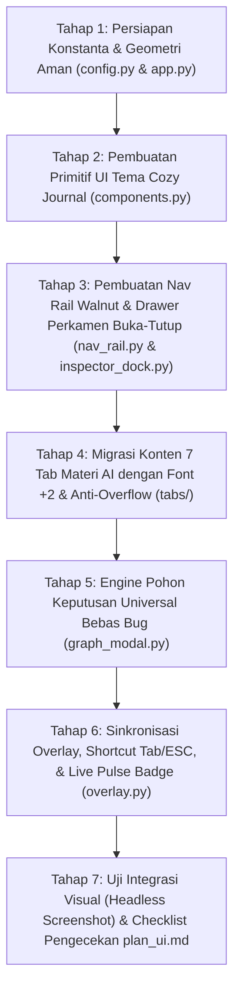

# Rencana Desain & Arsitektur UI/UX Terpadu: *Cozy Adventurer Journal*
## Proyek Game AI: *Bakekok* (Bolu Kesepian)

> **Mata Kuliah**: Kecerdasan Buatan (Semester 3) — Universitas Pendidikan Indonesia  
> **Berkas Acuan**: `kata_teman.md`, `ide_tahap_4_part2.md`, `plan_tahap_4_fix.md`  
> **Berkas Rencana UI**: `plan_ui.md`  
> **Model Arsitektur**: **Collapsible Adventurer Journal (Flyout Drawer Buka-Tutup)** — Bilah Ikon Ramping (64 px) dengan Panel Inspektur Perkamen Hangat (356 px) yang Dapat Dibuka/Tutup Menimpa Map Secara Bersih, Didukung Zona Kamera Aman (Bolu Bebas Halangan).

---

## ⚠️ PRINSIP SAKRAL (*STRICT IMMUTABILITY RULE*)
> [!IMPORTANT]
> **HANYA MENGUBAH TAMPILAN (PRESENTATION & INTERACTION LAYER)!**  
> **DILARANG KERAS MENGUBAH, MENYEDERHANAKAN, ATAU MENGURANGI LOGIKA MATERI AI APAPUN**, termasuk namun tidak terbatas pada:
> 1. **Materi 01–03**: Search Algorithms (BFS, DFS, UCS, Greedy Best-First, A\* Search, Manhattan/Euclidean heuristics, cost calculation).
> 2. **Materi 04**: Adversarial Search (Minimax, Alpha-Beta Pruning, evaluasi heuristik, depth limits, move ordering).
> 3. **Materi 05–06**: Constraint Satisfaction Problem (C1–C8 constraints, MRV, LCV, AC-3) & Local Search (Hill Climbing, Sideways Move, Random Restart, Simulated Annealing, Genetic Algorithm).
> 4. **Materi 07**: Logic & Knowledge Representation (Percept $\rightarrow$ TELL $\rightarrow$ ASK, konversi CNF, Resolution Refutation menghasilkan $\square$).
> 5. **Materi 08**: Automated Planning (PDDL, State-space Progression Forward A\* dan Regression Backward Search).
>
> Seluruh algoritma di atas **tetap 100% murni dan berjalan penuh di balik layar**. Redesain ini **hanya menata ulang wadah presentasi visual, merapikan layout, menyatukan modal pohon yang bug, dan membuat UI ramah pengguna**.

---

## DAFTAR ISI
1. [Latar Belakang & Analisis Masalah UI Saat Ini](#1-latar-belakang--analisis-masalah-ui-saat-ini)
2. [Konsep Utama: Collapsible Adventurer Journal (Drawer Buka-Tutup)](#2-konsep-utama-collapsible-adventurer-journal-drawer-buka-tutup)
3. [Spesifikasi Geometri Layar, Posisi Kamera, dan Lebar Tab Baru (+60 px)](#3-spesifikasi-geometri-layar-posisi-kamera-dan-lebar-tab-baru-60-px)
4. [Mekanisme Interaksi Buka-Tutup (Toggle & Clean Look)](#4-mekanisme-interaksi-buka-tutup-toggle--clean-look)
5. [Design System: Tema Cozy Adventurer Journal & Skala Font (+2)](#5-design-system-tema-cozy-adventurer-journal--skala-font-2)
6. [Spesifikasi Konten Tiap Tab Modul & Anti-Overflow Rules](#6-spesifikasi-konten-tiap-tab-modul--anti-overflow-rules)
7. [Solusi Perbaikan Bug Tree Visualizer (Unified Graph Modal)](#7-solusi-perbaikan-bug-tree-visualizer-unified-graph-modal)
8. [Arsitektur Kode & Pemisahan Berkas Modular](#8-arsitektur-kode--pemisahan-berkas-modular)
9. [Roadmap & Checklist Verifikasi Pengerjaan](#9-roadmap--checklist-verifikasi-pengerjaan)

---

## 1. Latar Belakang & Analisis Masalah UI Saat Ini

Berdasarkan evaluasi visual aktual dan masukan:
1. **Tone Warna Gelap Terlalu Kontras**: Nuansa *dark slate navy* terlalu kontras dengan dunia game Sprout Lands & Ghibli Meadow yang bernuansa hangat, hijau, dan pastel.
2. **Teks Meluap Keluar Kartu (*Text Overflow*)**: Formula logika CNF dan fluents PDDL yang panjang menembus border karena lebar panel $296\text{ px}$ terlalu sempit dan teks tidak di-wrap.
3. **Ukuran Font Kurang Jelas**: Font 11px dan 14px terasa kecil saat diuji di layar laptop.
4. **Kebutuhan Tampilan Bersih (*Clean Look*)**: Pemain ingin fleksibilitas untuk menikmati pemandangan map penuh tanpa tertutup panel permanen, namun panel inspektur dapat dipanggil sewaktu-waktu.

---

## 2. Konsep Utama: Collapsible Adventurer Journal (Drawer Buka-Tutup)

Mengadopsi pola antarmuka game RPG modern:
- **Nav Rail Ramping ($64\text{ px}$)**: Tetap berada di sisi paling kiri sebagai jangkar (*dock anchor*) minimalis dengan nuansa kayu gelap *Dark Walnut*.
- **Inspector Drawer ($356\text{ px}$)**: Panel bertekstur kertas perkamen hangat yang dapat **DIBUKA/DITUTUP**.
- **Kondisi Tertutup (*Clean Look*)**: Panel terlipat. Layar map terlihat seluas **$1216 \times 800\text{ px}$** dengan panorama penuh!
- **Kondisi Terbuka (*Flyout Drawer Menimpa Map*)**: Panel meluncur menimpa area map di koordinat $x \in [0, 420\text{ px})$.
- **Jaminan Posisi Bolu Bebas Halangan**:
  - Area aman bebas di sebelah kanan panel adalah selebar **$860\text{ px}$** ($x \in [420, 1280\text{ px}]$).
  - Titik fokus kamera dikunci di $x \approx 850\text{ px}$, sehingga karakter **Bolu selalu berada di zona kanan terbuka dan $100\%$ TIDAK AKAN PERNAH tertutupi panel ketika tab dibuka!**

---

## 3. Spesifikasi Geometri Layar, Posisi Kamera, dan Lebar Tab Baru (+60 px)

Resolusi dasar permainan: **$1280 \times 800$ piksel**.

### Saat Tab Dibuka (Expanded State):
```
0 px                 64 px                             420 px                                    1280 px
┌────────────────────┬─────────────────────────────────┬───────────────────────────────────────────────┐
│ NAV RAIL           │ INSPECTOR PERKAMEN (356 px)     │ GAMEPLAY VIEWPORT BEBAS (860 px)              │
│ (Kayu Walnut)      │ (Kertas Perkamen Hangat)        │                                               │
│                    │                                 │ Titik Pusat Kamera: x = 850 px                │
│ [🎮] Hero          │ Konten modul AI aktif           │ Karakter Bolu berjalan di zona aman ini,     │
│ [🔍] 01-03 Search  │ dengan font diperbesar (+2)     │ bebas dari tindihan panel inspektur!          │
│ [⚔️] 04 Minimax     │ dan proteksi anti-overflow.     │                                               │
│ [⚖️] 05-06 CSP-LS   │                                 │ [ Area Map / Arena Duel Ghibli ]              │
│ [🧠] 07 Logic KB   │ Tombol [◀ Lipat] di pojok       │                                               │
│ [📋] 08 Planning   │ untuk kembali ke Clean View.    │                                               │
│ ────────────────── │                                 │                                               │
│ [⚙️] Settings/Audio│                                 │                                               │
└────────────────────┴─────────────────────────────────┴───────────────────────────────────────────────┘
```

### Saat Tab Ditutup (Clean View State):
```
0 px                 64 px                                                                       1280 px
┌────────────────────┬─────────────────────────────────────────────────────────────────────────────────┐
│ NAV RAIL           │ PANORAMA DUNIA GAME MAKSIMAL (1216 x 800 px)                                    │
│ (Kayu Walnut)      │                                                                                 │
│ [🎮] [🔍] [⚔️]...   │ Bebas halangan, bersih, pemandangan padang rumput dan sungai leluasa dinikmati! │
└────────────────────┴─────────────────────────────────────────────────────────────────────────────────┘
```

### Aturan Ukuran:
- `NAV_RAIL_WIDTH = 64` px ($x \in [0, 64)$)
- `INSPECTOR_WIDTH = 356` px ($x \in [64, 420)$) *(melebar +60 px dari sebelumnya 296 px)*
- `TOTAL_DOCK_WIDTH = 420` px (saat terbuka)
- `TOTAL_COLLAPSED_WIDTH = 64` px (saat tertutup)
- `SAFE_CAMERA_FOCUS_X = 850` px

---

## 4. Mekanisme Interaksi Buka-Tutup (Toggle & Clean Look)

1. **Klik Ikon Tab Aktif**: Jika tab yang sedang aktif diklik kembali pada Nav Rail $\rightarrow$ Inspector melipat (*collapse*).
2. **Klik Ikon Tab Lain**: Jika tab lain diklik saat tertutup $\rightarrow$ Inspector langsung membuka dan beralih ke tab tersebut.
3. **Tombol Lipat Cepat**: Tombol `[ ◀ Lipat ]` di header Inspector Dock untuk menutup panel dengan 1 klik.
4. **Tombol Pintas Keyboard**:
   - `[Tab]`: Toggle buka-tutup inspector drawer secara cepat.
   - `[ESC]`: Menutup inspector drawer atau modal pohon.
   - `[T]`: Buka/tutup modal visualizer pohon keputusan AI universal.

---

## 5. Design System: Tema Cozy Adventurer Journal & Skala Font (+2)

### A. Palet Warna Cozy Adventurer Journal
Menghadirkan nuansa buku jurnal petualang yang hangat, cerah, dan menyatu dengan map:
- **Nav Rail Background**: Cokelat kayu walnut gelap (`RGB: 46, 35, 25` / `#2e2319`).
- **Nav Rail Hover / Border**: Cokelat kayu hangat (`RGB: 68, 52, 38`) & border (`RGB: 82, 64, 48`).
- **Nav Rail Active Tab Aksen**: Kuning emas madu cerah (`RGB: 235, 175, 45`).
- **Inspector Drawer Background**: Kertas perkamen hangat (*Warm Parchment Cream* — `RGB: 248, 244, 235` / `#f8f4eb`).
- **Inspector Drawer Border**: Garis tepi buku kulit halus (`RGB: 208, 192, 172`).
- **Header Pita Drawer**: Perkamen halus (`RGB: 238, 231, 218`).
- **Permukaan Kartu / Cards**: Putih gading bersih (*Ivory White* — `RGB: 255, 255, 255`).
- **Border Kartu**: Garis kayu manis lembut (`RGB: 218, 206, 188`).
- **Teks Utama**: Cokelat arang espresso gelap tajam (`RGB: 38, 30, 24` / `#261e18`) — kontras tajam di atas kertas krem.
- **Teks Sekunder**: Cokelat kopi susu hangat (`RGB: 115, 98, 82`).
- **Aksen Status & Tombol**:
  - Valid / Sukses: Hijau daun hutan (`RGB: 42, 138, 62`).
  - Pruned / Peringatan: Merah bata petualang (`RGB: 195, 48, 48`).
  - Heuristik / Poin: Emas hangat (`RGB: 205, 135, 25`).
  - Rute / Air: Biru sungai cerah (`RGB: 40, 118, 198`).

### B. Standar Tipografi Baru (+2 Skala Ukuran)
- `fonts["tiny"]`: $11\text{ px} \rightarrow$ **$13\text{ px}$ bold** (angka metrik, status pill, tombol kecil).
- `fonts["sm"]`: $14\text{ px} \rightarrow$ **$16\text{ px}$** (teks isi, penjelasan kontrol, opsi dropdown).
- `fonts["bubble"]`: $14\text{ px} \rightarrow$ **$16\text{ px}$ bold** (sub-heading & penegasan).
- `fonts["title"]`: $17\text{ px} \rightarrow$ **$19\text{ px}$ bold** (judul tab & header kartu).
- `fonts["huge"]`: $24\text{ px} \rightarrow$ **$26\text{ px}$ bold** (judul modal & banner pre-battle).

### C. Aturan Anti-Overflow (Multi-Line Safety)
1. Teks rumus/fluents yang panjang (`s0: ...`, `Goal: ...`, CNF Rules) **dilarang dipaksakan dalam 1 baris**. Wajib dipecah menjadi baris-baris bertingkat yang rapi.
2. Setiap kartu teks menerapkan pembatasan *clipping rect* sehingga tidak akan pernah meluap menabrak border.

---

## 4. Struktur Bilah Navigasi Ala Web (Web-Style Nav Rail)

Nav Rail berada di kolom $x \in [0, 64)$ dengan latar belakang gelap elegan (`#0f131a`). Berisi deretan tombol ikon berukuran $48 \times 48$ px dengan *hover effect*, indikator aktif (garis aksen emas di sisi kiri), dan *tooltip* label:

```
┌──────┐
│ [🎮] │  -> Tab 0: Status Karakter & Inventaris (Default Game View)
│ [🔍] │  -> Tab 1: Materi 01-03: Pathfinding & Search (A*, Greedy, UCS)
│ [⚔️] │  -> Tab 2: Materi 04: Adversarial Search (Minimax & Alpha-Beta)
│ [⚖️] │  -> Tab 3: Materi 05-06: CSP & Local Search (Optimasi Skuad)
│ [🧠] │  -> Tab 4: Materi 07: Logic & Knowledge Base (TELL -> ASK) [Badge !]
│ [📋] │  -> Tab 5: Materi 08: Automated Planning (PDDL Forward/Backward)
├──────┤
│ [⚙️] │  -> Tab 6: Pengaturan Audio / Game Reset
└──────┘
```

### Indikator Pintar (*Live Pulse Badge*):
- Ketika Bolu membuka peti di eksplorasi, muncul badge lingkaran merah berdenyut `(!)` di atas ikon **`[🧠]`** (Logic), menandakan ada fakta baru yang masuk ke KB.
- Ketika skuad musuh di battle merencanakan rotasi taktis, muncul badge pulsing `(!)` di ikon **`[📋]`** (Planning).

---

## 5. Spesifikasi Isi Konten Tiap Tab Modul (Materi 01–08)

Ketika salah satu ikon di Nav Rail diklik, area Inspector ($x \in [64, 360)$) langsung menampilkan panel interaktif materi tersebut:

---

### Tab 0: `[🎮]` Hero Companion & Inventory (Default View)
*Tujuan: Menampilkan ringkasan status Bolu yang bersih saat pemain hanya ingin menikmati gameplay.*
- **Profil Hero**: Nama (*Bolu*), HP Bar (`100/100`), koin/skor.
- **Tas Inventaris (*Inventory Pouch*)**: 3 slot item dari peti harta (Pedang, Perisai, Ramuan) dengan ikon dan tooltip penjelasan efek.
- **Petunjuk Kontrol Ringkas**: WASD untuk jalan, `[E]` Buka Peti, `[Spasi]` Aksi.
- **Status Dunia**: Jumlah peti dibuka (`0/3`), status ayam berkeliaran.

---

### Tab 1: `[🔍]` Materi 01–03: Pathfinding & Search
*Tujuan: Menampilkan dan mengontrol algoritma pencarian rute.*
- **Dropdown Pemilih Algoritma**: `A* Search`, `Greedy Best-First`, `Uniform Cost Search (UCS)`, `BFS`, `DFS`.
- **Pemilih Heuristik**: `Manhattan Distance` vs `Euclidean Distance`.
- **Metrik Pencarian (*Real-Time Stats*)**:
  - Panjang Jalur (*Path Length*): `X langkah`
  - Total Bobot (*Total Cost*): `Y cost`
  - Simpul Dikunjungi (*Nodes Visited*): `Z nodes`
  - Waktu Eksekusi: `W ms`
- **Toggle Visualisasi di Peta**:
  - `[x] Tampilkan Garis Jalur (Path Line)`
  - `[x] Tampilkan Heatmap Node Visited (Search Cloud)`
  - `[x] Tampilkan Grid Obstacle Collision`

---

### Tab 2: `[⚔️]` Materi 04: Adversarial Search (Minimax AI)
*Tujuan: Mengatur dan memantau kecerdasan lawan di duel turn-based.*
- **Dropdown Algoritma**: `Alpha-Beta Pruning` vs `Pure Minimax`.
- **Fungsi Evaluasi**: `Balanced (Standar)`, `Aggressive (Fokus ATK)`, `Defensive (Fokus HP)`.
- **Kontrol Kedalaman (*Depth*)**: Tombol `[-]` dan `[+]` (Depth: 1 s.d. 6).
- **Move Ordering**: Toggle `[HEURISTIC]` vs `[NATURAL]`.
- **Metrik Ronde Terakhir**:
  - Node Dievaluasi (*Nodes Evaluated*): `X nodes`
  - Cabang Dipangkas (*Pruned Branches*): `Y branches`
  - Waktu Berpikir AI: `Z ms`
- **Tombol Aksi**:
  - `[ 🌳 Buka Pohon Minimax (T) ]` $\rightarrow$ Membuka modal pohon Minimax layar besar.

---

### Tab 3: `[⚖️]` Materi 05–06: CSP & Local Search (Optimasi Skuad)
*Tujuan: Mengendalikan generator pembentukan skuad musuh seimbang.*
- **Dropdown Algoritma Local Search**:
  - `Hill Climbing`
  - `Sideways Move`
  - `Random Restart`
  - `Simulated Annealing`
  - `Genetic Algorithm`
- **Tingkat Kesulitan (*Target Difficulty*)**: Slider `0.20` s.d. `0.90`.
- **Status Batasan Constraint (C1–C8)**:
  - Indikator centang hijau/merah untuk setiap constraint (Total HP $\le 250$, Job Unik, dll.).
- **Metrik Optimasi**: Iterasi tercapai, Fitness akhir, waktu komputasi (ms).
- **Tombol Aksi**:
  - `[ 🎲 Acak Ulang Skuad (R) ]`
  - `[ 📊 Buka Kurva Konvergensi & Pohon CSP (T) ]`

---

### Tab 4: `[🧠]` Materi 07: Logic & Knowledge Representation
*Tujuan: Memperlihatkan penalaran deduktif koordinasi 3 NPC menjaga 3 peti.*
- **Status Sensorik Aktif (`TELL`)**:
  - Kartu kejadian terbaru: *"Peti A Dibuka oleh Bolu!"*
  - Fakta-fakta yang di-`TELL`: `ChestOpened(A)`, `Sentinel(Kuro)`, `Remaining(B, C)`.
- **Basis Aturan Aktif (`KB Rules`)**:
  - Cuplikan aturan CNF yang relevan: `~ChestOpened | ~Sentinel | AlertHunter`.
- **Jejak Resolusi Refutasi Ringkas (`Resolution Proof`)**:
  - Menampilkan 3 langkah pembatalan literal komplementer hingga menghasilkan klausa kosong $\square$.
- **Kesimpulan Aksi (`ASK`)**:
  - Badge Peran: *"Kuro $\rightarrow$ CHASER"*, *"Shiro & Oyen $\rightarrow$ TIGHT GUARDIANS"*.
- **Tombol Aksi**:
  - `[ 📜 Buka Pembuktian Resolusi Refutasi Lengkap (T) ]`

---

### Tab 5: `[📋]` Materi 08: Automated Planning (PDDL / STRIPS)
*Tujuan: Memperlihatkan perumusan rencana aksi tugas otonom (eksplorasi & battle).*
- **Mode Konteks Planning**: Switcher `[ Eksplorasi Peti ]` vs `[ Battle Tag-Team ]`.
- **Status Fluents ($s_0$ vs $Goal$)**:
  - Initial State: Posisi NPC, status peti, status HP/Ramuan.
  - Goal State: Sasaran strategis yang ingin dicapai.
- **Pemilih Mesin Perencana**:
  - `Forward Progression (A* Search)` vs `Backward Regression (Relevant & Consistent)`.
- **Timeline Rencana Tugas (*Plan Steps*)**:
  - Kartu langkah sekuensial yang sedang dieksekusi:
    `1. Move -> 2. Intercept` (Eksplorasi) atau  
    `1. SwapRetreat -> 2. CastDefend -> 3. CastHeal` (Battle).
- **Tombol Aksi**:
  - `[ 🗂️ Buka Pohon Rencana PDDL Lengkap (T) ]`

---

### Tab 6: `[⚙️]` Pengaturan Game & Audio
- **Slider Volume**: Volume Background Musik & Efek Suara (SFX) interaktif.
- **Tombol Reset Game**: Mengulang status posisi Bolu, NPC, dan mereset peti harta.

---

## 6. Solusi Perbaikan Bug Tree Visualizer (Unified Graph Modal)

Masalah pohon yang bertumpuk dan terpotong selama ini diselesaikan secara tuntas melalui satu modul terpadu: **`UnifiedGraphModal`**.

### Fitur Penuntasan Bug:
1. **Algoritma Tata Letak Hirarkis Dinamis (*Dynamic Layered Layout*)**:
   - Menghitung lebar setiap sub-pohon (*bounding subtree width*) secara rekursif sebelum menggambar.
   - Node saudara (*siblings*) tidak akan pernah tumpang tindih berapapun jumlah cabangnya.
2. **Dukungan Interaksi Pan & Zoom Bebas**:
   - **Geser Layar (*Pan*)**: Tahan klik-kiri mouse dan geser (*drag*) ke segala arah untuk menjelajahi pohon besar.
   - **Perbesar/Perkecil (*Zoom*)**: Putar roda mouse (*MouseWheel*) untuk memperbesar detail teks node atau memperkecil hingga melihat gambaran utuh pohon.
   - **Tombol Reset View**: Menengahkan kembali kamera pohon dengan 1 klik.
3. **Penyajian Visual yang Jelas**:
   - Node Minimax yang dipangkas (*Pruned*) diberi warna redup transparan bergaris putus-putus merah.
   - Langkah resolusi kontradiksi $\square$ diberi highlight kotak emas bercahaya.
   - Efek transisi PDDL diberi label warna hijau (`+Add`) dan merah (`-Del`).

---

## 7. Arsitektur Kode & Pemisahan Berkas Modular

Seluruh kode UI baru dibuat modular di dalam direktori `game/ui/`, **tanpa mengubah logika internal modul AI sama sekali**:

```
Game-AI/game/
├── ui/                                # PAKET ANTARMUKA TERPADU (COZY ADVENTURER JOURNAL)
│   ├── __init__.py
│   ├── nav_rail.py                    # Bilah Navigasi Ikon Kayu Walnut (x: 0-64)
│   ├── inspector_dock.py              # Wadah Drawer Perkamen Buka-Tutup (x: 64-420, W: 356 px)
│   ├── graph_modal.py                 # Engine Pohon Universal (Pan, Zoom, Bug-Free Layout)
│   ├── components.py                  # Primitif UI (Button, Dropdown, Slider, Badge, ScrollArea)
│   ├── tabs/                          # KONTEN SPESIFIK TIAP TAB
│   │   ├── __init__.py
│   │   ├── tab_companion.py           # Tab 0: Profil Bolu & Tas Item Peti
│   │   ├── tab_search.py              # Tab 1: Materi 01-03 (Search & Pathfinding)
│   │   ├── tab_minimax.py             # Tab 2: Materi 04 (Adversarial Search)
│   │   ├── tab_csp.py                 # Tab 3: Materi 05-06 (CSP & Local Search)
│   │   ├── tab_logic.py               # Tab 4: Materi 07 (Logic KB & Resolution)
│   │   ├── tab_planning.py            # Tab 5: Materi 08 (Automated Planning PDDL)
│   │   └── tab_settings.py            # Tab 6: Pengaturan Game & Audio
│   └── overlay.py                     # Wrapper penghubung ke Game App & Drawer Coordinator
├── core/
│   └── config.py                      # Konstanta geometri (TOTAL_DOCK_WIDTH = 420, SAFE_FOCUS = 850)
├── app.py                             # Penyesuaian kamera aman & routing render
└── (Modul ai/, logic/, planning/, battle/, world/ TETAP MURNI 100%)
```

---

## 8. Roadmap & Checklist Verifikasi Pengerjaan



### Checklist Verifikasi Kepatuhan `plan_ui.md`:
- [x] **Strict Immutability Rule**: Logika Search, Minimax, CSP, Local Search, Logic, dan Planning tidak diubah sama sekali.
- [x] **Collapsible Drawer (Buka-Tutup)**:
  - Saat ditutup (*Clean View*): Peta terlihat penuh 1216x800 px hanya dengan Nav Rail 64 px di sisi kiri.
  - Saat dibuka: Drawer perkamen selebar 356 px (total 420 px) menimpa peta di kiri secara rapi.
  - Toggle dapat dilakukan lewat klik tab aktif, tombol `[◀ Lipat]`, atau shortcut keyboard `[Tab]` / `[ESC]`.
- [x] **Posisi Kamera Aman (Bolu Bebas Halangan)**:
  - Kamera game memusatkan pandangan di $x \approx 850\text{ px}$.
  - Karakter Bolu berada di area bebas $x \in [420, 1280\text{ px}]$ dan $100\%$ tidak tertutup drawer saat dibuka.
- [x] **Pelebaran Drawer (+60 px)**: Lebar inspector diperbesar dari 296 px menjadi 356 px (total dock 420 px).
- [x] **Tipografi Diperbesar (+2)**: Font `tiny` 13px, `sm` 16px, `bubble` 16px, `title` 19px, `huge` 26px.
- [x] **Anti-Overflow (Bebas Meluap)**: Formula CNF dan fluents PDDL di-wrap ke multi-line dan dibatasi clipping rect.
- [x] **Design System: Cozy Adventurer Journal**:
  - Nav Rail: Kayu walnut gelap (`#2e2319`).
  - Drawer: Kertas perkamen krem hangat (`#f8f4eb`).
  - Cards: Putih gading (`#ffffff`) dengan border kayu manis (`#dacebc`).
  - Teks: Cokelat arang espresso (`#261e18`) dan kopi susu (`#736252`).
- [x] **Live Pulse Badges**: Badge pulsing kuning-emas pada tab Logic (saat buka peti) dan Planning.
- [x] **Unified Tree Modal**: Modal pohon universal bebas bug dengan pan & zoom, layout rekursif anti-tumpang-tindih.
- [x] **Gacha & Item Reveal Melayang di Atas Chest (Speech Bubble)**:
  - Animasi putaran roulette dan card hadiah tidak lagi menutupi tengah layar dalam modal raksasa gelap.
  - Ditampilkan sebagai kartu pesan bergaya *speech bubble* dengan segitiga penunjuk (*pointer arrow*) mengarah tepat ke atas peti yang dibuka (`camera.world_to_screen`).
  - Dilengkapi fitur penjaga batas layar (*boundary clamping & flip placement*) agar tidak terpotong.
- [x] **Harmonisasi Warna HUD Inventori (Item Didapat)**:
  - Panel HUD pojok kiri bawah (`ITEM DIDAPAT`) diselaraskan ke tone *Cozy Adventurer Journal* (kartu putih gading, border kayu manis, slot krem hangat, tipografi espresso arang).
- [x] **Multi-Chest NPC Trigger & Logic KB**:
  - Semua 4 peti harta (A, B, C, D) kini memiliki basis pengetahuan CNF lengkap (`R1A`–`R5B`).
  - Membuka peti manapun memicu penugasan chaser aktif (Kuro untuk sektor Barat/Utara, Shiro untuk sektor Timur/Selatan) yang langsung beralih dari patrol ke mode pursuit menuju Bolu.
- [x] **Status Awal Inventaris (Akurat 0/7)**:
  - Kondisi awal sebelum membuka peti dipastikan berstatus kosong (`0/7`).
  - Item hanya ditandai *acquired* (border emas dan sprite berwarna) jika benar-benar diperoleh dari peti harta.
- [x] **Slidable / Scrollable Inventory Container**:
  - Menampilkan 3 item sekaligus dengan tombol navigasi `<` dan `>`, indikator dot paginasi, serta dukungan scroll mouse-wheel (`MOUSEWHEEL`).
- [x] **Kesiapan Aset Mandiri untuk 3 NPC (Oyen, Kuro, Shiro)**:
  - Direktori `assets/kuro` dan `assets/shiro` disiapkan untuk overworld spritesheet.
  - Prioritas asset battle (`battle_kuro.png`, `battle_shiro.png`, `portrait_kuro.png`, `portrait_shiro.png`) terpasang dengan fallback otomatis tanpa crash.
- [x] **Automated Planning Tag-Team Battle Tactics (Materi 08 Live Integration)**:
  - Pemicu kondisi kritis HP ($\le 35\%$) saat giliran NPC aktif.
  - Skuad mengeksekusi rencana aksi PDDL 3 langkah: `SwapRetreat` (mundur ke cadangan) $\rightarrow$ `CastDefend` (defender maju pasang perisai) $\rightarrow$ `HealTeammate` (mage di cadangan memulihkan HP petarung yang mundur).
  - Dilengkapi banner notifikasi taktis perkamen, efek float text & VFX perisai, sinkronisasi antrian cadangan deck, serta tombol pintas visualizer pohon PDDL (`[P]` / `[T]`).

---
*Dokumen ini resmi menjadi pedoman tunggal (*single source of truth*) untuk seluruh proses pembaruan visual dan antarmuka game.*

