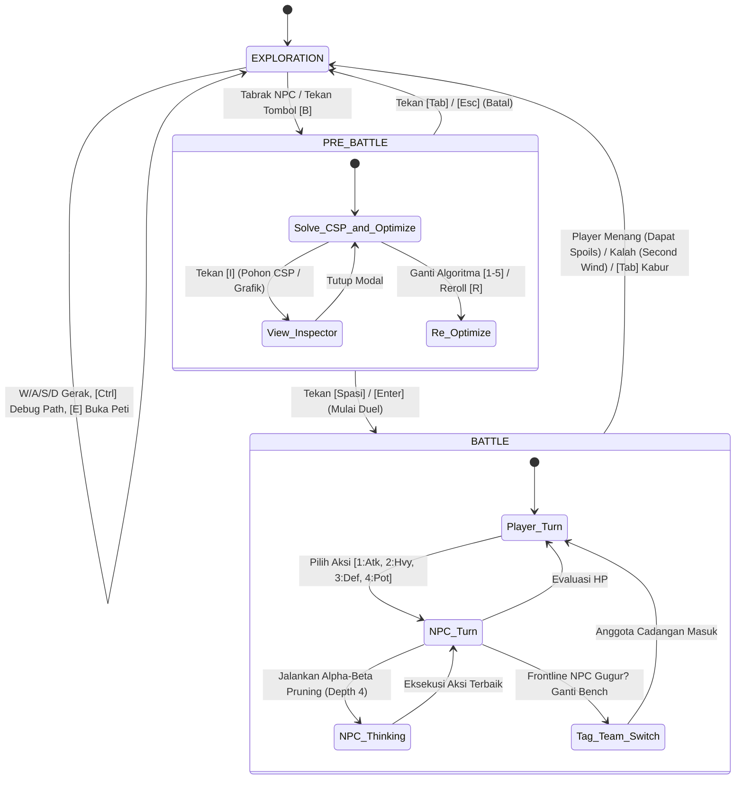

# Product Requirements Document (PRD)
## Sistem Permainan & Arsitektur AI: *Bakekok* (Bolu Kesepian)

> **Mata Kuliah**: Kecerdasan Buatan (Semester 3) — Universitas Pendidikan Indonesia  
> **Kelompok**: 7  
> **Anggota**:  
> 1. Muhammad Hanif Muyassar  
> 2. Moch Fadillah Pratama  
> 3. Muhammad Zidan Mirza Fedrieka  
> **Dokumen Versi**: 1.0 (Kondisi Eksisting: Milestone Tahap 1, 2, 3)  
> **Tanggal**: November 2026  

---

## 1. Ringkasan Eksekutif & Identitas Produk

### 1.1 Gambaran Umum Permainan
*Bakekok* (dikenal juga sebagai *Bolu Kesepian*) adalah game 2D top-down bertema petualangan taktis kucing yang dibangun menggunakan **Python 3.10+** dan framework grafis **`pygame-ce` (>= 2.5.0)**. Game ini dirancang sebagai platform terintegrasi untuk mengimplementasikan, menguji, dan memvisualisasikan pilar-pilar utama kecerdasan buatan akademis secara interaktif dan waktu nyata (*real-time*).

Pemain mengendalikan **Bolu**, seekor kucing oranye petualang yang menjelajahi labirin berubin (*tilemap*) berisi medan berbobot, peti harta gacha, dan kucing-kucing musuh (NPC Oyen, Kuro, dan Shiro). Permainan menggabungkan eksplorasi dunia bebas dengan arena duel berbasis giliran (*turn-based tactical battle*).

### 1.2 Pilar Kurikulum AI yang Telah Diimplementasikan
Sampai saat ini, sistem telah mengintegrasikan 4 modul AI fungsional:
1. **Tahap 1 — Informed Search & Grid Navigation**: Algoritma Uniform Cost Search (UCS) dan A\* Search dengan 3 fungsi heuristik (*Manhattan*, *Euclidean*, *Chebyshev*) pada grid berbobot medan (*weighted terrain*).
2. **Tahap 2 — Adversarial Search & Turn-Based Duel**: Algoritma Minimax, Alpha-Beta Pruning, dan Expectimax dengan evaluasi heuristik dinamis (*Balanced*, *Aggressive*, *Defensive*), didukung mekanisme rotasi regu musuh (*Tag-Team Battle*).
3. **Tahap 3.1 — Local Search & Dynamic Difficulty Adjustment (DDA)**: Optimasi komposisi tim musuh menggunakan 5 algoritma pencarian lokal (*Hill Climbing*, *HC with Sideways Move*, *Random Restart HC*, *Simulated Annealing*, *Genetic Algorithm*) untuk menyesuaikan tingkat kesulitan terhadap kondisi perlengkapan dan HP pemain.
4. **Tahap 3.2 — Constraint Satisfaction Problem (CSP)**: Perumusan formal pemilihan atribut skuad NPC berdasarkan 8 batasan konsistensi (C1–C8) menggunakan algoritma *Backtracking Search*, heuristik *Minimum Remaining Values* (MRV), *Least Constraining Value* (LCV), *Arc Consistency-3* (AC-3), dan *Forward Checking*.

---

## 2. Arsitektur Sistem & Struktur Direktori

Kode sumber diorganisasi secara modular berbasis *separation of concerns* pada direktori `Game-AI/`:

```
Game-AI/
├── main.py                     # Titik masuk utama aplikasi (entry point)
├── requirements.txt            # Dependensi pustaka eksternal (pygame-ce >= 2.5.0)
├── README.md                   # Panduan instalasi dan instruksi pengujian
├── prd.md                      # Dokumen PRD sistem eksisting saat ini
├── ide_tahap_4.md              # Dokumen awal ide Knowledge-Based Agent
├── ide_tahap_4_part2.md        # Ekplorasi komprehensif ide Materi 07 & 08
├── assets/                     # Spritesheet karakter, atlas tile, ikon item, potret
│   ├── bolu/                   # Sprite frame animasi Bolu (idle & 4 arah jalan)
│   ├── oyen/                   # Sprite frame animasi Oyen
│   ├── characters/             # Potret & kartu anggota regu (warrior, ranger, mage, assassin)
│   ├── icons/                  # Aset grafis perlengkapan (sword, bow, dagger, shield, potion)
│   └── tileset.png             # Atlas ubin lingkungan peta
├── data/
│   └── map_tubes.json          # Metadata peta: ubin tanah/rumput, collision, koordinat objek
├── game/                       # Paket modul inti logika permainan
│   ├── __init__.py             # Inisialisasi package game
│   ├── app.py                  # State machine game, loop utama, rendering kamera, input routing
│   ├── core/
│   │   ├── __init__.py
│   │   ├── config.py           # Konstanta global, konfigurasi warna UI, domain CSP, budget
│   │   ├── events.py           # Event dispatcher terpusat (Observer pattern)
│   │   └── animation.py        # Interpolasi animasi pergerakan grid ubin
│   ├── world/
│   │   ├── __init__.py
│   │   ├── mapdata.py          # Parser peta JSON, collision checker, kalkulator cost medan
│   │   ├── player.py           # Model pemain (Bolu): posisi grid, HP persisten, inventaris
│   │   └── npc.py              # Model NPC di peta: patroli waypoint, pengejaran A*, warna tint
│   ├── battle/
│   │   ├── __init__.py
│   │   ├── battle_system.py    # Mesin duel turn-based: kalkulasi damage, giliran, logs, rewards
│   │   ├── battle_vfx.py       # Efek visual animasi pertarungan prosedural (shake, slash, shield)
│   │   └── npc_squad.py        # Struktur data regu NPC (frontline aktif, bench cadangan)
│   ├── ai/
│   │   ├── __init__.py
│   │   ├── search.py           # Pathfinding: UCS, A*, PathNode, heuristik jarak
│   │   ├── battle_ai.py        # Adversarial search: Minimax, Alpha-Beta, Expectimax, BattleState
│   │   ├── difficulty.py       # Fungsi evaluasi tingkat kesulitan skuad dan fitness DDA
│   │   ├── npc_config_csp.py   # CSP Solver (Backtracking, MRV, LCV, AC-3, C1-C8)
│   │   └── npc_config_optimizer.py # Local search engine (HC, Sideways, Restart, SA, GA)
│   └── ui/
│       ├── __init__.py
│       ├── overlay.py          # HUD game & debug overlay pathfinding / battle stats
│       ├── pre_battle_visualizer.py # Visualizer interaktif 2D pohon CSP & grafik Local Search
│       └── tree_overlay.py     # Visualizer modal pohon keputusan Minimax / Alpha-Beta
└── scratch/                    # Skrip pengujian mandiri dan benchmark headless
    ├── run_tahap3_experiments.py  # Benchmark CSP vs 5 Local Search + DDA
    ├── benchmark_csp_mrv_lcv.py   # Benchmark pembuktian efisiensi MRV & LCV
    ├── run_experiments.py         # Benchmark Minimax vs Alpha-Beta vs Expectimax
    ├── test_app_integration.py    # Headless end-to-end integration test
    ├── test_csp.py                # Unit test kepatuhan constraint C1-C8
    └── test_optimizer.py          # Unit test konvergensi 5 algoritma Local Search
```

---

## 3. Alur Permainan & Finite State Machine (FSM)

Permainan diatur oleh mesin status tiga fase utama di dalam `game/app.py`:



### 3.1 Fase 1: Eksplorasi Peta Dunia (*Exploration Mode*)
* **Kamera & Viewport**: Resolusi 1280x800 px. Kamera dinamis mengikuti koordinat sub-pixel Bolu dengan batas viewport (*clamping*) dan zoom variabel.
* **Karakter Pemain (Bolu)**: Bergerak berbasis ubin 4 arah (`W, A, S, D` atau panah). Durasi perpindahan 0.12 detik per ubin dengan animasi siklus 4 frame.
* **NPC di Dunia**:
  1. **NPC Oyen** (Pengejar): Bergerak mengejar Bolu menggunakan A\* Search begitu tombol `[Spasi]` ditekan.
  2. **NPC Kuro** (Patroli Barat/Utara): Mengitari titik koordinat patroli `[(10, 8), (16, 8), (16, 16), (10, 16)]` secara otonom.
  3. **NPC Shiro** (Patroli Timur/Selatan): Mengitari koordinat `[(28, 14), (34, 14), (35, 24), (26, 21)]`.
* **Peti Harta Karun & Mini-Game Gacha**:
  - Lokasi peti: `(6, 20)` (Ramuan), `(22, 10)` (Pedang), `(32, 27)` (Perisai).
  - Saat pemain menekan tombol `[E]` di dekat peti, roda roulette berputar menghasilkan item acak.
  - Peningkatan status Bolu (*persistent stats*): Potion (+1 atau +2), ATK bonus (+2 s/d +6), DEF bonus (+1 s/d +4).
  - Status pemain ini disimpan secara persisten di instance `Player` dan dijadikan parameter acuan bagi sistem penyeimbang musuh (DDA).
* **Pemicu Pertarungan**: Pemain bertabrakan dengan NPC di peta atau menekan tombol pintas `[B]`.

### 3.2 Fase 2: Formasi Skuad Pre-Battle (*Pre-Battle Mode*)
Sebelum pertarungan dimulai, sistem menyiapkan susunan musuh yang seimbang secara prosedural:
1. Menghitung **Target Difficulty** berdasarkan rumus DDA dari kondisi terkini Bolu.
2. Menjalankan **CSP Solver** untuk menghasilkan basis konfigurasi yang 100% mematuhi aturan legalitas C1–C8.
3. Menjalankan **Local Search Optimizer** (default: *Hill Climbing*) untuk memodifikasi parameter skuad agar deviasi *Difficulty* terhadap *Target Difficulty* mendekati nol.
4. **Kontrol Interaktif Pre-Battle**:
   - `[1] s/d [5]`: Beralih algoritma Local Search (*Hill Climbing*, *Sideways*, *Random Restart*, *Simulated Annealing*, *Genetic Algorithm*).
   - `[R]`: Menjalankan ulang optimasi dengan seed acak baru.
   - `[I]`: Membuka modal **Visualizer Akademis AI Pre-Battle** (melihat pohon Backtracking CSP dan kurva konvergensi Local Search).
   - `[Spasi] / [Enter]`: Mengonfirmasi susunan tim dan masuk ke Arena Pertarungan.
   - `[Tab] / [Esc]`: Membatalkan persiapan dan kembali ke peta eksplorasi.

### 3.3 Fase 3: Arena Pertarungan Taktis (*Battle Arena Mode*)
Duel berlangsung turn-based antara Bolu melawan regu musuh (`NPCSquad`):
* **Pilihan Aksi Pemain**:
  - `[1 / A]` **Attack**: Serangan reguler. Menghasilkan damage dasar (18–24) + `player_atk_bonus`.
  - `[2 / S]` **Heavy Attack**: Serangan berdaya rusak tinggi (30–38) + `player_atk_bonus`. Memiliki masa jeda (*cooldown*) 3 giliran.
  - `[3 / D]` **Defend**: Memasang perisai, mengurangi damage serangan lawan yang masuk sebesar 65% pada giliran berikutnya.
  - `[4 / W]` **Potion**: Memulihkan 25 poin HP (dibatasi oleh kuota ramuan pemain).
* **Giliran AI Musuh**:
  - Agen AI menjalankan **Alpha-Beta Pruning** hingga kedalaman (*depth*) 4.
  - Evaluasi utilitas didasarkan pada profil karakter aktif:
    - `BALANCED`: Menyeimbangkan selisih HP, ketersediaan potion, dan efisiensi cooldown.
    - `AGGRESSIVE`: Memberikan penalti berat jika menahan serangan atau memilih defend; memprioritaskan pengurangan HP lawan secepat mungkin.
    - `DEFENSIVE`: Memprioritaskan pertahanan jika HP di bawah 40% dan memaksimalkan mitigasi damage.
* **Mekanisme Tag-Team Battle**:
  - Skuad musuh terdiri dari 1 hingga 3 anggota (`NPCMember`).
  - Jika anggota lini depan (*frontline*) mencapai HP 0, sistem memicu callback `on_tag_in` dengan animasi kartu memanggil anggota berikutnya dari bangku cadangan (*bench*).
  - Duel berlanjut tanpa reset status pemain hingga seluruh anggota regu musuh tumbang.
* **Kompensasi Kemenangan & Kekalahan**:
  - **Spoils of War**: Mengalahkan musuh memberikan drop item perlengkapan permanen sesuai kelas lawan (Pedang dari Warrior, Busur dari Ranger, Belati dari Assassin, Tongkat dari Mage).
  - **Second Wind Recovery**: Jika pemain kalah, HP dipulihkan ke 45 poin agar pemain dapat terus melanjutkan petualangan tanpa terputus.

---

## 4. Rincian Teknis Implementasi AI Eksisting

### 4.1 Modul Tahap 1: Informed Search & Navigasi Grid (`game/ai/search.py`)
* **Representasi Node (`PathNode`)**:
  Menyimpan koordinat `(x, y)`, biaya riil dari awal $g$, estimasi biaya ke tujuan $h$, total evaluasi $f = g + h$, dan referensi node induk (*parent*).
* **Biaya Medan (Weighted Terrain Cost)**:
  - Ubin jalan tanah / jembatan: $c = 1.0$.
  - Ubin rumput: $c = 2.0$.
  - Ubin rintangan / collision (air, pohon, dinding): $\infty$ (*impassable*).
* **Fungsi Heuristik Terverifikasi**:
  1. *Manhattan Distance* (untuk pergerakan 4-arah, terbukti *admissible* dan *consistent*):
     $$h(n) = |x_n - x_{\text{goal}}| + |y_n - y_{\text{goal}}|$$
  2. *Euclidean Distance* (garis lurus geometris, *admissible*):
     $$h(n) = \sqrt{(x_n - x_{\text{goal}})^2 + (y_n - y_{\text{goal}})^2}$$
  3. *Chebyshev Distance*:
     $$h(n) = \max(|x_n - x_{\text{goal}}|, |y_n - y_{\text{goal}}|)$$
* **Algoritma yang Didukung**:
  - **Uniform Cost Search (UCS)**: Implementasi Priority Queue dengan $h(n) = 0$.
  - **A\* Search**: Menggunakan priority queue berdasarkan nilai minimum $f(n)$.
* **Metrik Debug Overlay**: Menghitung waktu kalkulasi (ms), jumlah petak yang diekspansi (*closed set*), dan panjang lintasan yang dihasilkan.

### 4.2 Modul Tahap 2: Adversarial Search Turn-Based (`game/ai/battle_ai.py`)
* **Representasi Keadaan (`BattleState`)**:
  Struktur data *immutable* yang mencakup:
  `player_hp`, `npc_hp`, `player_potions`, `npc_potions`, `player_defending`, `npc_defending`, `player_heavy_cd`, `npc_heavy_cd`, `player_atk_bonus`, `npc_atk_bonus`, `player_def_bonus`, `npc_def_bonus`.
* **Algoritma Pertarungan**:
  1. **Minimax Murni**: Evaluasi rekursif penuh seluruh cabang aksi pemain dan musuh hingga kedalaman $d$.
  2. **Alpha-Beta Pruning**: Memangkas cabang yang tidak relevan dengan batas $\alpha$ (skor terbaik MAX) dan $\beta$ (skor terburuk MIN), mereduksi kompleksitas waktu dari $O(b^d)$ menjadi mendekati $O(b^{d/2})$.
  3. **Expectimax**: Memodelkan aksi pemain sebagai simpul probabilitas (*chance node*) dengan asumsi pemain bertindak suboptimal secara stokastik.
* **Move Ordering Heuristic**:
  Mengurutkan langkah evaluasi terlebih dahulu (serangan mematikan dan heal darurat dievaluasi pertama) untuk memaksimalkan frekuensi pemangkasan *alpha-beta cutoff*.
* **Overlay Visualisasi Pohon (`game/ui/tree_overlay.py`)**:
  Dapat dibuka dengan menekan tombol `[T]` pada giliran NPC, menampilkan seluruh diagram pohon evaluasi, nilai minimax setiap simpul, dan cabang yang dipangkas (*pruned*).

### 4.3 Modul Tahap 3.1: Local Search & DDA (`game/ai/npc_config_optimizer.py`, `difficulty.py`)
* **Rumus Evaluasi Difficulty Skuad**:
  $$\text{Difficulty}(s) = w_{\text{hp}} \cdot \bar{HP} + w_{\text{pot}} \cdot \bar{Pot} + w_{\text{atk}} \cdot \bar{Atk} + w_{\text{def}} \cdot \bar{Def} + w_{\text{count}} \cdot \bar{Count} + w_{\text{aggro}} \cdot \bar{Aggro}$$
  dengan bobot: $w_{\text{hp}}=0.25, w_{\text{pot}}=0.15, w_{\text{atk}}=0.20, w_{\text{def}}=0.10, w_{\text{count}}=0.20, w_{\text{aggro}}=0.10$.
* **Fungsi Objektif (Fitness)**:
  $$\text{Fitness}(s) = -|\text{Difficulty}(s) - \text{TargetDifficulty}|$$
* **5 Algoritma Local Search**:
  1. **Hill Climbing (Steepest-Ascent)**: Memilih tetangga dengan kenaikan fitness tertinggi dari semua kandidat mutasi yang legal.
  2. **Hill Climbing with Sideways Move**: Mengizinkan langkah datar (fitness sama) hingga maksimal 15 iterasi untuk melintasi *plateau* dan *shoulder*.
  3. **Random Restart Hill Climbing**: Melakukan pendakian berulang dari seed awal CSP acak yang berbeda untuk menghindari jebakan *local maximum*.
  4. **Simulated Annealing**: Menggunakan probabilitas penerimaan langkah buruk:
     $$P(\text{accept}) = \exp\left(\frac{\Delta E}{T}\right), \quad T_{k+1} = T_k \times 0.95$$
  5. **Genetic Algorithm**: Mengembangkan populasi 20 individu selama 30 generasi dengan seleksi turnamen, *one-point crossover*, dan mutasi acak berbasis CSP.

### 4.4 Modul Tahap 3.2: Constraint Satisfaction Problem (`game/ai/npc_config_csp.py`)
* **Variabel ($X$)**:
  Untuk $N$ anggota skuad ($N \in \{1, 2, 3\}$), terdapat $6 \times N$ variabel:
  `char_type_i`, `hp_i`, `potions_i`, `atk_bonus_i`, `def_bonus_i`, `eval_profile_i`.
* **Domain Diskret ($D$)**:
  - `char_type` $\in \{\text{"warrior"}, \text{"ranger"}, \text{"mage"}, \text{"assassin"}\}$
  - `hp` $\in \{60, 70, 80, 90, 100, 110, 120\}$
  - `potions` $\in \{0, 1, 2, 3\}$
  - `atk_bonus` $\in \{0, 5, 10, 15\}$
  - `def_bonus` $\in \{0, 2, 4, 6\}$
  - `eval_profile` $\in \{\text{"BALANCED"}, \text{"AGGRESSIVE"}, \text{"DEFENSIVE"}\}$
* **8 Batasan Konsistensi (C1–C8)**:
  - **C1 (Budget HP)**: $\sum hp_i \le 250$.
  - **C2 (Budget Potion)**: $\sum potions_i \le 5$.
  - **C3 (Syarat Tank)**: Jika `char_type = "tank"`, maka $HP \ge 90$.
  - **C4 (Syarat Ranger)**: Jika `char_type = "ranger"`, maka $atk\_bonus \ge 5$.
  - **C5 (Keunikan Role)**: Jika $N \ge 2$, setiap anggota regu harus memiliki `char_type` yang berbeda.
  - **C6 (Mage Fragile Caster)**: Jika `char_type = "mage"`, maka $HP \le 90$ dan $eval\_profile \in \{\text{"BALANCED"}, \text{"AGGRESSIVE"}\}$.
  - **C7 (Tank Sinergi)**: Jika `char_type = "tank"`, maka $eval\_profile \in \{\text{"BALANCED"}, \text{"DEFENSIVE"}\}$.
  - **C8 (Assassin Lethal Burst & Budget ATK)**: $\sum atk\_bonus_i \le 25$; jika `char_type = "assassin"`, maka $atk\_bonus \ge 10$, $HP \le 90$, dan $eval\_profile \in \{\text{"BALANCED"}, \text{"AGGRESSIVE"}\}$.
* **Strategi Heuristik CSP**:
  - **AC-3 Filtering**: Memangkas domain nilai yang secara apriori mustahil sebelum pencarian dimulai.
  - **MRV (Minimum Remaining Values)**: Memilih variabel dengan sisa domain terkecil (*fail-first*).
  - **LCV (Least Constraining Value)**: Memilih nilai yang paling sedikit menyaring sisa domain variabel tetangga (*succeed-first*).
  - **Forward Checking**: Validasi langsung pemangkasan anak simpul yang melanggar C1–C8.

---

## 5. Ringkasan Antarmuka & Kontrol (Keybindings)

| Mode | Tombol | Aksi / Fungsi |
|:---|:---|:---|
| **Eksplorasi (Peta)** | `W, A, S, D` / `Panah` | Menggerakkan karakter Bolu pada grid |
| | `E` | Membuka peti harta karun terdekat (Mini-game Gacha Item) |
| | `Spasi` | Memanggil NPC Oyen mengejar Bolu via A\* Pathfinding |
| | `Ctrl` | Membuka / menutup Debug Overlay Pathfinding |
| | `B` | Memicu transisi instan ke fase Pre-Battle |
| | `Esc` | Keluar dari aplikasi permainan |
| **Fase Pre-Battle** | `1, 2, 3, 4, 5` | Mengganti algoritma Local Search yang aktif |
| | `R` | Menjalankan ulang optimasi skuad (Re-roll seed) |
| | `I` / Klik Tombol | **Membuka Modal Visualizer Akademis AI Pre-Battle** |
| | `Spasi` / `Enter` | Mengunci skuad dan memulai duel turn-based |
| | `Tab` / `Esc` | Membatalkan duel dan kembali ke mode eksplorasi |
| **Visualizer Pre-Battle** | Klik Tab Atas | Berganti antara Tab 1 (Pohon CSP) & Tab 2 (Grafik Local Search) |
| | `[?] Aturan C1-C8` | Menampilkan dialog penjelasan 8 batasan konsistensi |
| | Drag / Tombol Zoom | Menggeser (*pan*) dan memperbesar/memperkecil kanvas pohon 2D |
| | Play / Step / Slider | Mengontrol pemutaran simulasi langkah pencarian CSP |
| | `X` / `Esc` | Menutup visualizer modal |
| **Arena Pertarungan** | `1` / `A` | Aksi: Serangan Biasa (*Attack*) |
| | `2` / `S` | Aksi: Serangan Kuat (*Heavy Attack*, jeda 3 giliran) |
| | `3` / `D` | Aksi: Bertahan (*Defend*, reduksi damage 65%) |
| | `4` / `W` | Aksi: Meminum Ramuan Pemulih (*Potion*, +25 HP) |
| | `T` | **Membuka Visualizer Pohon Keputusan Minimax / Alpha-Beta** |
| | `R` | Mereset pertarungan dari ronde awal |
| | `Tab` | Menyerah dan kembali ke peta dunia |

---

## 6. Spesifikasi Data Model & Skema Entitas

### 6.1 State Pertarungan (`BattleState`)
```python
@dataclass
class BattleState:
    player_hp: int = 100
    npc_hp: int = 100
    player_potions: int = 2
    npc_potions: int = 2
    player_defending: bool = False
    npc_defending: bool = False
    is_npc_turn: bool = False
    player_heavy_cd: int = 0
    npc_heavy_cd: int = 0
    player_atk_bonus: int = 0
    npc_atk_bonus: int = 0
    player_def_bonus: int = 0
    npc_def_bonus: int = 0
    player_max_hp: int = 100
    npc_max_hp: int = 100
```

### 6.2 Konfigurasi Anggota Regu (`NPCMember`)
```python
@dataclass
class NPCMember:
    name: str
    char_type: str        # 'warrior', 'ranger', 'mage', 'assassin'
    max_hp: int           # 60 - 120
    potions: int          # 0 - 3
    atk_bonus: int        # 0 - 15
    def_bonus: int        # 0 - 6
    eval_profile: str     # 'BALANCED', 'AGGRESSIVE', 'DEFENSIVE'
    current_hp: int = 100
    is_defeated: bool = False
```

### 6.3 Struktur Konfigurasi Regu Skuad (`NPCSquad`)
```python
class NPCSquad:
    members: List[NPCMember]
    active_index: int = 0
    # Method: get_active_member(), tag_in_next(), is_squad_defeated(), from_config(dict)
```

---

## 7. Rangkuman Kinerja & Benchmark Sistem Eksisting

Berdasarkan pengujian ekstensif yang tercatat pada skrip `scratch/`:
1. **CSP Solver (`scratch/benchmark_csp_mrv_lcv.py`)**:
   - Waktu preprocessing AC-3: **0.005 ms**.
   - Penyelesaian skuad 3 NPC: **0.299 ms** dengan tingkat kepatuhan batasan konsistensi C1–C8 sebesar **100% (0 pelanggaran)**.
   - Pemanfaatan kombinasi MRV dan LCV memangkas jumlah *backtracking* rata-rata hingga >70% dibanding pencarian tanpa heuristik.
2. **Local Search Optimizer (`scratch/run_tahap3_experiments.py`)**:
   - *Hill Climbing with Sideways Move* adalah algoritma tercepat (**2.84 ms**, rata-rata 5 iterasi) untuk mencapai konvergensi pada target difficulty 0.55.
   - *Random Restart Hill Climbing* mencapai solusi paling presisi (deviasi fitness hanya 0.0016).
   - Seluruh solusi tetangga (*neighbour states*) divalidasi oleh CSP Validator sehingga tidak ada solusi ilegal yang lolos ke arena duel.
3. **Adversarial Search (`scratch/run_experiments.py`)**:
   - Alpha-Beta Pruning memangkas lebih dari **55% simpul pohon** dibandingkan Minimax murni pada kedalaman pencarian $d = 4$ dengan output keputusan aksi yang identik.

---

## 8. Titik Masuk & Kebutuhan Pengembangan Tahap Selanjutnya

Game *Bakekok* saat ini telah memiliki fondasi dunia 2D yang stabil, sistem duel taktis yang kaya, serta mesin optimasi skuad yang kokoh. Namun, sistem saat ini masih memiliki keterbatasan konseptual:
* **NPC di Peta Belum Bernalar Bersama**: NPC bertindak secara individual (patroli waypoint statis atau mengejar pemain langsung), belum memiliki basis pengetahuan formal deklaratif (*Knowledge Base*) untuk berkomunikasi dan saling menalar tindakan rekan satu regu.
* **Tindakan Belum Direncanakan Secara Sekuensial Panjang**: NPC di peta maupun dalam pertarungan hanya mengevaluasi satu langkah instan ke depan (*reactive / depth-bounded minimax*), belum memiliki kemampuan merumuskan urutan rencana majemuk multi-tahap (*automated planning / PDDL action schemas*) untuk menyelesaikan target strategis tingkat tinggi.

Kebutuhan inilah yang akan dijawab oleh implementasi **Materi 07 (Logic & Knowledge Representation)** dan **Materi 08 (Automated Planning)** pada berkas perancangan `ide_tahap_4_part2.md`.

